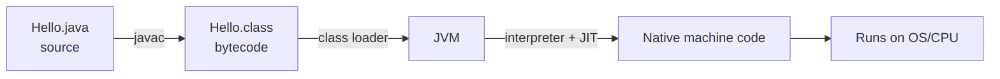

# Java Fundamentals

Everything you build on the backend — Spring Boot services, JPA entities, Kafka
consumers — is ordinary Java underneath the annotations. This section makes the
foundation solid so the "magic" later feels obvious instead of mysterious.

<ProgressTracker id="java-fundamentals-overview" />

## Table of Contents

- [What you will learn](#what-you-will-learn)
- [How Java runs](#how-java-runs)
- [The core building blocks](#the-core-building-blocks)
- [Topics in this section](#topics-in-this-section)
- [Most Asked Interview Questions](#most-asked-interview-questions)
- [Things You Should Know](#things-you-should-know)

## What you will learn

- The difference between the **JDK, JRE, and JVM**, and why "write once, run anywhere" works.
- The compilation pipeline: `.java → javac → .class (bytecode) → JVM`.
- Primitive vs reference types, type casting, and the stack/heap split.
- Operators, control flow, loops, and arrays.
- `String` immutability, the string pool, and `StringBuilder`/`StringBuffer`.
- The keywords that trip people up: `static`, `final`, `this`, `super`.
- Packages and access modifiers.

## How Java runs



Java is both **compiled and interpreted**. `javac` compiles source to
platform-independent **bytecode**. The JVM then loads that bytecode and executes
it, interpreting at first and JIT-compiling hot paths to native code for speed.
Because every OS ships its own JVM, the same `.class` file runs everywhere.

<Backend>
In production you almost never run `javac` by hand. Maven or Gradle compiles your
code, and a build produces a runnable JAR containing bytecode. Understanding this
pipeline is what lets you reason about classpath issues, version mismatches
(`UnsupportedClassVersionError`), and why a JRE alone cannot compile code.
</Backend>

## The core building blocks

| Concept | One-line mental model |
| --- | --- |
| Primitive types | Raw values stored directly (`int`, `long`, `boolean`, `double`, …). |
| Reference types | Variables holding a **pointer** to an object on the heap. |
| `String` | Immutable reference type with a shared pool. |
| `static` | Belongs to the **class**, not any instance. |
| `final` | Cannot be reassigned / overridden / extended. |
| `this` | The current object. |
| `super` | The parent class portion of the current object. |

```java
public class Demo {
    public static void main(String[] args) {
        int count = 3;                 // primitive: value lives on the stack
        String name = "backend";       // reference: variable points to heap object
        for (int i = 0; i < count; i++) {
            System.out.println(name.toUpperCase() + " " + i);
        }
    }
}
```

<Interview>
"Is Java pass-by-value or pass-by-reference?" Always **pass-by-value**. For objects,
the *value* being passed is the reference (the pointer), so you can mutate the
object but you cannot repoint the caller's variable.
</Interview>

## Topics in this section

<div className="jbm-card-grid">
  <Link className="jbm-card" to="/docs/java-fundamentals/jdk-jre-jvm">
    <div className="jbm-card__icon">⚙️</div>
    <h3>JDK, JRE & JVM</h3>
    <p>The platform, the compilation pipeline, and bytecode.</p>
  </Link>
  <Link className="jbm-card" to="/docs/java-fundamentals/types-and-variables">
    <div className="jbm-card__icon">🔢</div>
    <h3>Types & Variables</h3>
    <p>Primitives, references, casting, and the stack/heap split.</p>
  </Link>
  <Link className="jbm-card" to="/docs/java-fundamentals/operators-and-control-flow">
    <div className="jbm-card__icon">🔀</div>
    <h3>Operators & Control Flow</h3>
    <p>Operators, if/else, switch, loops, and arrays.</p>
  </Link>
  <Link className="jbm-card" to="/docs/java-fundamentals/strings">
    <div className="jbm-card__icon">🔤</div>
    <h3>Strings & the String Pool</h3>
    <p>Immutability, interning, StringBuilder vs StringBuffer.</p>
  </Link>
  <Link className="jbm-card" to="/docs/java-fundamentals/keywords">
    <div className="jbm-card__icon">🔑</div>
    <h3>static, final, this, super</h3>
    <p>The keywords interviewers love, plus packages & access.</p>
  </Link>
</div>

## Most Asked Interview Questions

### Beginner

- What is the difference between JDK, JRE, and JVM?
- Is Java compiled or interpreted?
- What are the primitive types and their default values?

### Intermediate

- What is the difference between `==` and `.equals()`?
- Why are strings immutable in Java?
- What does `static` mean and when would you use it?

### Advanced

- Walk through what happens from `javac` to native execution.
- How does autoboxing cause `NullPointerException` and performance issues?

### Coding

- Reverse a string without using `StringBuilder.reverse()`.
- Detect integer overflow when adding two `int`s.

## Things You Should Know

### 🔴 Must Know

- The JDK/JRE/JVM distinction and the compilation pipeline.
- `==` compares references (or primitive values); `.equals()` compares logical equality.
- Strings are immutable; use `StringBuilder` for concatenation in loops.

### 🟡 Good to Know

- Integer caching (`-128..127`) and why `Integer` `==` sometimes "works".
- The difference between `StringBuilder` and `StringBuffer` (thread safety).

### 🟢 Nice to Know

- How the JIT compiler decides to compile hot methods.
- The internal layout of an object header on the HotSpot JVM.
