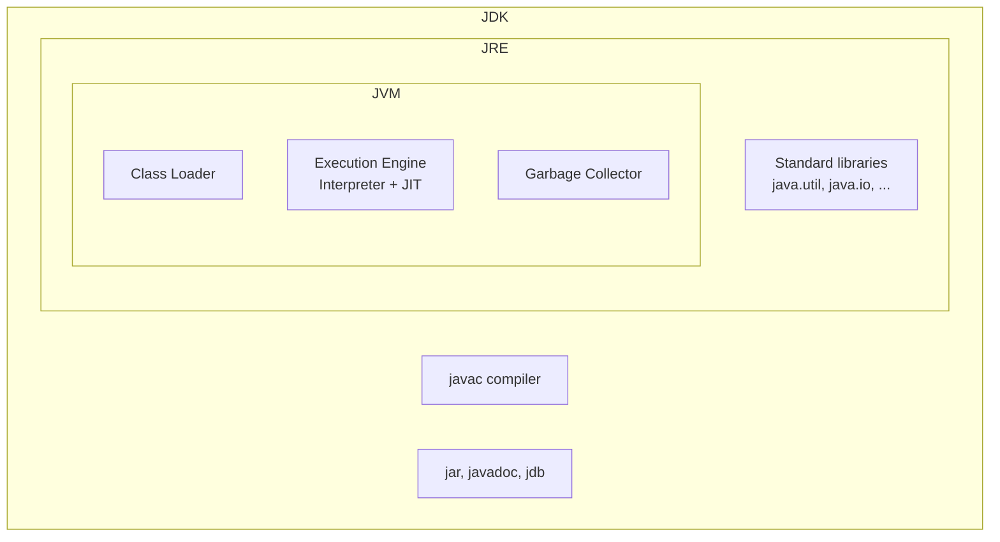
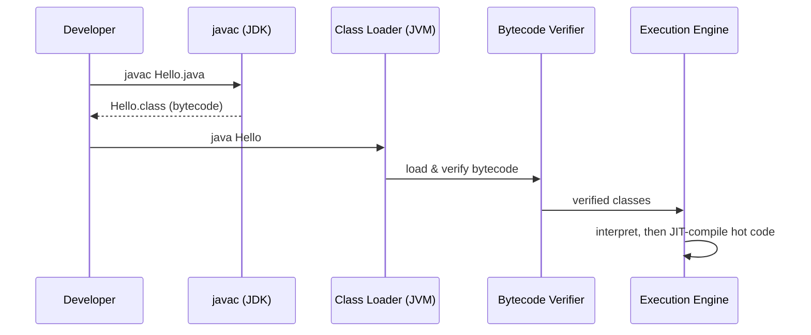

# JDK, JRE & JVM

<ProgressTracker id="jdk-jre-jvm" />

## Table of Contents

- [What is it?](#what-is-it)
- [Why does it exist?](#why-does-it-exist)
- [How it works](#how-it-works)
- [Example](#example)
- [Backend usage](#backend-usage)
- [Common mistakes](#common-mistakes)
- [Interview questions](#interview-questions)
- [Things You Should Know](#things-you-should-know)

## What is it?

Three nested things, from largest to smallest:

- **JDK (Java Development Kit)** — everything you need to *develop*: the compiler
  (`javac`), packaging tools (`jar`), the debugger, plus the JRE.
- **JRE (Java Runtime Environment)** — everything you need to *run* a compiled
  program: the JVM plus the standard class libraries. It cannot compile code.
- **JVM (Java Virtual Machine)** — the abstract machine that actually loads,
  verifies, and executes bytecode.



## Why does it exist?

Before Java, a C program compiled to machine code for one CPU/OS. Java introduced a
**virtual machine** as an intermediate target. `javac` compiles to bytecode — an
instruction set for the JVM, not for any real CPU. Each platform ships a JVM that
translates bytecode to its own native instructions. That indirection is what
delivers **"write once, run anywhere."**

## How it works

The full pipeline for `Hello.java`:



1. **Compile:** `javac Hello.java` produces `Hello.class` containing bytecode.
2. **Class loading:** the JVM's class loaders (Bootstrap → Platform → Application)
   load classes lazily, on first use.
3. **Verification:** the bytecode verifier rejects malformed or unsafe bytecode.
4. **Execution:** the interpreter runs bytecode; the **JIT** compiler promotes
   frequently executed ("hot") methods to native code for speed.

## Example

```java title="Hello.java"
public class Hello {
    public static void main(String[] args) {
        System.out.println("Hello, backend engineer");
    }
}
```

```bash
# Compile with the JDK
javac Hello.java        # -> produces Hello.class

# Inspect the bytecode (great interview party trick)
javap -c Hello

# Run on the JVM
java Hello              # -> Hello, backend engineer
```

<Tip>
Since Java 11 you can run a single source file without compiling first:
`java Hello.java`. The JVM compiles in memory. Handy for quick experiments,
not for real builds.
</Tip>

## Backend usage

- **Docker images:** a common mistake is basing a runtime image on a full JDK.
  Use a **JRE-only** (or `jlink`-trimmed) base image to shrink image size and
  attack surface. You only need the JDK at build time.
- **Version errors:** `UnsupportedClassVersionError` means code compiled with a
  newer JDK is running on an older JVM. Match your build and runtime Java versions.
- **Multi-stage Docker builds** compile with a JDK stage and run on a slim JRE stage.

<Backend>
```dockerfile
# Build stage: needs the full JDK
FROM eclipse-temurin:21-jdk AS build
WORKDIR /app
COPY . .
RUN ./mvnw -q clean package -DskipTests

# Runtime stage: only needs a JRE
FROM eclipse-temurin:21-jre
COPY --from=build /app/target/app.jar /app.jar
ENTRYPOINT ["java", "-jar", "/app.jar"]
```
</Backend>

## Common mistakes

<Warning>
- Shipping a JDK in your production container when a JRE is enough.
- Assuming the JVM is single-threaded — it runs GC and JIT on background threads.
- Confusing "bytecode" with "machine code". Bytecode is portable; machine code is not.
</Warning>

## Interview questions

**Q: Difference between JDK, JRE, and JVM?**
JVM executes bytecode. JRE = JVM + standard libraries (run only). JDK = JRE +
development tools like `javac` (develop and run).

**Q: Is Java compiled or interpreted?**
Both. `javac` compiles to bytecode; the JVM interprets it and JIT-compiles hot
paths to native code.

**Q: What is bytecode?**
A portable, verified instruction set for the JVM, stored in `.class` files.

## Things You Should Know

### 🔴 Must Know
- JDK ⊃ JRE ⊃ JVM, and which one compiles vs runs.
- The `.java → .class → JVM → native` pipeline.

### 🟡 Good to Know
- Class loader hierarchy (Bootstrap, Platform, Application).
- Why the bytecode verifier exists (security/stability).

### 🟢 Nice to Know
- `jlink` for building custom minimal runtimes.
- Tiered compilation (C1/C2) in HotSpot.
