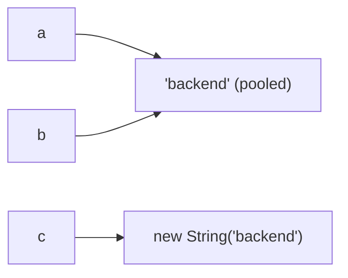

# Strings & the String Pool

<ProgressTracker id="strings" />

## Table of Contents

- [What is it?](#what-is-it)
- [Why immutability?](#why-immutability)
- [The string pool](#the-string-pool)
- [StringBuilder vs StringBuffer](#stringbuilder-vs-stringbuffer)
- [Backend usage](#backend-usage)
- [Common mistakes](#common-mistakes)
- [Interview questions](#interview-questions)
- [Things You Should Know](#things-you-should-know)

## What is it?

`String` is an **immutable** reference type. Once created, its characters never
change. Every "modification" returns a new `String`.

```java
String s = "hello";
s.toUpperCase();          // returns "HELLO" but does NOT change s
System.out.println(s);    // still "hello"
s = s.toUpperCase();      // reassigns s to the new object
```

## Why immutability?

- **Thread safety:** immutable objects are safe to share across threads without locks.
- **Caching & pooling:** identical literals can be shared safely.
- **Safe as map keys:** a key's `hashCode` never changes, so it stays findable.
- **Security:** a file path or connection string can't be altered after a check.

<Important>
Immutability is exactly why `String` is the ideal `HashMap` key. If keys could
mutate, their `hashCode` would change and you would never find them again.
</Important>

## The string pool

String literals are interned in a special heap region called the **string pool**.
Identical literals reference the same object; `new String(...)` forces a distinct
object.

```java
String a = "backend";
String b = "backend";
String c = new String("backend");

System.out.println(a == b);        // true  — same pooled object
System.out.println(a == c);        // false — c is a new heap object
System.out.println(a == c.intern()); // true — intern() returns the pooled one
System.out.println(a.equals(c));   // true  — always compare content with equals
```



## StringBuilder vs StringBuffer

Because `String` is immutable, concatenating in a loop creates a new object every
iteration — `O(n²)` copying. Use a builder instead.

```java
// BAD: creates a new String each iteration
String out = "";
for (String part : parts) {
    out += part;            // quadratic behaviour
}

// GOOD: one mutable buffer
StringBuilder sb = new StringBuilder();
for (String part : parts) {
    sb.append(part);
}
String out2 = sb.toString();
```

| | `StringBuilder` | `StringBuffer` |
| --- | --- | --- |
| Thread-safe | No | Yes (synchronized) |
| Speed | Faster | Slower (locking overhead) |
| Use when | Single thread (the norm) | Shared across threads (rare) |

<Tip>
Default to `StringBuilder`. You almost never need `StringBuffer` — if multiple
threads build one string, you usually have a design problem.
</Tip>

## Backend usage

<Backend>
- Building SQL by string concatenation invites SQL injection. Use
  `PreparedStatement` parameters, never `"... WHERE id = " + userInput`.
- Log message construction in hot paths should avoid eager concatenation; SLF4J's
  `log.debug("user {} did {}", id, action)` defers formatting until needed.
- Large text assembly (CSV/report export) should use `StringBuilder` or stream to
  the response to avoid holding megabytes in memory.
</Backend>

## Common mistakes

<Warning>
- Comparing strings with `==` instead of `.equals()`.
- Concatenating in loops with `+` instead of `StringBuilder`.
- Building SQL with string concatenation (injection risk).
- Calling `.intern()` on huge volumes of dynamic strings, bloating the pool.
</Warning>

## Interview questions

**Q: Why is String immutable?**
Thread safety, safe pooling/caching, safe hash-map keys, and security. Immutability
lets the JVM share literals freely.

**Q: `String s = new String("x")` — how many objects?**
Up to two: the pooled literal `"x"` and the new heap object created by `new`.

**Q: `StringBuilder` vs `StringBuffer`?**
Both are mutable char buffers; `StringBuffer` is synchronized (thread-safe, slower),
`StringBuilder` is not (faster, single-thread default).

## Things You Should Know

### 🔴 Must Know
- Strings are immutable; compare with `.equals()`.
- Use `StringBuilder` for loop concatenation.
- Never build SQL by concatenating user input.

### 🟡 Good to Know
- The string pool and `intern()`.
- Text blocks (`"""..."""`) for multi-line strings (Java 15+).

### 🟢 Nice to Know
- Compact strings (Latin-1 vs UTF-16 internal storage since Java 9).
