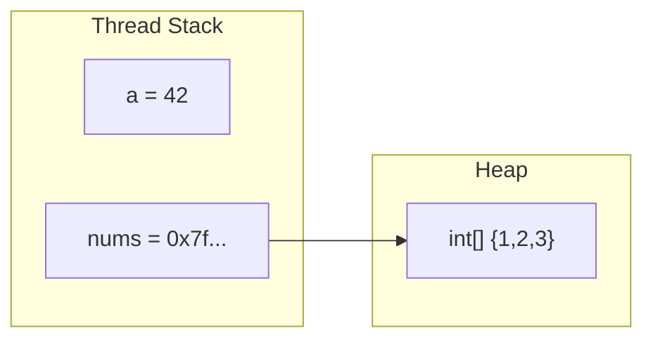

# Types & Variables

<ProgressTracker id="types-and-variables" />

## Table of Contents

- [Primitive types](#primitive-types)
- [Reference types](#reference-types)
- [Stack vs heap](#stack-vs-heap)
- [Type casting](#type-casting)
- [Autoboxing and its traps](#autoboxing-and-its-traps)
- [Backend usage](#backend-usage)
- [Common mistakes](#common-mistakes)
- [Interview questions](#interview-questions)
- [Things You Should Know](#things-you-should-know)

## Primitive types

Java has eight primitives. They store values directly, have fixed sizes, and are
never `null`.

| Type | Size | Range / notes | Default |
| --- | --- | --- | --- |
| `byte` | 8-bit | -128 to 127 | `0` |
| `short` | 16-bit | -32,768 to 32,767 | `0` |
| `int` | 32-bit | ~±2.1 billion | `0` |
| `long` | 64-bit | ~±9.2 quintillion | `0L` |
| `float` | 32-bit | approximate decimals | `0.0f` |
| `double` | 64-bit | approximate decimals | `0.0d` |
| `char` | 16-bit | a single UTF-16 unit | `'\u0000'` |
| `boolean` | JVM-dependent | `true`/`false` | `false` |

<Warning>
Default values apply only to **fields**, not local variables. A local variable
must be assigned before use or the compiler rejects it.
</Warning>

## Reference types

Everything else — classes, interfaces, arrays, enums, `String` — is a reference
type. A reference variable holds a pointer to an object on the heap, or `null`.

```java
int a = 42;                 // 'a' holds the value 42
int[] nums = {1, 2, 3};     // 'nums' holds a reference to an array object
String s = null;            // valid: a reference pointing to nothing
```

## Stack vs heap



- **Stack:** per-thread, stores primitives and references (the pointers). Fast,
  automatically reclaimed when a method returns.
- **Heap:** shared across threads, stores all objects. Managed by the garbage
  collector.

<Interview>
"Where does a local `int` live vs a local `String`?" The `int` value lives on the
stack. For the `String`, the **reference** lives on the stack and the **object**
lives on the heap.
</Interview>

## Type casting

**Widening** (smaller → larger) is implicit and safe. **Narrowing** (larger →
smaller) requires an explicit cast and can lose data.

```java
int i = 100;
long l = i;          // widening: implicit
double d = l;        // widening: implicit

double pi = 3.99;
int truncated = (int) pi;   // narrowing: explicit -> 3 (fraction dropped, not rounded)

long big = 300;
byte b = (byte) big;        // overflow -> 44 (wraps around)
```

Reference casting uses `instanceof` to stay safe (Java 16+ pattern form shown):

```java
Object o = "hello";
if (o instanceof String str) {   // pattern matching for instanceof
    System.out.println(str.length());
}
```

## Autoboxing and its traps

Autoboxing converts between primitives and their wrapper objects (`int` ↔
`Integer`). Convenient, but it hides two real bugs.

```java
Map<String, Integer> counts = new HashMap<>();
Integer c = counts.get("missing");   // returns null
int x = c;                           // NullPointerException on unboxing!
```

```java
Integer a = 127, b = 127;
System.out.println(a == b);   // true  -> cached (-128..127)
Integer x = 1000, y = 1000;
System.out.println(x == y);   // false -> different objects
System.out.println(x.equals(y)); // true -> always compare wrappers with equals
```

## Backend usage

<Backend>
Entity IDs are usually `Long` (wrapper), not `long`, so a not-yet-persisted entity
can have a `null` id. Money should never be `double` — use `BigDecimal` to avoid
floating-point rounding errors in payments and invoices.
</Backend>

```java
// Wrong: floating point money
double price = 0.1 + 0.2;          // 0.30000000000000004

// Right: exact decimal money
BigDecimal total = new BigDecimal("0.1").add(new BigDecimal("0.2")); // 0.3
```

## Common mistakes

<Warning>
- Using `double`/`float` for currency. Use `BigDecimal`.
- Comparing wrapper objects with `==` instead of `.equals()`.
- Unboxing a `null` wrapper → `NullPointerException`.
- Assuming `(int) 3.99` rounds — it truncates to `3`.
</Warning>

## Interview questions

**Q: Difference between `int` and `Integer`?**
`int` is a primitive (value, never null, on stack). `Integer` is an object wrapper
(nullable, on heap, cached for -128..127).

**Q: Why is `BigDecimal` preferred for money?**
Binary floating point cannot represent many decimal fractions exactly, causing
rounding errors that are unacceptable for financial calculations.

**Q: What happens when you narrow a `long` to a `byte` that overflows?**
The value wraps around modulo the target range; no exception is thrown.

## Things You Should Know

### 🔴 Must Know
- The 8 primitives, their defaults, and primitive vs reference semantics.
- `BigDecimal` for money; never `double`.
- Compare wrappers with `.equals()`.

### 🟡 Good to Know
- Integer caching range and its effect on `==`.
- Widening vs narrowing conversion rules.

### 🟢 Nice to Know
- `char` is UTF-16; supplementary characters need two `char`s (surrogate pairs).
