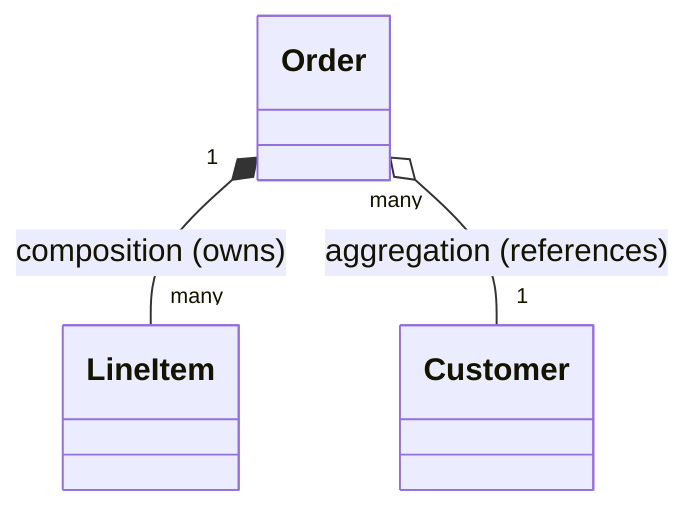

# Composition over Inheritance

<ProgressTracker id="composition-over-inheritance" />

## Table of Contents

- [IS-A vs HAS-A](#is-a-vs-has-a)
- [Association, aggregation, composition](#association-aggregation-composition)
- [Why composition wins](#why-composition-wins)
- [Backend example](#backend-example)
- [Interview questions](#interview-questions)
- [Things You Should Know](#things-you-should-know)

## IS-A vs HAS-A

- **IS-A** → inheritance. `SavingsAccount` IS-A `Account`.
- **HAS-A** → composition. An `OrderService` HAS-A `PaymentGateway`.

If you cannot honestly say "X is a Y and can be used everywhere a Y is expected"
(Liskov Substitution), do not use inheritance.

## Association, aggregation, composition



- **Association** — a general "uses/knows" relationship.
- **Aggregation** — a whole references parts that can live independently
  (an `Order` references a `Customer`; the customer outlives the order).
- **Composition** — a whole owns parts whose lifecycle it controls
  (an `Order` owns its `LineItem`s; delete the order, delete the items).

## Why composition wins

<Interview>
Inheritance couples a subclass to a parent's implementation. Change the parent and
subclasses can break (the "fragile base class" problem). Composition delegates to
collaborators behind interfaces, so you can swap behavior, test in isolation, and
avoid deep hierarchies. Effective Java's advice: **favor composition over inheritance.**
</Interview>

```java
// Inheritance abused: a Stack "is" a Vector? Not really.
class Stack<E> extends Vector<E> { }   // leaks Vector's insert/remove-anywhere API

// Composition: expose only what a stack should do
class Stack<E> {
    private final List<E> items = new ArrayList<>();   // HAS-A list
    public void push(E e) { items.add(e); }
    public E pop() { return items.remove(items.size() - 1); }
}
```

## Backend example

```java
@Service
public class CheckoutService {
    private final PaymentGateway payment;     // HAS-A
    private final InventoryService inventory; // HAS-A
    private final NotificationService notifier;

    public CheckoutService(PaymentGateway payment,
                           InventoryService inventory,
                           NotificationService notifier) {
        this.payment = payment;
        this.inventory = inventory;
        this.notifier = notifier;
    }

    public void checkout(Order order) {
        inventory.reserve(order);
        payment.charge(order);
        notifier.orderConfirmed(order);
    }
}
```

<Backend>
Spring's dependency injection *is* composition at scale. Services are composed from
injected collaborators (repositories, gateways, other services) rather than
inheriting behavior. This is why Spring code is so testable — swap any collaborator
with a mock.
</Backend>

## Interview questions

**Q: When would you still use inheritance?**
For a genuine, stable IS-A with shared state and the Liskov property — e.g. an
abstract `PaymentProcessor` template with concrete card/UPI subclasses.

**Q: Composition vs aggregation?**
Composition implies ownership and shared lifecycle (parts die with the whole);
aggregation is a looser reference where parts live independently.

## Things You Should Know

### 🔴 Must Know
- IS-A → inheritance, HAS-A → composition.
- Favor composition; it's more flexible and testable.
- Spring DI is composition in practice.

### 🟡 Good to Know
- The fragile base class problem.
- Aggregation vs composition lifecycle semantics.

### 🟢 Nice to Know
- Delegation patterns and mixins via interfaces + default methods.
