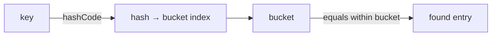

# equals, hashCode & toString

<ProgressTracker id="equals-hashcode" />

## Table of Contents

- [The problem](#the-problem)
- [The contract](#the-contract)
- [Implementing them correctly](#implementing-them-correctly)
- [Records do this for you](#records-do-this-for-you)
- [Backend usage](#backend-usage)
- [Common mistakes](#common-mistakes)
- [Interview questions](#interview-questions)
- [Things You Should Know](#things-you-should-know)

## The problem

By default `equals` compares object identity (`==`) and `hashCode` returns an
identity-based number. That means two logically-equal objects are treated as
different — which breaks `HashMap`, `HashSet`, and de-duplication.

```java
var a = new Point(1, 2);
var b = new Point(1, 2);
a.equals(b);              // false by default — different objects!
Set.of(a, b).size();      // 2, even though they represent the same point
```

## The contract

<Important>
If two objects are `equals`, they **must** have the same `hashCode`. Override one
and you must override the other. Breaking this makes objects "vanish" from hash
collections.
</Important>

`equals` must be:
- **Reflexive:** `x.equals(x)` is true.
- **Symmetric:** `x.equals(y) == y.equals(x)`.
- **Transitive:** if `x=y` and `y=z` then `x=z`.
- **Consistent:** repeated calls return the same result.
- `x.equals(null)` is false.

## Implementing them correctly

```java
public final class Money {
    private final long amountMinor;   // cents
    private final String currency;

    public Money(long amountMinor, String currency) {
        this.amountMinor = amountMinor;
        this.currency = currency;
    }

    @Override
    public boolean equals(Object o) {
        if (this == o) return true;
        if (!(o instanceof Money money)) return false;
        return amountMinor == money.amountMinor
            && currency.equals(money.currency);
    }

    @Override
    public int hashCode() {
        return Objects.hash(amountMinor, currency);
    }

    @Override
    public String toString() {
        return amountMinor + " " + currency;
    }
}
```

### How HashMap uses them



`hashCode` picks the bucket; `equals` distinguishes keys within that bucket. A bad
`hashCode` (e.g. always returning `1`) turns a `HashMap` into a linked list — `O(n)`.

## Records do this for you

For immutable data carriers, a `record` generates `equals`, `hashCode`, and
`toString` from its components automatically.

```java
public record Money(long amountMinor, String currency) { }
// equals, hashCode, toString, accessors — all generated
```

## Backend usage

<Backend>
**JPA entities need special care.** Do not use a database-generated `id` in
`equals`/`hashCode`, because the id is null before persistence and the object's
hash would change after saving — corrupting any `HashSet` it lives in. Prefer a
business key, or a stable UUID assigned in the constructor.
</Backend>

## Common mistakes

<Warning>
- Overriding `equals` but not `hashCode` (or vice versa).
- Using mutable fields in `hashCode`, then mutating them while the object is a map key.
- Using an auto-generated JPA id in `equals`/`hashCode`.
- Comparing with `getClass()` vs `instanceof` inconsistently, breaking symmetry with subclasses.
</Warning>

## Interview questions

**Q: Why override `equals` and `hashCode` together?**
`HashMap`/`HashSet` first use `hashCode` to find the bucket, then `equals` to match.
If equal objects have different hash codes, they land in different buckets and are
never found.

**Q: What happens if `hashCode` always returns a constant?**
The map still works but all entries collide into one bucket, degrading operations
from O(1) to O(n) (O(log n) after treeification).

**Q: Are `record` equals/hashCode value-based?**
Yes — generated from all components.

## Things You Should Know

### 🔴 Must Know
- The equals/hashCode contract and why both must change together.
- How HashMap uses hashCode then equals.
- Records generate value-based equality.

### 🟡 Good to Know
- Don't use JPA generated ids in equals/hashCode.
- `Objects.hash` and `Objects.equals` helpers.

### 🟢 Nice to Know
- Treeification of buckets in Java 8+ HashMap.
