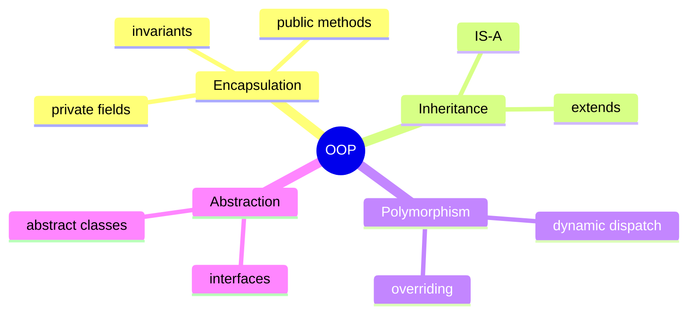

# Object-Oriented Programming

OOP is how you model a backend domain. `User`, `Order`, `Payment`, and `Product`
are classes; a running system is objects collaborating. This section is the
vocabulary every Java interview assumes you already have.

<ProgressTracker id="oop-overview" />

## Table of Contents

- [Classes and objects](#classes-and-objects)
- [The four pillars](#the-four-pillars)
- [Constructors](#constructors)
- [Topics in this section](#topics-in-this-section)
- [Most Asked Interview Questions](#most-asked-interview-questions)
- [Things You Should Know](#things-you-should-know)

## Classes and objects

A **class** is a blueprint; an **object** is an instance of it with its own state.

```java
public class Product {
    private final Long id;
    private final String name;
    private BigDecimal price;

    public Product(Long id, String name, BigDecimal price) {
        this.id = id;
        this.name = name;
        this.price = price;
    }

    public void applyDiscount(BigDecimal percent) {
        this.price = price.multiply(BigDecimal.ONE.subtract(percent));
    }

    public BigDecimal getPrice() { return price; }
}
```

## The four pillars



- **Encapsulation** — hide internal state behind methods; protect invariants.
- **Inheritance** — model an **IS-A** relationship (`SavingsAccount` IS-A `Account`).
- **Polymorphism** — one reference type, many runtime behaviors (method overriding).
- **Abstraction** — program to interfaces, hide implementation details.

```java
// Polymorphism: the same call, different behavior at runtime
PaymentProcessor processor = switch (method) {
    case CARD -> new CardProcessor();
    case UPI  -> new UpiProcessor();
};
processor.charge(order);   // resolves to the concrete type at runtime
```

<Interview>
**IS-A vs HAS-A:** inheritance models IS-A; composition models HAS-A. A `Car`
HAS-A `Engine` (composition). A `SportsCar` IS-A `Car` (inheritance). Prefer
composition unless there is a genuine, stable IS-A relationship.
</Interview>

## Constructors

A constructor initializes a new object. If you declare none, Java supplies a
no-arg default. Declaring any constructor removes that default.

```java
public class Order {
    private final Long id;
    private final List<LineItem> items;

    public Order(Long id, List<LineItem> items) {
        if (items == null || items.isEmpty()) {
            throw new IllegalArgumentException("Order needs items");
        }
        this.id = id;
        this.items = List.copyOf(items);   // defensive copy -> immutability
    }
}
```

<Tip>
Validate invariants in the constructor and take defensive copies of mutable inputs.
An object should never exist in an invalid state.
</Tip>

## Topics in this section

<div className="jbm-card-grid">
  <Link className="jbm-card" to="/docs/oop/inheritance-and-polymorphism">
    <div className="jbm-card__icon">🧬</div>
    <h3>Inheritance & Polymorphism</h3>
    <p>Overloading vs overriding, dynamic dispatch, and abstract classes.</p>
  </Link>
  <Link className="jbm-card" to="/docs/oop/interfaces-and-abstraction">
    <div className="jbm-card__icon">🎭</div>
    <h3>Interfaces & Abstraction</h3>
    <p>Interfaces vs abstract classes, default methods, and when to use each.</p>
  </Link>
  <Link className="jbm-card" to="/docs/oop/equals-hashcode">
    <div className="jbm-card__icon">⚖️</div>
    <h3>equals, hashCode & toString</h3>
    <p>The contract that makes HashMap, HashSet, and caching work.</p>
  </Link>
  <Link className="jbm-card" to="/docs/oop/composition-over-inheritance">
    <div className="jbm-card__icon">🧩</div>
    <h3>Composition over Inheritance</h3>
    <p>Association, aggregation, composition, and why to favor HAS-A.</p>
  </Link>
</div>

## Most Asked Interview Questions

### Beginner
- What are the four pillars of OOP?
- Difference between a class and an object?
- What is a constructor and can it be overloaded?

### Intermediate
- Method overloading vs overriding?
- Interface vs abstract class — when do you pick which?
- Why favor composition over inheritance?

### Advanced
- How does dynamic dispatch work under the hood (vtables)?
- How do `equals` and `hashCode` interact with `HashMap` resizing?

### Coding
- Implement an immutable `Money` value object with `equals`/`hashCode`.
- Model a payment system using an interface and multiple implementations.

## Things You Should Know

### 🔴 Must Know
- The four pillars and a backend example of each.
- Overloading (compile-time) vs overriding (runtime).
- `equals`/`hashCode` contract.
- IS-A vs HAS-A; prefer composition.

### 🟡 Good to Know
- Default and `static` methods on interfaces.
- Immutability and defensive copying.

### 🟢 Nice to Know
- How the JVM implements virtual dispatch.
- The Liskov Substitution Principle in depth.
