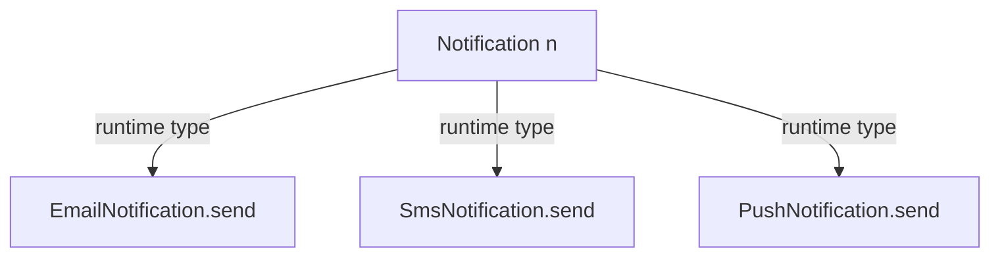

# Inheritance & Polymorphism

<ProgressTracker id="inheritance-and-polymorphism" />

## Table of Contents

- [Inheritance](#inheritance)
- [Method overriding](#method-overriding)
- [Method overloading](#method-overloading)
- [Polymorphism & dynamic dispatch](#polymorphism--dynamic-dispatch)
- [Abstract classes](#abstract-classes)
- [Common mistakes](#common-mistakes)
- [Interview questions](#interview-questions)
- [Things You Should Know](#things-you-should-know)

## Inheritance

Inheritance lets a subclass reuse and extend a parent's state and behavior. It
models an **IS-A** relationship.

```java
public class Account {
    protected BigDecimal balance = BigDecimal.ZERO;
    public void deposit(BigDecimal amount) { balance = balance.add(amount); }
    public BigDecimal getBalance() { return balance; }
}

public class SavingsAccount extends Account {   // SavingsAccount IS-A Account
    private final BigDecimal rate;
    public SavingsAccount(BigDecimal rate) { this.rate = rate; }
    public void addInterest() { deposit(balance.multiply(rate)); }
}
```

## Method overriding

A subclass provides a new implementation of a parent method with the **same
signature**. Resolved at **runtime** based on the actual object type.

```java
class Notification {
    void send(String msg) { System.out.println("generic: " + msg); }
}
class EmailNotification extends Notification {
    @Override
    void send(String msg) { System.out.println("email: " + msg); }
}
```

<Important>
Always use `@Override`. It makes the compiler verify you actually override a method
— catching typos like `toString2()` or a wrong parameter type at compile time.
</Important>

## Method overloading

Same method name, **different parameter lists**, in the same class. Resolved at
**compile time** by the argument types.

```java
class Report {
    void export(String path) { ... }
    void export(String path, boolean compress) { ... }   // overload
    void export(OutputStream out) { ... }                // overload
}
```

| | Overloading | Overriding |
| --- | --- | --- |
| Signature | Different params | Same signature |
| Where | Same class | Subclass |
| Resolved | Compile time (static) | Runtime (dynamic) |
| Return type | Can differ | Same or covariant |

## Polymorphism & dynamic dispatch

Polymorphism means a single reference type can point to many concrete types, and
the correct overridden method is chosen at runtime.

```java
List<Notification> channels = List.of(
    new EmailNotification(), new SmsNotification(), new PushNotification());

for (Notification n : channels) {
    n.send("Order shipped");   // each runs its own overridden send()
}
```



The JVM implements this with a **virtual method table (vtable)** per class: the
call jumps through a pointer to the actual type's method.

## Abstract classes

An `abstract` class cannot be instantiated and can mix concrete and abstract
methods. Use it to share state and partial behavior across related subclasses.

```java
public abstract class PaymentProcessor {
    // shared template
    public final PaymentResult process(Order order) {
        validate(order);
        return charge(order);      // subclass fills this in
    }
    protected void validate(Order order) { /* shared */ }
    protected abstract PaymentResult charge(Order order);  // must implement
}
```

## Common mistakes

<Warning>
- Overriding without `@Override`, silently creating an overload instead.
- Deep inheritance hierarchies that are hard to change (favor composition).
- Calling overridable methods from a constructor (subclass state not yet initialized).
- Violating LSP: a subclass that throws on a method the parent supports.
</Warning>

## Interview questions

**Q: Overloading vs overriding?**
Overloading = same name, different params, resolved at compile time. Overriding =
same signature in a subclass, resolved at runtime via dynamic dispatch.

**Q: Can you override a static or private method?**
No. Static methods are hidden (resolved by reference type); private methods aren't
visible to subclasses.

**Q: Abstract class vs interface?**
Abstract classes can hold state and constructors and model a strong IS-A; interfaces
define a contract and support multiple inheritance of type. See the next page.

## Things You Should Know

### 🔴 Must Know
- Overloading (compile time) vs overriding (runtime).
- Always annotate overrides with `@Override`.
- Polymorphism enables open/closed design.

### 🟡 Good to Know
- Covariant return types.
- Template Method pattern via abstract classes.

### 🟢 Nice to Know
- vtable-based dynamic dispatch.
- Why calling overridable methods in constructors is dangerous.
