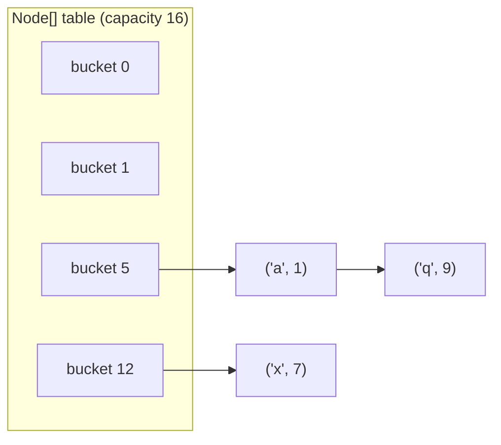
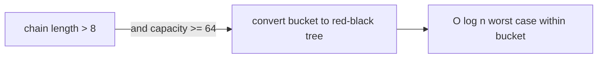

# HashMap Internals

<ProgressTracker id="hashmap-internals" />

## Table of Contents

- [The data structure](#the-data-structure)
- [put and get](#put-and-get)
- [Collisions](#collisions)
- [Load factor & resizing](#load-factor--resizing)
- [Treeification](#treeification)
- [ConcurrentHashMap](#concurrenthashmap)
- [Common mistakes](#common-mistakes)
- [Interview questions](#interview-questions)
- [Things You Should Know](#things-you-should-know)

## The data structure

A `HashMap` is an array of **buckets**. Each bucket holds a chain of entries
(key, value, hash, next). The default capacity is 16.



## put and get

```java
map.put("user:42", user);
User u = map.get("user:42");
```

For `put(key, value)`:
1. Compute `hash(key)` — the key's `hashCode()`, then spread the high bits.
2. Index = `hash & (capacity - 1)` (fast modulo because capacity is a power of two).
3. If the bucket is empty, insert. Otherwise walk the chain: if a node's key
   `equals` the given key, **replace** the value; else append a new node.

For `get(key)`: compute the same index, walk the bucket, return the value whose
key `equals` the search key.

<Important>
This is why a correct `hashCode`/`equals` pair is mandatory. `hashCode` selects the
bucket; `equals` finds the entry inside it. Break either and lookups fail.
</Important>

## Collisions

Two different keys can hash to the same bucket — a **collision**. Java handles this
with **separate chaining**: entries in the same bucket form a linked list (then a
tree, see below). A poor `hashCode` causes many collisions and degrades performance.

## Load factor & resizing

- **Load factor** (default `0.75`) is the fullness threshold.
- When `size > capacity * loadFactor`, the map **resizes**: capacity doubles and
  every entry is **rehashed** into the new, larger table.

```text
capacity 16, loadFactor 0.75 -> resize when size > 12
after resize: capacity 32 -> resize when size > 24
```

<Tip>
If you know the expected size, pre-size the map: `new HashMap<>(expected / 0.75 + 1)`.
This avoids repeated costly resizes when loading large datasets.
</Tip>

## Treeification

Since Java 8, when a single bucket's chain grows beyond **8** entries **and** the
table capacity is at least 64, that bucket converts from a linked list to a
**red-black tree**, improving worst-case lookup from O(n) to O(log n). It reverts to
a list if the bucket shrinks below 6.



## ConcurrentHashMap

`HashMap` is **not** thread-safe — concurrent `put`s during resize historically
caused infinite loops (pre-Java 8) and still cause lost updates. `ConcurrentHashMap`
allows concurrent reads and locks only the individual bucket being written (CAS +
fine-grained synchronization), so it scales far better than a fully synchronized map.

| | HashMap | Hashtable | ConcurrentHashMap |
| --- | --- | --- | --- |
| Thread-safe | No | Yes (whole-map lock) | Yes (bucket-level) |
| Null key/value | 1 null key, null values | None | None |
| Performance | Fastest single-thread | Slow | Fast under concurrency |

## Common mistakes

<Warning>
- Sharing a plain `HashMap` across request threads. Use `ConcurrentHashMap`.
- Mutating a key's fields after insertion so its `hashCode` changes — the entry
  becomes unreachable.
- Assuming iteration order is stable. `HashMap` order is unspecified; use
  `LinkedHashMap` for insertion order.
</Warning>

## Interview questions

**Q: How does `HashMap` work internally?**
Array of buckets; key's `hashCode` (bit-spread) picks the bucket via `hash &
(n-1)`; collisions chain in a list that treeifies past 8 entries; resizes at 0.75
load factor by doubling and rehashing.

**Q: Why must capacity be a power of two?**
So `hash & (capacity - 1)` computes the bucket index efficiently and distributes
bits well.

**Q: `HashMap` vs `ConcurrentHashMap`?**
`ConcurrentHashMap` is thread-safe with bucket-level locking and disallows nulls;
`HashMap` is single-thread only and allows one null key.

**Q: What breaks if `hashCode` is inconsistent with `equals`?**
Entries land in wrong/duplicate buckets; `get` returns null for keys that are
logically present.

## Things You Should Know

### 🔴 Must Know
- Bucket array + hashing + equals lookup.
- Load factor 0.75, resize by doubling and rehashing.
- `HashMap` is not thread-safe; use `ConcurrentHashMap`.

### 🟡 Good to Know
- Treeification at 8 entries / capacity 64.
- Pre-sizing to avoid resizes.

### 🟢 Nice to Know
- The pre-Java-8 concurrent resize infinite-loop bug.
- Bit-spreading in `hash()` to reduce collisions.
