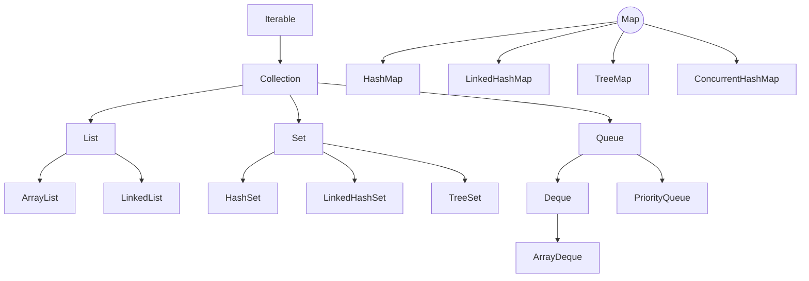

# Collections Framework

APIs return lists, caches are maps, and de-duplication uses sets. Choosing the
right collection — and knowing how it behaves under the hood — is daily backend work
and a guaranteed interview topic.

<ProgressTracker id="collections-overview" />

## Table of Contents

- [The hierarchy](#the-hierarchy)
- [Choosing a collection](#choosing-a-collection)
- [Time complexity](#time-complexity)
- [hashCode/equals and why they matter](#hashcodeequals-and-why-they-matter)
- [Sorting: Comparable & Comparator](#sorting-comparable--comparator)
- [Fail-fast iterators](#fail-fast-iterators)
- [Immutable & unmodifiable collections](#immutable--unmodifiable-collections)
- [Worked example: LRU cache](#worked-example-lru-cache)
- [Topics in this section](#topics-in-this-section)
- [Most Asked Interview Questions](#most-asked-interview-questions)
- [Things You Should Know](#things-you-should-know)

## The hierarchy



`Map` is not a `Collection` — it models key→value pairs, not a group of elements,
so it sits in its own branch.

## Choosing a collection

| Collection | Ordering | Duplicates | Null keys/values | Lookup | Typical backend use |
| --- | --- | --- | --- | --- | --- |
| `ArrayList` | Insertion (indexed) | Yes | Values yes | O(1) by index | Default list, API responses |
| `LinkedList` | Insertion | Yes | Values yes | O(n) by index | Rare; queue/deque via `ArrayDeque` instead |
| `HashSet` | None | No | One null | O(1) | De-dupe, membership checks |
| `LinkedHashSet` | Insertion | No | One null | O(1) | De-dupe while keeping order |
| `TreeSet` | Sorted | No | No null | O(log n) | Sorted unique data, ranges |
| `HashMap` | None | Keys unique | One null key | O(1) | Caches, lookups, grouping |
| `LinkedHashMap` | Insertion/access | Keys unique | One null key | O(1) | LRU caches, ordered output |
| `TreeMap` | Sorted keys | Keys unique | No null key | O(log n) | Sorted/range queries |
| `ConcurrentHashMap` | None | Keys unique | No nulls | O(1) | Thread-safe shared caches |
| `ArrayDeque` | Insertion | Yes | No null | O(1) ends | Stacks & queues |
| `PriorityQueue` | Priority order | Yes | No null | O(log n) | Schedulers, top-K, Dijkstra |

<Interview>
"When would you use `LinkedList`?" Almost never in practice. `ArrayList` wins for
random access and cache locality; for queue/stack behavior use `ArrayDeque`.
`LinkedList` only helps when frequently inserting/removing in the middle via an
iterator — a rare backend need.
</Interview>

### Quick examples

```java
// ArrayList — default list, indexed access
List<String> names = new ArrayList<>();
names.add("Alice");
names.add("Bob");
names.get(0); // "Alice", O(1)

// ArrayDeque — stack or queue, never LinkedList for this
Deque<Integer> stack = new ArrayDeque<>();
stack.push(1);
stack.push(2);
stack.pop(); // 2 (LIFO)

Deque<Integer> queue = new ArrayDeque<>();
queue.offer(1);
queue.offer(2);
queue.poll(); // 1 (FIFO)

// HashSet — membership / de-dupe, no order guarantee
Set<String> seen = new HashSet<>();
seen.add("a@x.com");
seen.contains("a@x.com"); // true, O(1) avg

// LinkedHashSet — de-dupe but keep insertion order
Set<String> ordered = new LinkedHashSet<>(List.of("c", "a", "b", "a"));
// iteration order: c, a, b

// TreeSet — sorted, supports range queries
TreeSet<Integer> scores = new TreeSet<>(List.of(90, 40, 75, 60));
scores.first();          // 40
scores.higher(60);       // 75 — smallest element strictly greater than 60
scores.headSet(75);      // [40, 60] — all elements < 75

// PriorityQueue — top-K / scheduling
PriorityQueue<Integer> minHeap = new PriorityQueue<>();
minHeap.addAll(List.of(5, 1, 4, 2));
minHeap.poll(); // 1 (smallest first)

// Max-heap: supply a reversed comparator
PriorityQueue<Integer> maxHeap = new PriorityQueue<>(Comparator.reverseOrder());
```

## Time complexity

| Operation | ArrayList | LinkedList | HashMap | TreeMap |
| --- | --- | --- | --- | --- |
| get/index | O(1) | O(n) | O(1) avg | O(log n) |
| add (end) | O(1) amortized | O(1) | O(1) avg | O(log n) |
| remove (middle) | O(n) | O(n)* | O(1) avg | O(log n) |
| contains | O(n) | O(n) | O(1) avg | O(log n) |

\*O(1) once positioned, but positioning is O(n).

## hashCode/equals and why they matter

`HashMap`, `HashSet`, and `Hashtable` all rely on `hashCode()` to pick a bucket
and `equals()` to resolve collisions within that bucket. If you use a custom
class as a key (or set element) without overriding both, you get identity
semantics — two "equal" objects land in different buckets and lookups silently fail.

```java
public class UserId {
    private final long value;

    public UserId(long value) { this.value = value; }

    @Override
    public boolean equals(Object o) {
        if (this == o) return true;
        if (!(o instanceof UserId other)) return false;
        return value == other.value;
    }

    @Override
    public int hashCode() {
        return Long.hashCode(value);
    }
}

Map<UserId, User> cache = new HashMap<>();
cache.put(new UserId(42), user);
cache.get(new UserId(42)); // returns `user` — works only because equals/hashCode are overridden
```

<Important>
The contract: if `a.equals(b)` is true, then `a.hashCode() == b.hashCode()` **must**
also be true. The reverse isn't required (different objects can share a hash code —
that's a collision, and `equals()` breaks the tie). Breaking this contract is one of
the most common real-world sources of "why isn't my map lookup working?" bugs.
</Important>

## Sorting: Comparable & Comparator

`Comparable` defines a class's single "natural" order (implemented on the class
itself). `Comparator` defines an external, swappable order — use it whenever you
need multiple orderings or don't own the class.

```java
public record Employee(String name, int age, BigDecimal salary) implements Comparable<Employee> {
    @Override
    public int compareTo(Employee other) {
        return Integer.compare(this.age, other.age); // natural order: by age
    }
}

List<Employee> employees = new ArrayList<>(List.of(
    new Employee("Sam", 34, new BigDecimal("90000")),
    new Employee("Ada", 29, new BigDecimal("110000"))
));

Collections.sort(employees); // uses compareTo — sorted by age

// Comparator: sort by salary descending, then name ascending as a tiebreaker
employees.sort(
    Comparator.comparing(Employee::salary).reversed()
        .thenComparing(Employee::name));
```

## Fail-fast iterators

Most `java.util` collections throw `ConcurrentModificationException` if the
collection is structurally modified while iterating, other than through the
iterator's own `remove()`. This is a best-effort safety check, not a guarantee.

```java
List<String> items = new ArrayList<>(List.of("a", "b", "c"));

for (String item : items) {
    if (item.equals("b")) {
        items.remove(item); // throws ConcurrentModificationException
    }
}

// Correct: remove via the iterator
Iterator<String> it = items.iterator();
while (it.hasNext()) {
    if (it.next().equals("b")) {
        it.remove(); // safe
    }
}

// Or: removeIf, which handles this internally
items.removeIf(item -> item.equals("b"));
```

`CopyOnWriteArrayList` and `ConcurrentHashMap` avoid this exception entirely —
they use snapshot or weakly-consistent iteration instead, at the cost of extra
memory (copy-on-write) or slightly stale reads.

## Immutable & unmodifiable collections

```java
// Truly immutable — throws UnsupportedOperationException on any mutation
List<String> fixed = List.of("a", "b", "c");
Map<String, Integer> counts = Map.of("a", 1, "b", 2);

// Unmodifiable VIEW — the underlying list can still change out from under you
List<String> mutable = new ArrayList<>(List.of("a", "b"));
List<String> view = Collections.unmodifiableList(mutable);
mutable.add("c");
view.size(); // 3 — the view reflects the change, it just can't itself mutate
```

`List.of`/`Map.of`/`Set.of` (Java 9+) also reject `null` elements, unlike
`Collections.unmodifiableList`, which merely wraps whatever you give it.

## Worked example: LRU cache

A classic use of `LinkedHashMap`'s access-order mode plus `removeEldestEntry`:

```java
public class LruCache<K, V> extends LinkedHashMap<K, V> {
    private final int capacity;

    public LruCache(int capacity) {
        super(16, 0.75f, true); // accessOrder=true: reads move an entry to the end
        this.capacity = capacity;
    }

    @Override
    protected boolean removeEldestEntry(Map.Entry<K, V> eldest) {
        return size() > capacity; // evict the least-recently-used entry
    }
}

LruCache<String, String> cache = new LruCache<>(2);
cache.put("a", "1");
cache.put("b", "2");
cache.get("a");     // "a" is now most-recently-used
cache.put("c", "3"); // evicts "b", the least-recently-used
cache.keySet();      // [a, c]
```

## Topics in this section

<div className="jbm-card-grid">
  <Link className="jbm-card" to="/docs/collections/hashmap-internals">
    <div className="jbm-card__icon">🗺️</div>
    <h3>HashMap Internals</h3>
    <p>Buckets, hashing, collisions, load factor, resizing, treeification.</p>
  </Link>
  <Link className="jbm-card" to="/docs/collections/list-internals">
    <div className="jbm-card__icon">📋</div>
    <h3>ArrayList vs LinkedList</h3>
    <p>Backing arrays, growth, and why ArrayList usually wins.</p>
  </Link>
  <Link className="jbm-card" to="/docs/collections/comparable-comparator">
    <div className="jbm-card__icon">🔃</div>
    <h3>Comparable & Comparator</h3>
    <p>Natural vs custom ordering, and multi-key sorting.</p>
  </Link>
</div>

## Most Asked Interview Questions

### Beginner
- Difference between `List`, `Set`, and `Map`?
- `ArrayList` vs `LinkedList`?
- Why does overriding `equals()` without `hashCode()` break `HashMap`/`HashSet`?

### Intermediate
- How does `HashMap` work internally?
- `HashMap` vs `Hashtable` vs `ConcurrentHashMap`?
- `Comparable` vs `Comparator`?
- What triggers `ConcurrentModificationException`, and how do you avoid it?

### Advanced
- What happens during `HashMap` resizing and treeification?
- How does `ConcurrentHashMap` achieve thread safety without locking the whole map?
- How would you implement an LRU cache from scratch, and why does `LinkedHashMap` make it easy?

### Coding
- Find the first non-repeating character using a `LinkedHashMap`.
- Implement an LRU cache with `LinkedHashMap`.
- Sort a list of objects by two fields using `Comparator.thenComparing`.

## Things You Should Know

### 🔴 Must Know
- When to pick each collection and its time complexity.
- How `HashMap` uses `hashCode`/`equals`, and the equals-implies-same-hashCode contract.
- `ArrayList` is the default list; `ArrayDeque` for stack/queue.

### 🟡 Good to Know
- Load factor (0.75), resizing, and treeification threshold (8).
- `ConcurrentHashMap` bucket-level concurrency.
- `Comparable` (natural order, on the class) vs `Comparator` (external, composable via `thenComparing`).
- Fail-fast iterators vs `CopyOnWriteArrayList`/`ConcurrentHashMap`'s weakly-consistent iteration.

### 🟢 Nice to Know
- Fail-fast iterators and `ConcurrentModificationException` internals.
- Immutable collections via `List.of` / `Map.of`, and how they differ from `Collections.unmodifiableList` views.
- `LinkedHashMap`'s access-order mode + `removeEldestEntry` as a built-in LRU cache.
