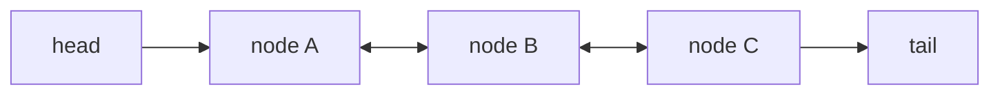

# ArrayList vs LinkedList

<ProgressTracker id="list-internals" />

## Table of Contents

- [ArrayList internals](#arraylist-internals)
- [LinkedList internals](#linkedlist-internals)
- [Head-to-head](#head-to-head)
- [Common mistakes](#common-mistakes)
- [Interview questions](#interview-questions)
- [Things You Should Know](#things-you-should-know)

## ArrayList internals

`ArrayList` wraps a resizable array (`Object[] elementData`). Random access is O(1)
because it is a direct array index. When full, it grows by ~50%.

```text
add past capacity -> new array of size oldCapacity + (oldCapacity >> 1)
                  -> System.arraycopy old -> new
```

```java
List<String> list = new ArrayList<>();  // default capacity 10 on first add
list.add("a");        // O(1) amortized
list.get(0);          // O(1)
list.add(0, "x");     // O(n) — shifts all elements right
```

<Tip>
If you know the size up front, pre-size: `new ArrayList<>(10_000)`. This avoids
repeated array copies as the list grows.
</Tip>

## LinkedList internals

`LinkedList` is a doubly-linked list of nodes (each holds prev/next pointers). It
implements both `List` and `Deque`. Index access must walk from the nearest end, so
`get(i)` is O(n).



## Head-to-head

| Operation | ArrayList | LinkedList |
| --- | --- | --- |
| `get(i)` | O(1) | O(n) |
| `add` at end | O(1) amortized | O(1) |
| `add`/`remove` at front | O(n) | O(1) |
| `add`/`remove` middle | O(n) | O(n) (find) + O(1) (unlink) |
| Memory per element | Low (packed array) | High (node + 2 pointers) |
| Cache locality | Excellent | Poor |

<Interview>
In practice `ArrayList` beats `LinkedList` for almost everything because CPU cache
locality makes contiguous arrays fast, even for inserts that shift elements. For
queue/stack/deque semantics, prefer **`ArrayDeque`** over `LinkedList`.
</Interview>

## Common mistakes

<Warning>
- Choosing `LinkedList` "because inserts are O(1)" — locating the insert point is
  still O(n), and cache misses usually make it slower than `ArrayList`.
- Calling `list.remove(int)` vs `list.remove(Object)` on a `List<Integer>` — the
  `int` overload removes by index, a classic bug.
- Removing from a list while iterating with a for-each loop → `ConcurrentModificationException`; use an `Iterator` or `removeIf`.
</Warning>

## Interview questions

**Q: `ArrayList` vs `LinkedList`?**
`ArrayList` = resizable array, O(1) random access, better cache locality, default
choice. `LinkedList` = doubly-linked nodes, O(1) end insertion but O(n) indexing and
high memory overhead.

**Q: How does `ArrayList` grow?**
When capacity is exceeded it allocates a new array ~1.5× larger and copies elements
over (`System.arraycopy`).

**Q: How do you safely remove during iteration?**
Use `iterator.remove()` or `list.removeIf(predicate)`.

## Things You Should Know

### 🔴 Must Know
- `ArrayList` = array-backed, O(1) get; `LinkedList` = node-based, O(n) get.
- `ArrayList` is the default; `ArrayDeque` for stacks/queues.
- Safe removal with `removeIf`/`Iterator`.

### 🟡 Good to Know
- 1.5× growth and pre-sizing.
- `remove(int)` vs `remove(Object)` pitfall.

### 🟢 Nice to Know
- Why cache locality makes arrays win in benchmarks.
