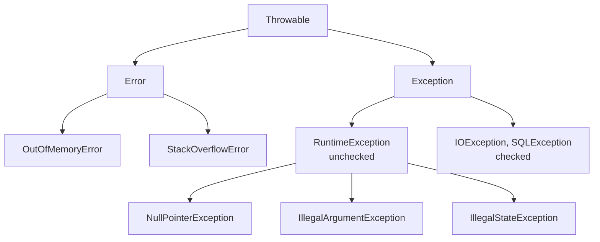

# Exception Handling

Exceptions are how Java signals "something went wrong". On the backend, how you
handle them decides whether a client gets a clean `400` with a helpful message or a
leaked stack trace and a `500`.

<ProgressTracker id="exceptions-overview" />

## Table of Contents

- [The hierarchy](#the-hierarchy)
- [Checked vs unchecked](#checked-vs-unchecked)
- [try / catch / finally](#try--catch--finally)
- [throw vs throws](#throw-vs-throws)
- [try-with-resources](#try-with-resources)
- [Custom exceptions](#custom-exceptions)
- [Exception propagation](#exception-propagation)
- [REST API exception handling](#rest-api-exception-handling)
- [Common mistakes](#common-mistakes)
- [Most Asked Interview Questions](#most-asked-interview-questions)
- [Things You Should Know](#things-you-should-know)

## The hierarchy



- **`Throwable`** is the root.
- **`Error`** = serious JVM problems you should not catch (`OutOfMemoryError`).
- **`Exception`** = application problems you can handle.
- **`RuntimeException`** and subclasses are **unchecked**; everything else under
  `Exception` is **checked**.

## Checked vs unchecked

| | Checked | Unchecked (RuntimeException) |
| --- | --- | --- |
| Compiler forces handling | Yes (`throws` or `catch`) | No |
| Represents | Recoverable, external conditions | Programming errors / invariants |
| Examples | `IOException`, `SQLException` | `NullPointerException`, `IllegalArgumentException` |

A **checked** exception is a compile-time contract: the compiler forces the caller to
either catch it or declare `throws`.

```java
// CHECKED — extends Exception (not RuntimeException).
// Every caller MUST handle or declare it, or the code won't compile.
class InsufficientFundsException extends Exception {
    public InsufficientFundsException(String message) { super(message); }
}

class Account {
    private long balanceCents;

    // The 'throws' clause is mandatory — it's part of the method's contract
    public void withdraw(long cents) throws InsufficientFundsException {
        if (cents > balanceCents) {
            throw new InsufficientFundsException("balance=" + balanceCents + " requested=" + cents);
        }
        balanceCents -= cents;
    }
}

// Caller is FORCED by the compiler to deal with it
void pay(Account account) {
    try {
        account.withdraw(5_000);
    } catch (InsufficientFundsException e) {   // must catch...
        log.warn("payment declined: {}", e.getMessage());
    }
}
// ...or propagate it:  void pay(Account a) throws InsufficientFundsException { a.withdraw(5000); }
```

An **unchecked** exception extends `RuntimeException`: the compiler does **not** force
handling. Use it for programming errors and violated invariants.

```java
// UNCHECKED — extends RuntimeException. No 'throws' needed; no forced catch.
class UserNotFoundException extends RuntimeException {
    public UserNotFoundException(Long id) { super("User not found: " + id); }
}

// No 'throws' clause, callers aren't forced to catch — a global handler deals with it
public User getUser(Long id) {
    return repository.findById(id)
        .orElseThrow(() -> new UserNotFoundException(id));
}

// Built-in unchecked examples — these signal bugs, not recoverable conditions
Objects.requireNonNull(name);                 // throws NullPointerException if null
if (qty < 0) throw new IllegalArgumentException("qty must be >= 0");  // bad argument
if (!started) throw new IllegalStateException("call start() first");   // wrong state
```

<Important>
Decision rule: throw a **checked** exception when the caller can reasonably **recover**
(retry, fall back, ask the user) and you want the compiler to enforce handling. Throw an
**unchecked** exception for programming errors and invariant violations the caller
generally can't fix at runtime (`IllegalArgumentException`, `IllegalStateException`,
`NullPointerException`). When in doubt in modern backend code, prefer unchecked.
</Important>

<Interview>
Modern Spring code leans heavily on **unchecked** exceptions. Spring wraps
`SQLException` in the unchecked `DataAccessException` hierarchy so your service code
isn't cluttered with `throws`. Custom domain exceptions are typically unchecked.
</Interview>

## try / catch / finally

```java
try {
    return repository.load(id);
} catch (NotFoundException e) {
    log.warn("Missing id {}", id);
    throw e;                      // rethrow after logging context
} finally {
    // always runs — cleanup, metrics, etc.
    meter.increment("load.attempt");
}
```

`finally` runs whether or not an exception was thrown (except on `System.exit` or
JVM crash). Never `return` from `finally` — it swallows exceptions and return values.

## throw vs throws

- `throw` — actually raise an exception instance.
- `throws` — declare in a method signature that it may propagate a checked exception.

```java
public Config load(String path) throws IOException {   // declares
    if (path == null) {
        throw new IllegalArgumentException("path required");   // raises
    }
    return parse(Files.readString(Path.of(path)));
}
```

## try-with-resources

Any `AutoCloseable` is closed automatically, in reverse order, even on exceptions —
replacing error-prone `finally` blocks.

```java
try (var conn = dataSource.getConnection();
     var stmt = conn.prepareStatement("SELECT * FROM users WHERE id = ?")) {
    stmt.setLong(1, id);
    try (var rs = stmt.executeQuery()) {
        return map(rs);
    }
}   // rs, stmt, conn all closed automatically
```

<Tip>
Always use try-with-resources for JDBC connections, streams, and files. Leaked
connections exhaust the pool and take down the service under load.
</Tip>

## Custom exceptions

```java
public class UserNotFoundException extends RuntimeException {
    private final Long userId;
    public UserNotFoundException(Long userId) {
        super("User not found: " + userId);
        this.userId = userId;
    }
    public Long getUserId() { return userId; }
}
```

<Important>
Preserve the cause when wrapping: `throw new ServiceException("load failed", e);`.
Dropping the cause (`catch (X e) { throw new Y(); }`) discards the original stack
trace and makes production debugging miserable.
</Important>

## Exception propagation

An uncaught exception unwinds the call stack until a matching `catch` is found; if
none exists, the thread terminates (and the JVM prints the stack trace).

```mermaid
flowchart TD
  c[controller] --> s[service]
  s --> r[repository]
  r -->|throws| s
  s -->|no catch, propagates| c
  c -->|@ExceptionHandler| resp[HTTP 404 JSON]
```

## REST API exception handling

Centralize error handling so every endpoint returns a consistent error shape.

```java
public record ApiError(int status, String code, String message, Instant timestamp) {}

@RestControllerAdvice
public class GlobalExceptionHandler {

    @ExceptionHandler(UserNotFoundException.class)
    public ResponseEntity<ApiError> handleNotFound(UserNotFoundException ex) {
        var body = new ApiError(404, "USER_NOT_FOUND", ex.getMessage(), Instant.now());
        return ResponseEntity.status(HttpStatus.NOT_FOUND).body(body);
    }

    @ExceptionHandler(MethodArgumentNotValidException.class)
    public ResponseEntity<ApiError> handleValidation(MethodArgumentNotValidException ex) {
        String msg = ex.getBindingResult().getFieldErrors().stream()
            .map(f -> f.getField() + ": " + f.getDefaultMessage())
            .collect(Collectors.joining(", "));
        var body = new ApiError(400, "VALIDATION_ERROR", msg, Instant.now());
        return ResponseEntity.badRequest().body(body);
    }

    @ExceptionHandler(Exception.class)
    public ResponseEntity<ApiError> handleUnexpected(Exception ex) {
        // Log full detail server-side; return a generic message to the client
        log.error("Unhandled exception", ex);
        var body = new ApiError(500, "INTERNAL_ERROR", "Something went wrong", Instant.now());
        return ResponseEntity.internalServerError().body(body);
    }
}
```

<Backend>
Never return raw stack traces to clients — they leak internal structure and are a
security risk. Log details server-side with a correlation id; return a safe,
structured message. See [Validation & Error Handling](/docs/rest-api/) and
[Production Backend](/docs/production/).
</Backend>

## Common mistakes

<Warning>
- Swallowing exceptions: `catch (Exception e) {}` hides real failures.
- Catching `Throwable`/`Error` — you can't recover from `OutOfMemoryError`.
- Losing the cause when rewrapping.
- Using exceptions for normal control flow (they're expensive and unclear).
- `return`/`continue` inside `finally`.
</Warning>

## Most Asked Interview Questions

### Beginner
- Checked vs unchecked exceptions?
- Difference between `throw` and `throws`?
- What is `finally` and when does it not run?

### Intermediate
- What is try-with-resources and what problem does it solve?
- Why does Spring favor unchecked exceptions?

### Advanced
- How does exception propagation interact with `@Transactional` rollback?
- How do you design a consistent API error contract?

### Coding
- Write a global exception handler returning a structured JSON error.

## Things You Should Know

### 🔴 Must Know
- The hierarchy: `Throwable` → `Error`/`Exception` → `RuntimeException`.
- Checked vs unchecked and when each applies.
- try-with-resources for all closeables.
- Centralized `@RestControllerAdvice` handling.

### 🟡 Good to Know
- Preserve causes when wrapping.
- `@Transactional` rolls back on `RuntimeException` by default, not checked.

### 🟢 Nice to Know
- Suppressed exceptions in try-with-resources.
- Cost of filling in stack traces and `fillInStackTrace`.
