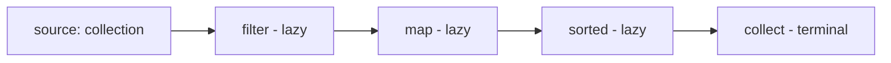

# Stream API Deep Dive

<ProgressTracker id="streams" />

## Table of Contents

- [Pipeline anatomy](#pipeline-anatomy)
- [Creating streams](#creating-streams)
- [Core operations](#core-operations)
- [map vs flatMap](#map-vs-flatmap)
- [Primitive streams](#primitive-streams)
- [reduce and collect](#reduce-and-collect)
- [groupingBy & partitioningBy](#groupingby--partitioningby)
- [Collectors in depth](#collectors-in-depth)
- [Laziness & short-circuiting](#laziness--short-circuiting)
- [Infinite streams](#infinite-streams)
- [Handling checked exceptions in lambdas](#handling-checked-exceptions-in-lambdas)
- [peek & debugging](#peek--debugging)
- [Parallel streams](#parallel-streams)
- [When NOT to use streams](#when-not-to-use-streams)
- [Interview questions](#interview-questions)
- [Things You Should Know](#things-you-should-know)

## Pipeline anatomy

A stream pipeline has a **source**, zero or more **intermediate** (lazy)
operations, and one **terminal** operation that triggers execution.



```java
List<String> activeEmails = users.stream()   // source
    .filter(User::isActive)                   // intermediate
    .map(User::getEmail)                      // intermediate
    .sorted()                                 // intermediate
    .toList();                                // terminal
```

<Important>
A stream is **single-use** and does **not** store data — it's a pipeline over a source.
Once a terminal operation runs, the stream is consumed; reusing it throws
`IllegalStateException: stream has already been operated upon or closed`.
</Important>

## Creating streams

```java
Stream<String> s1 = List.of("a", "b").stream();     // from a collection
Stream<String> s2 = Stream.of("a", "b", "c");        // from values
Stream<String> s3 = Arrays.stream(new String[]{"a"});// from an array
IntStream s4 = IntStream.range(0, 10);               // 0..9 (rangeClosed for 0..10)
Stream<String> s5 = "a,b,c".lines();                 // Stream<String> of lines
Stream<String> empty = Stream.empty();
```

## Core operations

| Operation | Type | Purpose |
| --- | --- | --- |
| `filter(Predicate)` | intermediate | keep matching elements |
| `map(Function)` | intermediate | transform each element |
| `flatMap(Function)` | intermediate | flatten nested streams |
| `distinct()` | intermediate | remove duplicates (uses equals) |
| `sorted()` | intermediate | order elements |
| `limit`/`skip` | intermediate | paginate |
| `reduce` | terminal | fold to a single value |
| `collect` | terminal | accumulate into a container |
| `count`/`anyMatch`/`findFirst` | terminal | aggregate / search |

## map vs flatMap

`map` transforms one element to one element. `flatMap` transforms one element to a
**stream** and flattens all of them into one.

```java
// map: List<Order> -> List<Long> (order ids)
List<Long> ids = orders.stream().map(Order::getId).toList();

// flatMap: List<Order> each with many items -> one flat stream of items
List<LineItem> allItems = orders.stream()
    .flatMap(o -> o.getItems().stream())
    .toList();
```

## Primitive streams

`IntStream`, `LongStream`, and `DoubleStream` avoid boxing overhead and add numeric
helpers (`sum`, `average`, `max`, `summaryStatistics`). Convert with `mapToInt` /
`boxed`.

```java
// Sum of order quantities without boxing every int
int totalQty = orders.stream()
    .mapToInt(Order::getQuantity)   // Stream<Order> -> IntStream
    .sum();

// Average, min, max, count in one pass
IntSummaryStatistics stats = orders.stream()
    .mapToInt(Order::getQuantity)
    .summaryStatistics();
double avg = stats.getAverage();
int max = stats.getMax();

// Back to an object stream when needed
List<Integer> boxed = IntStream.rangeClosed(1, 5).boxed().toList();  // [1,2,3,4,5]
```

<Tip>
Reach for `mapToInt`/`mapToLong` when summing or averaging numbers — `stream().map(...)
.reduce(0, Integer::sum)` boxes every value. Primitive streams are both faster and more
readable for numeric aggregation.
</Tip>

## reduce and collect

```java
// reduce: sum order totals
BigDecimal total = orders.stream()
    .map(Order::getTotal)
    .reduce(BigDecimal.ZERO, BigDecimal::add);

// collect: build a Map<id, Order>
Map<Long, Order> byId = orders.stream()
    .collect(Collectors.toMap(Order::getId, Function.identity()));
```

## groupingBy & partitioningBy

```java
// Group orders by status
Map<Status, List<Order>> byStatus = orders.stream()
    .collect(Collectors.groupingBy(Order::getStatus));

// Group and aggregate: total revenue per status
Map<Status, BigDecimal> revenue = orders.stream()
    .collect(Collectors.groupingBy(
        Order::getStatus,
        Collectors.reducing(BigDecimal.ZERO, Order::getTotal, BigDecimal::add)));

// Partition into two buckets by a boolean
Map<Boolean, List<Order>> paidVsUnpaid = orders.stream()
    .collect(Collectors.partitioningBy(Order::isPaid));
```

## Collectors in depth

`Collectors` does far more than `toList()`. The **downstream collector** (second arg to
`groupingBy`) is where the power is.

```java
// Join into a single string
String csv = users.stream().map(User::getName)
    .collect(Collectors.joining(", ", "[", "]"));   // "[Ann, Bob]"

// Count per group
Map<Status, Long> countByStatus = orders.stream()
    .collect(Collectors.groupingBy(Order::getStatus, Collectors.counting()));

// Map values then collect (mapping downstream)
Map<Status, List<Long>> idsByStatus = orders.stream()
    .collect(Collectors.groupingBy(Order::getStatus,
             Collectors.mapping(Order::getId, Collectors.toList())));

// Averages / sums with primitive collectors
Map<Status, Double> avgTotal = orders.stream()
    .collect(Collectors.groupingBy(Order::getStatus,
             Collectors.averagingDouble(o -> o.getTotal().doubleValue())));

// toMap with a merge function to resolve duplicate keys
Map<String, Order> latestByCustomer = orders.stream()
    .collect(Collectors.toMap(Order::getCustomer, o -> o,
             (a, b) -> a.getCreatedAt().isAfter(b.getCreatedAt()) ? a : b));
```

<Warning>
`Collectors.toMap` throws `IllegalStateException` on **duplicate keys** unless you
supply a merge function (third argument). This surprises people constantly — always
consider whether keys can collide.
</Warning>

## Laziness & short-circuiting

Intermediate operations do nothing until a terminal operation runs, and
short-circuiting operations (`findFirst`, `anyMatch`, `limit`) stop early.

```java
Optional<User> first = users.stream()
    .filter(User::isActive)      // not evaluated for elements after the match
    .findFirst();                // stops at the first active user
```

## Infinite streams

`Stream.iterate` and `Stream.generate` produce unbounded streams — you **must** bound
them with `limit` (or a predicate) or the pipeline never terminates.

```java
// First 10 even numbers
List<Integer> evens = Stream.iterate(0, n -> n + 2).limit(10).toList();

// Iterate with a built-in stop condition (Java 9+)
List<Integer> under100 = Stream.iterate(1, n -> n < 100, n -> n * 2).toList();

// generate: supplier-based (e.g. random) — always bound it
List<Double> randoms = Stream.generate(Math::random).limit(5).toList();
```

<Warning>
`Stream.iterate(0, n -> n + 1).forEach(...)` without a `limit` runs forever. Infinite
streams only work because of laziness — the source produces values on demand until a
short-circuiting operation stops it.
</Warning>

## Handling checked exceptions in lambdas

Stream lambdas implement functional interfaces (`Function`, `Consumer`, …) whose methods
**don't declare checked exceptions**. So calling a method that throws a **checked**
exception inside a lambda won't compile.

```java
// DOES NOT COMPILE — Files.readString throws the checked IOException,
// but Function.apply is not allowed to throw it
List<String> contents = paths.stream()
    .map(p -> Files.readString(p))   // compile error: unhandled IOException
    .toList();
```

You have three options:

```java
// 1) Handle inside the lambda and rethrow as an UNCHECKED exception (most common)
List<String> a = paths.stream()
    .map(p -> {
        try {
            return Files.readString(p);
        } catch (IOException e) {
            throw new UncheckedIOException(e);   // JDK's unchecked wrapper for IOException
        }
    })
    .toList();

// 2) Extract a helper method that wraps the checked exception
List<String> b = paths.stream().map(FileUtil::readOrThrow).toList();

static String readOrThrow(Path p) {
    try {
        return Files.readString(p);
    } catch (IOException e) {
        throw new UncheckedIOException(e);       // checked -> unchecked at the boundary
    }
}
```

```java
// 3) A reusable "checked function" wrapper — define once, reuse everywhere
@FunctionalInterface
interface CheckedFunction<T, R> {
    R apply(T t) throws Exception;               // allowed to throw checked
}

static <T, R> Function<T, R> unchecked(CheckedFunction<T, R> f) {
    return t -> {
        try {
            return f.apply(t);
        } catch (Exception e) {
            throw new RuntimeException(e);        // adapt checked -> unchecked
        }
    };
}

// Now the pipeline reads cleanly:
List<String> c = paths.stream()
    .map(unchecked(Files::readString))
    .toList();
```

<Important>
The core issue: functional interfaces used by streams (`Function`, `Consumer`,
`Supplier`, `Predicate`) declare **no checked exceptions**, so a checked exception must
be caught inside the lambda and converted to an **unchecked** one (`UncheckedIOException`,
`RuntimeException`, or a domain exception). Prefer `UncheckedIOException` for I/O — it
preserves the original `IOException` as the cause. See
[Exception Handling](/docs/exceptions/#checked-vs-unchecked) for checked vs unchecked.
</Important>

## peek & debugging

`peek` is an intermediate operation for observing elements without changing them —
useful for debugging a pipeline. It only runs for elements the terminal op actually pulls.

```java
List<String> result = users.stream()
    .filter(User::isActive)
    .peek(u -> log.debug("kept {}", u.getId()))   // debug visibility, no mutation
    .map(User::getEmail)
    .toList();
```

<Warning>
Don't use `peek` for real side effects (mutation, I/O). It may be skipped by the JVM
when the result isn't needed, and its behavior with short-circuiting is subtle. It's a
debugging aid, not a `forEach`.
</Warning>

## Parallel streams

`parallelStream()` (or `.parallel()`) splits work across the common ForkJoinPool. It can
speed up **large, CPU-bound, stateless** pipelines — and hurt everything else.

```java
long count = hugeList.parallelStream()
    .filter(this::expensiveCpuCheck)   // stateless, CPU-bound
    .count();
```

<Warning>
Parallel stream pitfalls: (1) the shared **common ForkJoinPool** means blocking I/O in
one parallel stream starves all others; (2) any shared mutable state causes race
conditions — collectors must be concurrent/associative; (3) for small collections the
splitting/merging overhead outweighs the gain. Measure before parallelizing, and never
use it for I/O — use a dedicated executor or virtual threads instead
([Concurrency](/docs/concurrency/executors-and-thread-pools/)).
</Warning>

## When NOT to use streams

<Warning>
- **Side effects in `forEach`** that mutate shared state — not thread-safe and hard
  to read. Prefer `collect`.
- **Trivial loops** — a plain `for` is clearer and faster for simple index work.
- **Parallel streams** for small data or I/O tasks — the common ForkJoinPool
  overhead usually hurts, and blocking I/O starves the pool. Use them only for
  large, CPU-bound, stateless work.
</Warning>

<Interview>
"Are streams faster than loops?" Usually no for small collections — they add
overhead. Their value is readability and composability, not raw speed. Reach for a
loop when the logic is trivial or performance-critical in a tight path.
</Interview>

## Interview questions

**Q: Intermediate vs terminal operations?**
Intermediate ops are lazy and return a stream (`map`, `filter`); terminal ops trigger
execution and produce a result (`collect`, `reduce`, `count`).

**Q: `map` vs `flatMap`?**
`map` is 1→1; `flatMap` is 1→stream and flattens nested structures.

**Q: When are parallel streams appropriate?**
Large, CPU-bound, stateless, easily-splittable data — never for blocking I/O.

**Q: How do you call a method that throws a checked exception inside a stream lambda?**
Functional interfaces don't declare checked exceptions, so catch it inside the lambda and
rethrow as unchecked (`UncheckedIOException`/`RuntimeException`), extract a wrapper helper
method, or use a reusable "checked function" adapter.

**Q: Why can't you reuse a stream?**
A stream is single-use; after a terminal operation it's consumed and reusing it throws
`IllegalStateException`. Create a fresh stream from the source instead.

**Q: When does `Collectors.toMap` fail?**
On duplicate keys, unless you supply a merge function as the third argument.

## Things You Should Know

### 🔴 Must Know
- Source → intermediate (lazy) → terminal pipeline; streams are single-use.
- `map`/`filter`/`collect`/`groupingBy`; `map` vs `flatMap`.
- Checked exceptions must be wrapped as unchecked inside lambdas.

### 🟡 Good to Know
- Primitive streams (`mapToInt`) for numeric aggregation.
- Downstream collectors (`groupingBy` + `counting`/`mapping`); `toMap` merge function.
- Laziness, short-circuiting, and bounding infinite streams with `limit`.

### 🟢 Nice to Know
- `peek` is for debugging, not side effects.
- Parallel stream pitfalls and the shared common ForkJoinPool.
