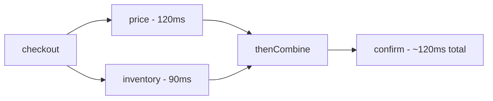

# CompletableFuture & Async Programming

A plain `Future` can only be blocked on with `get()`. `CompletableFuture` (Java 8+)
lets you **compose** async steps into a non-blocking pipeline — run independent calls
in parallel, chain dependent ones, and handle failures declaratively.

<ProgressTracker id="completable-future" />

## Table of Contents

- [Future vs CompletableFuture](#future-vs-completablefuture)
- [Creating a CompletableFuture](#creating-a-completablefuture)
- [Chaining dependent steps](#chaining-dependent-steps)
- [Combining independent futures](#combining-independent-futures)
- [Waiting for many](#waiting-for-many)
- [Exception handling](#exception-handling)
- [Choosing an executor](#choosing-an-executor)
- [A backend example](#a-backend-example)
- [Common mistakes](#common-mistakes)
- [Interview questions](#interview-questions)
- [Things You Should Know](#things-you-should-know)

## Future vs CompletableFuture

| | `Future` | `CompletableFuture` |
| --- | --- | --- |
| Get result | `get()` blocks | callbacks, non-blocking |
| Chain steps | No | `thenApply`, `thenCompose` |
| Combine | No | `thenCombine`, `allOf` |
| Handle errors | try/catch on `get` | `exceptionally`, `handle` |
| Complete manually | No | `complete(value)` |

## Creating a CompletableFuture

```java
// Async with a result (runs on the given executor)
CompletableFuture<String> f = CompletableFuture.supplyAsync(() -> loadUser(id), executor);

// Async with no result
CompletableFuture<Void> r = CompletableFuture.runAsync(() -> sendEmail(id), executor);

// Already-known value
CompletableFuture<String> done = CompletableFuture.completedFuture("cached");
```

## Chaining dependent steps

Use `thenApply` for a sync transform, `thenCompose` to flat-map another future
(avoids nested `CompletableFuture<CompletableFuture<T>>`).

```java
CompletableFuture<Invoice> pipeline =
    CompletableFuture.supplyAsync(() -> loadOrder(id), executor)   // Order
        .thenApply(Order::customerId)                              // Long (sync map)
        .thenCompose(cid -> loadCustomerAsync(cid))                // CompletableFuture<Customer>
        .thenApply(this::buildInvoice);                            // Invoice
```

<Important>
`thenApply` is like `map` (returns a value); `thenCompose` is like `flatMap` (returns
another `CompletableFuture`). Using `thenApply` where the lambda returns a future gives
you a nested future — reach for `thenCompose` there.
</Important>

The `*Async` variants (`thenApplyAsync`) run the callback on a pool instead of the
completing thread — use them when the step itself is expensive.

## Combining independent futures

Run two independent calls in parallel and merge — latency becomes the **slower** of
the two, not the sum.

```java
CompletableFuture<Quote> quote = CompletableFuture.supplyAsync(() -> price(order), pool);
CompletableFuture<Stock> stock = CompletableFuture.supplyAsync(() -> inventory(order), pool);

CompletableFuture<Confirmation> confirmation =
    quote.thenCombine(stock, (q, s) -> confirm(q, s));   // runs both, then combines
```



## Waiting for many

```java
List<CompletableFuture<Result>> futures = ids.stream()
    .map(id -> CompletableFuture.supplyAsync(() -> fetch(id), pool))
    .toList();

// Wait for ALL, then collect
CompletableFuture<List<Result>> all =
    CompletableFuture.allOf(futures.toArray(CompletableFuture[]::new))
        .thenApply(v -> futures.stream().map(CompletableFuture::join).toList());

// Or take the FIRST to finish
CompletableFuture<Object> fastest =
    CompletableFuture.anyOf(futures.toArray(CompletableFuture[]::new));
```

## Exception handling

```java
CompletableFuture<Quote> safe =
    CompletableFuture.supplyAsync(() -> price(order), pool)
        .exceptionally(ex -> {                    // recover with a fallback value
            log.error("pricing failed", ex);
            return Quote.unavailable();
        });

// handle: see both result and exception
future.handle((result, ex) -> ex != null ? fallback() : result);

// whenComplete: side effect, does not change the value
future.whenComplete((result, ex) -> metrics.record(ex == null));
```

<Warning>
Exceptions inside a stage are wrapped in a `CompletionException` and **propagate down
the chain** — later `thenApply` stages are skipped until an `exceptionally`/`handle`
catches them. If you never add a handler and only call `join()`, the exception surfaces
there. Don't forget error handling in async pipelines.
</Warning>

## Choosing an executor

<Important>
By default, `supplyAsync`/`thenApplyAsync` **without** an executor run on the shared
**ForkJoinPool.commonPool()**, sized to CPU cores. Running **blocking I/O** (DB, HTTP)
there starves every parallel task in the JVM. Always pass a **dedicated, bounded
executor** for I/O-bound async work.
</Important>

```java
ExecutorService io = Executors.newFixedThreadPool(50);   // sized for blocking I/O
CompletableFuture.supplyAsync(() -> callSlowService(), io);   // isolated, controlled
```

## A backend example

Fan out three independent service calls, combine them, and degrade gracefully:

```java
public CompletableFuture<CheckoutView> checkout(Order order) {
    var pricing   = CompletableFuture.supplyAsync(() -> pricingClient.quote(order), ioPool)
                        .exceptionally(ex -> Quote.cached(order));
    var inventory = CompletableFuture.supplyAsync(() -> inventoryClient.check(order), ioPool);
    var fraud     = CompletableFuture.supplyAsync(() -> fraudClient.score(order), ioPool);

    return CompletableFuture.allOf(pricing, inventory, fraud)
        .thenApply(v -> new CheckoutView(pricing.join(), inventory.join(), fraud.join()))
        .orTimeout(3, TimeUnit.SECONDS);   // overall deadline
}
```

<Backend>
This pattern cuts endpoint latency from the **sum** of downstream calls to the
**slowest** one. Pair it with timeouts and circuit breakers
([Reliability](/docs/system-design/concepts/reliability/)). With Java 21 virtual
threads, plain blocking code often reads more simply than `CompletableFuture` chains —
see [Virtual Threads](/docs/concurrency/virtual-threads/).
</Backend>

## Common mistakes

<Warning>
- Running blocking I/O on the common ForkJoinPool (starvation).
- Using `thenApply` where `thenCompose` is needed (nested futures).
- Forgetting exception handling — silent failures or exceptions only at `join()`.
- Calling `.get()`/`.join()` early, turning async back into blocking.
- No overall timeout, so one slow dependency hangs the request.
</Warning>

## Interview questions

**Q: `Future` vs `CompletableFuture`?**
`Future` only lets you block on `get()`. `CompletableFuture` composes async stages
(chain, combine, handle errors) without blocking.

**Q: `thenApply` vs `thenCompose`?**
`thenApply` maps to a value; `thenCompose` flat-maps to another `CompletableFuture`.

**Q: How do you run two calls in parallel and merge?**
`thenCombine` (two) or `allOf` + `join` (many).

**Q: What executor do async methods use by default and why is that dangerous?**
The shared common ForkJoinPool; blocking I/O on it starves other parallel work — pass a
dedicated executor.

**Q: How do you handle errors in a pipeline?**
`exceptionally` (fallback value), `handle` (result or exception), `whenComplete` (side
effect).

## Things You Should Know

### 🔴 Must Know
- Compose async work: `supplyAsync`, `thenApply`/`thenCompose`, `thenCombine`, `allOf`.
- Always supply a dedicated executor for blocking I/O.
- Handle exceptions with `exceptionally`/`handle`; add an overall timeout.

### 🟡 Good to Know
- `thenApply` vs `thenCompose` (map vs flatMap).
- `anyOf`, `orTimeout`, `*Async` variants.
- Fan-out/combine to reduce latency.

### 🟢 Nice to Know
- Manual completion (`complete`, `completeExceptionally`).
- How virtual threads simplify async code.
