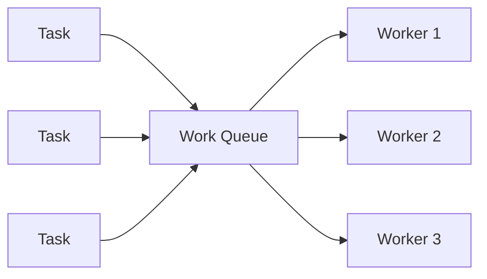
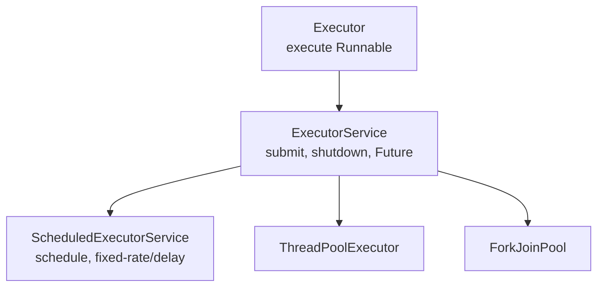
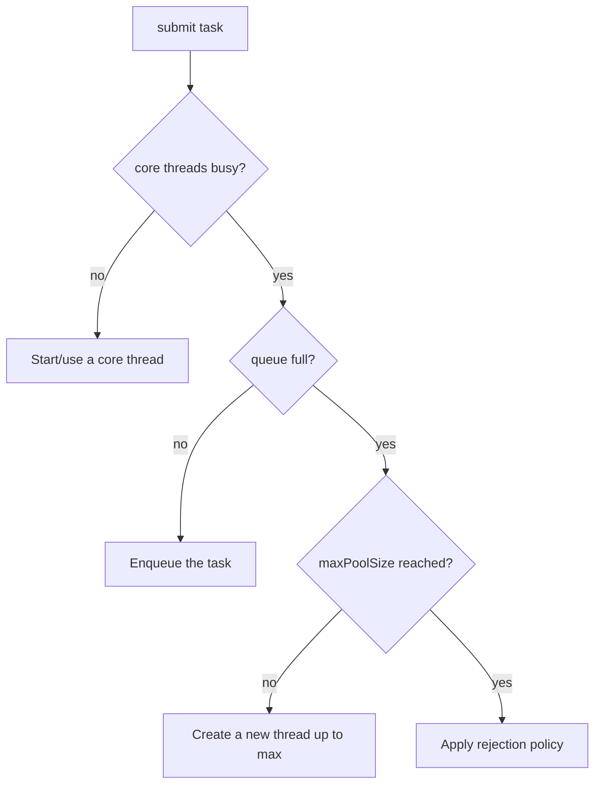

# Executors & Thread Pools

Creating a thread per task doesn't scale — threads are expensive and unbounded thread
creation causes `OutOfMemoryError`. The Executor framework decouples **what** runs from
**how** it runs, using a reusable pool of worker threads.

<ProgressTracker id="executors-and-thread-pools" />

## Table of Contents

- [Why thread pools?](#why-thread-pools)
- [The Executor hierarchy](#the-executor-hierarchy)
- [Runnable, Callable, Future](#runnable-callable-future)
- [ThreadPoolExecutor internals](#threadpoolexecutor-internals)
- [Pool sizing](#pool-sizing)
- [Rejection policies](#rejection-policies)
- [Factory pool types](#factory-pool-types)
- [Scheduled tasks](#scheduled-tasks)
- [ForkJoinPool](#forkjoinpool)
- [Graceful shutdown](#graceful-shutdown)
- [Coordination utilities](#coordination-utilities)
- [Interview questions](#interview-questions)
- [Things You Should Know](#things-you-should-know)

## Why thread pools?

<Important>
A **thread pool** keeps a fixed set of worker threads and feeds them tasks from a
queue. Benefits: (1) **reuse** — no per-task thread creation cost; (2) **bounding** —
cap concurrency so a spike can't spawn millions of threads; (3) **backpressure** — a
bounded queue + rejection policy degrades gracefully instead of crashing.
</Important>



## The Executor hierarchy



- `Executor` — the base: `execute(Runnable)`.
- `ExecutorService` — adds `submit` (returns `Future`), lifecycle (`shutdown`), and
  bulk ops (`invokeAll`).
- `ScheduledExecutorService` — delayed and periodic tasks.

## Runnable, Callable, Future

```java
ExecutorService pool = Executors.newFixedThreadPool(4);

// Runnable: no result
pool.execute(() -> log.info("fire and forget"));

// Callable: returns a value, may throw
Future<BigDecimal> future = pool.submit(() -> priceService.quote(order));

// Future: retrieve the result (blocks), with a timeout to avoid hanging forever
try {
    BigDecimal price = future.get(2, TimeUnit.SECONDS);
} catch (TimeoutException e) {
    future.cancel(true);   // attempt to interrupt the task
}

// Run many, wait for all
List<Future<Integer>> results = pool.invokeAll(listOfCallables);
```

| Type | Returns value | Can throw checked | Used with |
| --- | :---: | :---: | --- |
| `Runnable` | No | No | `execute` / `submit` |
| `Callable<T>` | Yes | Yes | `submit` / `invokeAll` |
| `Future<T>` | — | — | handle to a pending result |

## ThreadPoolExecutor internals

Every `Executors` factory is a `ThreadPoolExecutor` under the hood. Configure it
directly for production control:

```java
ThreadPoolExecutor pool = new ThreadPoolExecutor(
    4,                                   // corePoolSize: threads kept alive
    16,                                  // maximumPoolSize: hard ceiling
    60L, TimeUnit.SECONDS,               // keepAliveTime for threads above core
    new LinkedBlockingQueue<>(1000),     // bounded work queue
    new ThreadFactoryBuilder().setNameFormat("orders-%d").build(),
    new ThreadPoolExecutor.CallerRunsPolicy());  // rejection policy
```

**How a submitted task is handled** (the order matters and surprises people):



<Warning>
The task path is: **fill core threads → fill the queue → only then grow to max → then
reject.** A common bug: using an **unbounded** `LinkedBlockingQueue` means the queue
never fills, so the pool never grows past `corePoolSize` and, worse, a traffic spike
grows the queue until you get an `OutOfMemoryError`. Always bound the queue.
</Warning>

## Pool sizing

<Important>
Size the pool to the workload type:
- **CPU-bound** tasks: `threads ≈ number of cores` (more just adds context-switching).
- **I/O-bound** tasks (DB/HTTP calls): threads can far exceed cores, since they spend
  most time blocked. A starting formula: `cores * (1 + waitTime/computeTime)`.

Measure, don't guess. And remember total DB connections across all pools must stay
within the database's limit ([JDBC](/docs/jdbc/)).
</Important>

## Rejection policies

When the queue is full and max threads are busy, the `RejectedExecutionHandler` decides:

| Policy | Behavior |
| --- | --- |
| `AbortPolicy` (default) | Throw `RejectedExecutionException` |
| `CallerRunsPolicy` | Run the task on the caller's thread (natural backpressure) |
| `DiscardPolicy` | Silently drop the task |
| `DiscardOldestPolicy` | Drop the oldest queued task, then retry |

<Tip>
`CallerRunsPolicy` is often the best default for backend services: when the pool is
saturated, the submitting thread runs the task itself, which slows intake and applies
natural backpressure instead of dropping work or throwing.
</Tip>

## Factory pool types

`Executors` provides convenience factories — know their trade-offs:

| Factory | Behavior | Caution |
| --- | --- | --- |
| `newFixedThreadPool(n)` | n threads, **unbounded** queue | Queue can OOM under load |
| `newCachedThreadPool()` | Grows **unbounded**, reuses idle threads | Can create too many threads |
| `newSingleThreadExecutor()` | One thread, sequential | Serial processing |
| `newScheduledThreadPool(n)` | Delayed/periodic tasks | — |
| `newVirtualThreadPerTaskExecutor()` | One virtual thread per task (Java 21) | Great for I/O-bound |

<Warning>
The convenience factories hide unbounded queues/threads. For anything production-facing,
prefer an explicit `ThreadPoolExecutor` with a **bounded queue** and a rejection policy
so overload is handled deliberately.
</Warning>

## Scheduled tasks

```java
ScheduledExecutorService scheduler = Executors.newScheduledThreadPool(2);

scheduler.schedule(this::runOnce, 5, TimeUnit.SECONDS);                 // once, after delay
scheduler.scheduleAtFixedRate(this::poll, 0, 10, TimeUnit.SECONDS);     // every 10s (rate)
scheduler.scheduleWithFixedDelay(this::poll, 0, 10, TimeUnit.SECONDS);  // 10s after each finishes
```

`scheduleAtFixedRate` fires on a fixed cadence (tasks can overlap/pile up if slow);
`scheduleWithFixedDelay` waits a fixed gap **after** each completes.

## ForkJoinPool

Designed for **divide-and-conquer** CPU-bound work: split a task into subtasks, run
them in parallel, join results. Uses **work-stealing** — idle threads steal tasks from
busy threads' queues.

```java
class SumTask extends RecursiveTask<Long> {
    private final long[] arr; private final int lo, hi;
    SumTask(long[] arr, int lo, int hi) { this.arr = arr; this.lo = lo; this.hi = hi; }
    protected Long compute() {
        if (hi - lo <= 1000) {                     // small enough: compute directly
            long s = 0; for (int i = lo; i < hi; i++) s += arr[i]; return s;
        }
        int mid = (lo + hi) >>> 1;
        SumTask left = new SumTask(arr, lo, mid);
        left.fork();                                // async
        SumTask right = new SumTask(arr, mid, hi);
        return right.compute() + left.join();       // combine
    }
}
long total = ForkJoinPool.commonPool().invoke(new SumTask(data, 0, data.length));
```

<Warning>
Parallel streams and `CompletableFuture.*Async` (without an explicit executor) run on
the **shared common ForkJoinPool**. Blocking I/O on it starves every other parallel
task in the JVM. For blocking work, pass your **own** executor. See
[CompletableFuture](/docs/concurrency/completable-future/).
</Warning>

## Graceful shutdown

<Important>
Always shut down executors, or their non-daemon threads keep the JVM alive. The
standard pattern: `shutdown()` (stop accepting new tasks), `awaitTermination()` (let
in-flight tasks finish), then `shutdownNow()` (interrupt stragglers) as a fallback.
</Important>

```java
pool.shutdown();                              // no new tasks; existing ones continue
try {
    if (!pool.awaitTermination(30, TimeUnit.SECONDS)) {
        pool.shutdownNow();                   // interrupt running tasks
    }
} catch (InterruptedException e) {
    pool.shutdownNow();
    Thread.currentThread().interrupt();
}
```

<Backend>
In Spring, prefer a managed `ThreadPoolTaskExecutor` bean (with
`setWaitForTasksToCompleteOnShutdown(true)`), or `@Async` backed by a configured
executor. Spring handles graceful shutdown with the application lifecycle. See
[Production Backend](/docs/production/).
</Backend>

## Coordination utilities

`java.util.concurrent` ships higher-level tools so you rarely need `wait`/`notify`:

| Tool | Use |
| --- | --- |
| `CountDownLatch` | Wait for N tasks to finish once |
| `CyclicBarrier` | N threads wait for each other, reusable |
| `Semaphore` | Limit concurrent access to a resource |
| `BlockingQueue` | Producer/consumer hand-off |
| `Phaser` | Multi-phase coordination |

```java
CountDownLatch latch = new CountDownLatch(3);
for (int i = 0; i < 3; i++) pool.submit(() -> { work(); latch.countDown(); });
latch.await();   // blocks until all three finish
```

## Interview questions

**Q: Why use a thread pool over `new Thread()`?**
Reuse threads (avoid creation cost), bound concurrency, and apply backpressure — raw
thread-per-task can exhaust memory.

**Q: Walk through `ThreadPoolExecutor`'s task handling.**
Use core threads first, then queue, then grow to max, then apply the rejection policy.

**Q: Why is `Executors.newFixedThreadPool` risky in production?**
Its unbounded queue can grow until OOM; the pool never exceeds core size. Prefer an
explicit bounded `ThreadPoolExecutor`.

**Q: How do you size a pool?**
CPU-bound ≈ cores; I/O-bound = cores × (1 + wait/compute). Measure.

**Q: `submit` vs `execute`?**
`submit` accepts `Callable`/`Runnable` and returns a `Future` (captures result and
exceptions); `execute` takes a `Runnable` and returns nothing.

**Q: `shutdown()` vs `shutdownNow()`?**
`shutdown` stops accepting tasks and drains existing ones; `shutdownNow` also
interrupts running tasks and returns the queued ones.

## Things You Should Know

### 🔴 Must Know
- Thread pools: reuse + bounding + backpressure.
- `ThreadPoolExecutor` task path; always bound the queue.
- `Callable`/`Future`/`submit`; pool sizing by workload.
- Graceful shutdown pattern.

### 🟡 Good to Know
- Rejection policies (esp. `CallerRunsPolicy`).
- Factory pool pitfalls; scheduled tasks (rate vs delay).
- Coordination utilities (`CountDownLatch`, `Semaphore`, `BlockingQueue`).

### 🟢 Nice to Know
- ForkJoinPool work-stealing; the shared common pool hazard.
- Custom `ThreadFactory` for named threads and uncaught-exception handlers.
