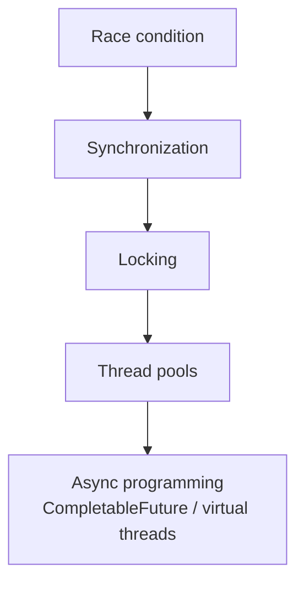

# Concurrency & Multithreading

A web server is concurrent by nature — every request runs on its own thread sharing
the same objects. The hardest production bugs live here: race conditions, deadlocks,
and visibility issues. This is a top interview differentiator.

<ProgressTracker id="concurrency-overview" />

## Table of Contents

- [Process vs thread](#process-vs-thread)
- [Creating threads](#creating-threads)
- [The concurrency ladder](#the-concurrency-ladder)
- [Executors & thread pools](#executors--thread-pools)
- [Runnable, Callable, Future](#runnable-callable-future)
- [Shared state problems](#shared-state-problems)
- [Topics in this section](#topics-in-this-section)
- [Most Asked Interview Questions](#most-asked-interview-questions)
- [Things You Should Know](#things-you-should-know)

## Process vs thread

- A **process** has its own memory space; processes are isolated.
- A **thread** is a unit of execution *within* a process; threads share the
  process's heap. That sharing is what makes them powerful and dangerous.

## Creating threads

```java
// 1. Runnable (preferred over extending Thread)
Thread t = new Thread(() -> System.out.println("hello"));
t.start();

// 2. ExecutorService (preferred in real code — don't manage threads by hand)
ExecutorService pool = Executors.newFixedThreadPool(8);
pool.submit(() -> doWork());
```

<Warning>
`t.run()` executes on the current thread. Only `t.start()` spawns a new one. And in
backend code you almost never create raw `Thread`s — use an `ExecutorService`.
</Warning>

## The concurrency ladder



Each rung solves the problem the previous one exposed: uncontrolled shared state →
mutual exclusion → richer locks → managed execution → non-blocking composition.

## Executors & thread pools

Creating a thread per task doesn't scale — thread creation is expensive and
unbounded threads exhaust memory. A **thread pool** reuses a fixed set of workers
fed by a queue.

```java
ExecutorService pool = new ThreadPoolExecutor(
    4,                                   // core pool size
    8,                                   // max pool size
    60, TimeUnit.SECONDS,                // idle keep-alive
    new LinkedBlockingQueue<>(1000),     // bounded work queue
    new ThreadPoolExecutor.CallerRunsPolicy());  // backpressure when full
```

<Tip>
Always bound the queue and choose a rejection policy. An unbounded queue turns a
traffic spike into an `OutOfMemoryError` instead of graceful backpressure.
</Tip>

## Runnable, Callable, Future

- `Runnable` — no result, cannot throw checked exceptions.
- `Callable<T>` — returns a value and may throw.
- `Future<T>` — a handle to a pending result.

```java
Future<BigDecimal> future = pool.submit(() -> priceService.quote(order));
BigDecimal price = future.get(2, TimeUnit.SECONDS);   // blocks with timeout
```

## Shared state problems

```java
class Counter {
    private int count = 0;
    void increment() { count++; }   // NOT atomic: read, add, write
}
```

Two threads calling `increment()` can both read the same value and lose an update —
a **race condition**. Fixes: `synchronized`, `AtomicInteger`, or a lock. See the
deep dive next.

## Topics in this section

<div className="jbm-card-grid">
  <Link className="jbm-card" to="/docs/concurrency/thread-fundamentals">
    <div className="jbm-card__icon">🧵</div>
    <h3>Thread Fundamentals & Lifecycle</h3>
    <p>Process vs thread, lifecycle states, creating threads, interrupts, daemon threads, wait/notify.</p>
  </Link>
  <Link className="jbm-card" to="/docs/concurrency/thread-safety">
    <div className="jbm-card__icon">🔒</div>
    <h3>Thread Safety Deep Dive</h3>
    <p>synchronized, volatile, atomics, locks, deadlocks, concurrent collections.</p>
  </Link>
  <Link className="jbm-card" to="/docs/concurrency/executors-and-thread-pools">
    <div className="jbm-card__icon">🏊</div>
    <h3>Executors & Thread Pools</h3>
    <p>ExecutorService, ThreadPoolExecutor internals, sizing, rejection, scheduling, ForkJoinPool, shutdown.</p>
  </Link>
  <Link className="jbm-card" to="/docs/concurrency/completable-future">
    <div className="jbm-card__icon">🔗</div>
    <h3>CompletableFuture & Async</h3>
    <p>Compose, combine, and handle errors in non-blocking pipelines.</p>
  </Link>
  <Link className="jbm-card" to="/docs/concurrency/virtual-threads">
    <div className="jbm-card__icon">🪶</div>
    <h3>Virtual Threads</h3>
    <p>Platform vs virtual threads, pinning, structured concurrency, Spring Boot.</p>
  </Link>
</div>

## Most Asked Interview Questions

### Beginner
- Process vs thread?
- `Runnable` vs `Callable`?
- Why use a thread pool?

### Intermediate
- `synchronized` vs `volatile`?
- What is a race condition and how do you fix it?
- What is a deadlock and how do you avoid it?

### Advanced
- How does `ConcurrentHashMap` avoid locking the whole map?
- `CompletableFuture` composition and exception handling?
- Virtual threads vs platform threads?

### Coding
- Implement a thread-safe counter three ways (synchronized, AtomicInteger, LongAdder).

## Things You Should Know

### 🔴 Must Know
- Threads share the heap → shared mutable state is dangerous.
- Use `ExecutorService`, not raw threads; bound the queue.
- Race conditions and how to fix them.

### 🟡 Good to Know
- `synchronized` vs `volatile` vs atomics.
- Deadlock conditions and prevention.
- `CompletableFuture` basics.

### 🟢 Nice to Know
- Java Memory Model happens-before.
- Virtual threads and structured concurrency.
