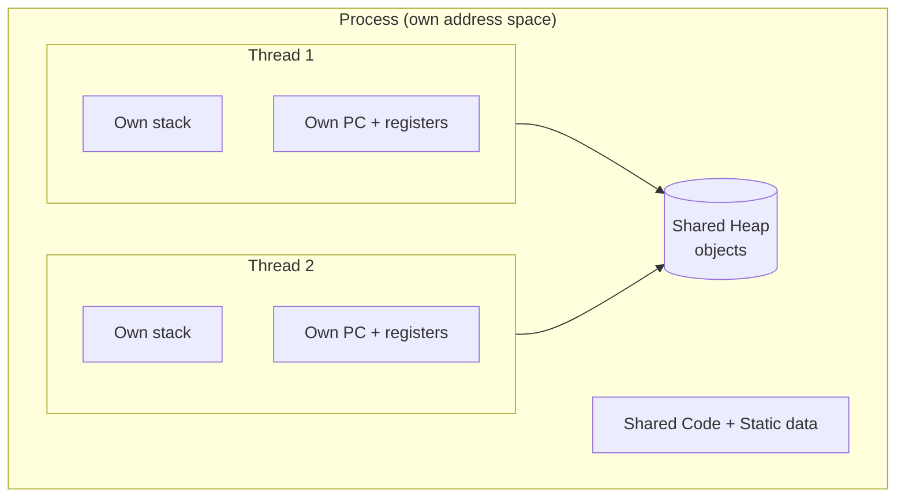
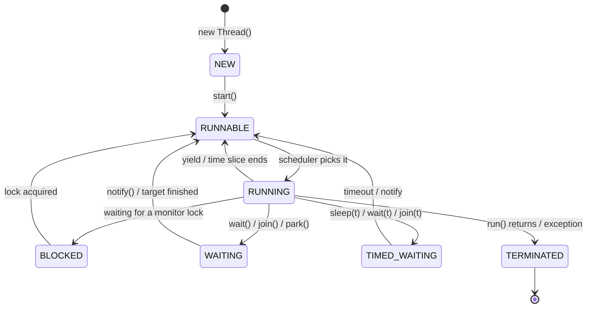

# Thread Fundamentals & Lifecycle

Before executors and `CompletableFuture`, you need the raw material: what a thread
actually is, how it's born, how it moves between states, and how threads coordinate.

<ProgressTracker id="thread-fundamentals" />

## Table of Contents

- [Process vs thread](#process-vs-thread)
- [What a thread owns vs shares](#what-a-thread-owns-vs-shares)
- [Creating threads](#creating-threads)
- [The thread lifecycle](#the-thread-lifecycle)
- [Core thread methods](#core-thread-methods)
- [Interrupting threads](#interrupting-threads)
- [Daemon threads](#daemon-threads)
- [wait / notify coordination](#wait--notify-coordination)
- [Common mistakes](#common-mistakes)
- [Interview questions](#interview-questions)
- [Things You Should Know](#things-you-should-know)

## Process vs thread

A **process** is an independent program in execution with its own isolated memory
space. A **thread** is a lightweight unit of execution **inside** a process; all
threads of a process share that process's heap and code.



| | Process | Thread |
| --- | --- | --- |
| Memory | Own isolated address space | Shares process heap |
| Communication | IPC (pipes, sockets) — expensive | Shared memory — cheap but dangerous |
| Creation cost | Heavy | Light (platform threads still ~1MB stack) |
| Crash impact | Isolated | A crash/uncaught error can affect the process |
| Context switch | Expensive | Cheaper |

<Important>
The single most important fact: **threads share the heap**. That sharing is what makes
threads efficient (no copying) and what makes concurrency dangerous — two threads
touching the same object need synchronization. This is the root of every race
condition. See [Thread Safety](/docs/concurrency/thread-safety/).
</Important>

## What a thread owns vs shares

- **Per-thread (private):** the **stack** (method frames, local variables, references),
  the **program counter**, and thread-local storage (`ThreadLocal`).
- **Shared across threads:** the **heap** (all objects), static fields, class metadata.

<Interview>
"Where do local variables live vs objects?" Locals and references live on each
thread's own stack (inherently thread-safe). The objects they point to live on the
shared heap (need synchronization if mutated by multiple threads).
</Interview>

## Creating threads

There are three idiomatic ways; in real backend code you almost always use an
`ExecutorService` rather than raw `Thread`.

```java
// 1. Implement Runnable (preferred over extending Thread — no result)
Runnable task = () -> System.out.println("running on " + Thread.currentThread().getName());
Thread t1 = new Thread(task);
t1.start();          // spawns a new thread and calls run() on it

// 2. Extend Thread (rarely — you give up the ability to extend anything else)
class Worker extends Thread {
    public void run() { doWork(); }
}
new Worker().start();

// 3. Callable + ExecutorService (returns a value, can throw) — the real-world choice
ExecutorService pool = Executors.newFixedThreadPool(4);
Future<Integer> f = pool.submit(() -> compute());   // Callable<Integer>
Integer result = f.get();
```

<Warning>
Call **`start()`**, not `run()`. `t.run()` just executes the method on the **current**
thread — no new thread is created. `start()` is what asks the JVM/OS to schedule a new
thread that then invokes `run()`.
</Warning>

<Tip>
Prefer `Runnable`/`Callable` over extending `Thread`: Java has single inheritance, so
extending `Thread` wastes your one superclass slot and couples the task to the thread.
Separate **what to do** (task) from **how it runs** (thread/pool).
</Tip>

## The thread lifecycle

A Java thread moves through six states (`Thread.State` enum):



| State | Meaning |
| --- | --- |
| **NEW** | Created but `start()` not yet called |
| **RUNNABLE** | Eligible to run (running or ready, waiting for CPU) |
| **BLOCKED** | Waiting to acquire a monitor lock (`synchronized`) |
| **WAITING** | Waiting indefinitely (`wait()`, `join()`, `LockSupport.park()`) |
| **TIMED_WAITING** | Waiting with a timeout (`sleep(ms)`, `wait(ms)`, `join(ms)`) |
| **TERMINATED** | `run()` completed or threw |

<Note>
Java collapses "ready" and "running" into a single **RUNNABLE** state — the OS
scheduler decides which RUNNABLE thread actually holds a CPU core at any instant.
</Note>

## Core thread methods

```java
Thread t = new Thread(task, "worker-1");
t.start();                 // begin execution
t.join();                  // caller waits until t finishes
t.join(1000);              // wait at most 1s

Thread.sleep(500);         // current thread sleeps 500ms (keeps held locks!)
Thread.yield();            // hint: willing to give up the CPU (advisory)
Thread.currentThread();    // reference to the running thread
t.setPriority(Thread.MAX_PRIORITY);  // 1..10 hint, OS may ignore
```

<Warning>
`Thread.sleep()` does **not** release any locks the thread holds — a sleeping thread
inside a `synchronized` block still blocks everyone else. `Object.wait()` **does**
release the lock. This distinction is a classic interview trap.
</Warning>

## Interrupting threads

Java has **cooperative** interruption — you can't forcibly kill a thread (the
deprecated `stop()` is dangerous). You *request* it to stop by setting its interrupt
flag; the thread must check and honor it.

```java
Thread worker = new Thread(() -> {
    while (!Thread.currentThread().isInterrupted()) {
        try {
            doChunkOfWork();
            Thread.sleep(100);
        } catch (InterruptedException e) {
            Thread.currentThread().interrupt();  // restore the flag, then exit
            break;
        }
    }
});
worker.start();
worker.interrupt();   // request cancellation
```

<Important>
When you catch `InterruptedException`, **restore the interrupt status** with
`Thread.currentThread().interrupt()` (or propagate the exception). Swallowing it
silently hides cancellation from the rest of the stack — a real production bug.
</Important>

## Daemon threads

A **daemon** thread is a background thread (GC, timers) that does **not** keep the JVM
alive. When all non-daemon (user) threads finish, the JVM exits and abandons daemon
threads.

```java
Thread t = new Thread(this::backgroundCleanup);
t.setDaemon(true);   // must be set BEFORE start()
t.start();
```

<Warning>
Don't run critical work (writing files, flushing data) on a daemon thread — the JVM
can terminate it mid-operation without cleanup.
</Warning>

## wait / notify coordination

Low-level thread coordination on a shared monitor. A thread `wait()`s (releasing the
lock) until another thread `notify()`s. **Always** wait in a loop that rechecks the
condition (guards against spurious wakeups and lost signals).

```java
class BoundedBuffer<T> {
    private final Queue<T> queue = new LinkedList<>();
    private final int capacity;
    BoundedBuffer(int capacity) { this.capacity = capacity; }

    public synchronized void put(T item) throws InterruptedException {
        while (queue.size() == capacity) {   // WHILE, not if
            wait();                           // releases the lock, parks the thread
        }
        queue.add(item);
        notifyAll();                          // wake consumers
    }

    public synchronized T take() throws InterruptedException {
        while (queue.isEmpty()) {
            wait();
        }
        T item = queue.remove();
        notifyAll();                          // wake producers
        return item;
    }
}
```

<Tip>
In practice, don't hand-roll `wait`/`notify` — use higher-level tools:
`BlockingQueue` for producer/consumer, `CountDownLatch`/`CyclicBarrier`/`Semaphore` for
coordination, and `ExecutorService` for task execution. `wait`/`notify` is what those
are built on and a common interview topic.
</Tip>

## Common mistakes

<Warning>
- Calling `run()` instead of `start()` (no new thread).
- Using `if` instead of `while` around `wait()` (spurious wakeups).
- Forgetting that `sleep()` holds locks but `wait()` releases them.
- Swallowing `InterruptedException` without restoring the flag.
- Managing raw threads instead of an `ExecutorService` (unbounded thread creation → OOM).
- Running essential work on daemon threads.
</Warning>

## Interview questions

**Q: Process vs thread?**
A process has an isolated address space; a thread runs inside a process and shares its
heap. Threads are cheaper to create and switch but require synchronization for shared
state.

**Q: `start()` vs `run()`?**
`start()` schedules a new thread that invokes `run()`. Calling `run()` directly runs it
synchronously on the current thread.

**Q: What are the thread states?**
NEW, RUNNABLE, BLOCKED, WAITING, TIMED_WAITING, TERMINATED.

**Q: `sleep()` vs `wait()`?**
`sleep()` pauses the thread and keeps held locks; `wait()` releases the monitor lock and
waits for `notify()`. `wait/notify` must be called inside `synchronized`.

**Q: How do you stop a thread?**
Cooperatively, via `interrupt()` plus a checked flag — never `stop()`.

**Q: What is a daemon thread?**
A background thread that doesn't prevent JVM shutdown.

## Things You Should Know

### 🔴 Must Know
- Process vs thread; threads share the heap, own their stack.
- `start()` vs `run()`; the six lifecycle states.
- `sleep()` keeps locks, `wait()` releases them; wait in a `while` loop.
- Cooperative interruption; restore the interrupt flag.

### 🟡 Good to Know
- Daemon vs user threads and JVM shutdown.
- `join()`, `yield()`, priorities (advisory).
- Producer/consumer with `wait`/`notify` and its higher-level replacements.

### 🟢 Nice to Know
- Thread priorities are OS-dependent hints.
- `ThreadLocal` for per-thread state (and leaks in pools).
- Why `Thread.stop()`/`suspend()` were deprecated.
