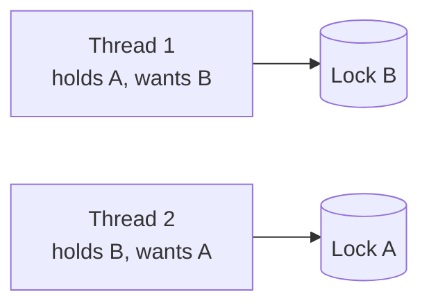

# Thread Safety Deep Dive

<ProgressTracker id="thread-safety" />

## Table of Contents

- [Race conditions](#race-conditions)
- [synchronized](#synchronized)
- [volatile](#volatile)
- [Atomic classes](#atomic-classes)
- [Locks](#locks)
- [Deadlocks](#deadlocks)
- [Concurrent collections](#concurrent-collections)
- [CompletableFuture](#completablefuture)
- [Interview questions](#interview-questions)
- [Things You Should Know](#things-you-should-know)

## Race conditions

A race condition occurs when the result depends on the timing of unsynchronized
threads accessing shared mutable state.

```java
count++;   // 3 steps: read count, add 1, write back — interleavable
```

Three fixes, in order of preference for simple counters:

```java
private final AtomicInteger count = new AtomicInteger();   // 1. lock-free
count.incrementAndGet();

private int c = 0;
synchronized void inc() { c++; }                            // 2. mutual exclusion
```

## synchronized

`synchronized` gives mutual exclusion **and** visibility: only one thread holds the
monitor at a time, and changes are flushed to main memory on release.

```java
class BankAccount {
    private BigDecimal balance = BigDecimal.ZERO;

    public synchronized void deposit(BigDecimal amt) {   // locks on 'this'
        balance = balance.add(amt);
    }

    private final Object lock = new Object();
    public void withdraw(BigDecimal amt) {
        synchronized (lock) {          // lock on a private object (safer)
            balance = balance.subtract(amt);
        }
    }
}
```

## volatile

`volatile` guarantees **visibility** (reads/writes go to main memory) but **not
atomicity**. Use it for flags, not compound updates.

```java
private volatile boolean running = true;   // visible to all threads immediately
public void stop() { running = false; }
public void loop() { while (running) { ... } }   // sees the change promptly
```

<Important>
`volatile` does **not** make `count++` safe — that's a compound read-modify-write.
Use `volatile` for a simple published flag; use atomics or `synchronized` for
compound operations.
</Important>

## Atomic classes

`AtomicInteger`, `AtomicLong`, `AtomicReference`, and `LongAdder` provide lock-free
atomic operations via CPU compare-and-swap (CAS).

```java
AtomicReference<Status> status = new AtomicReference<>(Status.NEW);
status.compareAndSet(Status.NEW, Status.PROCESSING);   // only if still NEW

LongAdder requests = new LongAdder();   // better than AtomicLong under high contention
requests.increment();
```

## Locks

`ReentrantLock` is a flexible alternative to `synchronized`: try-lock with timeout,
interruptible, and fair ordering. `ReadWriteLock` allows many readers or one writer.

```java
private final ReentrantLock lock = new ReentrantLock();
public void update() {
    if (lock.tryLock(1, TimeUnit.SECONDS)) {   // avoids indefinite blocking
        try { /* critical section */ }
        finally { lock.unlock(); }             // ALWAYS unlock in finally
    }
}
```

## Deadlocks

Two threads each hold a lock the other needs, forever.



**Prevention:** always acquire locks in a consistent global order, use `tryLock`
with timeouts, and keep critical sections small.

## Concurrent collections

| Need | Use |
| --- | --- |
| Shared map | `ConcurrentHashMap` |
| Shared queue between producers/consumers | `LinkedBlockingQueue`, `ArrayBlockingQueue` |
| Copy-on-write list (read-heavy) | `CopyOnWriteArrayList` |
| Counter under contention | `LongAdder` |

<Warning>
`Collections.synchronizedMap` locks the whole map per operation and still needs
external synchronization for compound actions (check-then-put). Prefer
`ConcurrentHashMap` with atomic methods like `computeIfAbsent`.
</Warning>

## CompletableFuture

Compose asynchronous work without blocking, with built-in error handling.

```java
CompletableFuture<Quote> quote = CompletableFuture.supplyAsync(() -> priceService.quote(order), pool);
CompletableFuture<Stock> stock = CompletableFuture.supplyAsync(() -> inventory.check(order), pool);

CompletableFuture<Confirmation> result = quote
    .thenCombine(stock, (q, s) -> confirm(q, s))     // run both, then combine
    .thenApply(this::persist)
    .exceptionally(ex -> {                            // handle failures
        log.error("checkout failed", ex);
        return Confirmation.failed();
    });
```

<Backend>
Use `CompletableFuture` to fan out independent calls (pricing + inventory +
fraud-check) concurrently and combine the results, cutting latency from the sum of
calls to the slowest one. Always run them on a **bounded, dedicated executor**, not
the common ForkJoinPool, to isolate failures and control capacity.
</Backend>

## Interview questions

**Q: `synchronized` vs `volatile`?**
`synchronized` provides mutual exclusion + visibility (atomic compound ops).
`volatile` provides visibility only — good for flags, not for `count++`.

**Q: How do you prevent deadlocks?**
Consistent lock ordering, lock timeouts (`tryLock`), and minimal critical sections.

**Q: `AtomicInteger` vs `synchronized` counter?**
`AtomicInteger` uses lock-free CAS — usually faster under moderate contention;
`LongAdder` scales better under very high contention.

## Things You Should Know

### 🔴 Must Know
- Race conditions and three fixes.
- `synchronized` = exclusion + visibility; `volatile` = visibility only.
- Always `unlock()` in `finally`.

### 🟡 Good to Know
- Deadlock prevention via lock ordering.
- `ConcurrentHashMap.computeIfAbsent`, `LongAdder`.
- `CompletableFuture` composition + `exceptionally`.

### 🟢 Nice to Know
- CAS and the ABA problem.
- Happens-before and the Java Memory Model.
