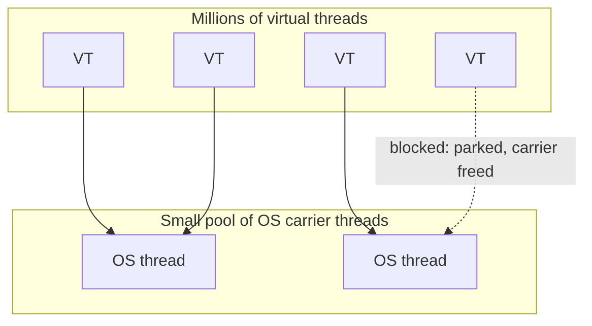

# Virtual Threads & Structured Concurrency

Virtual threads (Project Loom, stable in **Java 21**) are the biggest change to Java
concurrency in a decade. They make the simple "thread-per-request, blocking code"
model scale to millions of concurrent tasks — reclaiming readability from callback and
`CompletableFuture` chains.

<ProgressTracker id="virtual-threads" />

## Table of Contents

- [The problem they solve](#the-problem-they-solve)
- [Platform vs virtual threads](#platform-vs-virtual-threads)
- [How they work](#how-they-work)
- [Using virtual threads](#using-virtual-threads)
- [Pinning: the main pitfall](#pinning-the-main-pitfall)
- [Structured concurrency](#structured-concurrency)
- [Spring Boot enablement](#spring-boot-enablement)
- [When to use them](#when-to-use-them)
- [Interview questions](#interview-questions)
- [Things You Should Know](#things-you-should-know)

## The problem they solve

A platform (OS) thread is expensive — ~1MB of stack and a kernel resource — so you
can only run a few thousand. For an I/O-bound server that means either a limited
thread-per-request model or complex async code to avoid blocking threads.

<Important>
Virtual threads flip this: they're so cheap you can create **millions**. A virtual
thread that blocks on I/O simply **parks** and frees its underlying OS thread for other
work. So you write plain, blocking, sequential code — and it scales like async code.
</Important>

## Platform vs virtual threads

| | Platform thread | Virtual thread |
| --- | --- | --- |
| Backed by | One OS thread | Scheduled onto a small pool of OS "carrier" threads |
| Cost | ~1MB stack, kernel-managed | ~few hundred bytes, JVM-managed |
| How many | Thousands | Millions |
| Blocking I/O | Wastes the OS thread | Parks, frees the carrier |
| Best for | CPU-bound work | I/O-bound work (most web backends) |



## How they work

The JVM mounts a virtual thread onto a **carrier** (platform) thread to run. When the
virtual thread hits a blocking operation (socket read, JDBC call, `sleep`), the JVM
**unmounts** it, saving its stack, and lets the carrier run another virtual thread.
When the I/O completes, the virtual thread is rescheduled. All of this is transparent —
your code just looks like normal blocking code.

## Using virtual threads

```java
// Start one virtual thread
Thread.startVirtualThread(() -> handle(request));

// One virtual thread PER task — the recommended executor for I/O work
try (var executor = Executors.newVirtualThreadPerTaskExecutor()) {
    for (var task : tasks) {
        executor.submit(() -> callDownstreamService(task));  // blocking is fine & cheap
    }
}   // try-with-resources awaits all tasks
```

<Warning>
Do **not** pool virtual threads. They're not a scarce resource — the whole point is to
create one per task. `newVirtualThreadPerTaskExecutor()` is not a bounded pool; if you
need to limit concurrency (e.g. to protect a downstream), use a `Semaphore`, not a
small thread pool.
</Warning>

## Pinning: the main pitfall

<Warning>
A virtual thread that blocks **inside a `synchronized` block** (or in a native call)
becomes **pinned** — it can't unmount, so it holds its carrier OS thread while blocked,
defeating the benefit. If enough virtual threads pin at once, you can starve carriers.
**Fix:** replace `synchronized` around blocking I/O with a `ReentrantLock`, which does
not pin. (Recent JDKs are progressively removing pinning, but design for it now.)
</Warning>

```java
// Pins the carrier while doing I/O under synchronized
synchronized (lock) { result = jdbcCall(); }   // avoid

// Does not pin
lock.lock();
try { result = jdbcCall(); }
finally { lock.unlock(); }
```

## Structured concurrency

Structured concurrency (preview) treats a group of related subtasks as a single unit:
they're spawned together, and the scope waits for all of them, propagating errors and
cancellation cleanly — no leaked threads.

```java
try (var scope = new StructuredTaskScope.ShutdownOnFailure()) {
    Subtask<Quote> quote = scope.fork(() -> pricing.quote(order));
    Subtask<Stock> stock = scope.fork(() -> inventory.check(order));

    scope.join();            // wait for both
    scope.throwIfFailed();   // if either failed, cancel the other + throw

    return new Checkout(quote.get(), stock.get());
}   // both subtasks guaranteed complete or cancelled at scope exit
```

<Tip>
Structured concurrency is the modern replacement for hand-rolled `CompletableFuture`
fan-out: if one branch fails, the others are cancelled automatically, and nothing
leaks. Pair it with virtual threads for readable, safe parallel I/O.
</Tip>

## Spring Boot enablement

Spring Boot 3.2+ can run web requests and `@Async`/executors on virtual threads with a
single property:

```yaml
spring:
  threads:
    virtual:
      enabled: true
```

<Backend>
With this on, Tomcat serves each request on a virtual thread, so blocking JDBC/HTTP
calls no longer tie up scarce OS threads — the classic thread-per-request model scales
to very high concurrency without switching to reactive/WebFlux. Audit hot paths for
`synchronized`-around-I/O pinning before enabling in production.
</Backend>

## When to use them

- ✅ **I/O-bound** services: lots of DB queries, downstream HTTP calls, blocking waits.
- ✅ Simplifying existing blocking code that needs higher concurrency.
- ❌ **CPU-bound** work: virtual threads don't add compute; use a sized platform-thread
  pool or ForkJoinPool.
- ❌ As a pooled resource — create one per task instead.

## Interview questions

**Q: Platform vs virtual thread?**
A platform thread maps 1:1 to an OS thread (expensive, thousands max). A virtual thread
is JVM-scheduled onto carrier OS threads (cheap, millions); it parks on blocking I/O and
frees its carrier.

**Q: How do virtual threads help a web backend?**
They make thread-per-request with blocking calls scale to huge concurrency without
reactive complexity, because blocked virtual threads don't consume OS threads.

**Q: What is pinning?**
A virtual thread blocked inside `synchronized`/native code can't unmount, holding its
carrier. Avoid by using `ReentrantLock` around blocking I/O.

**Q: Should you pool virtual threads?**
No — create one per task. Use a `Semaphore` to bound concurrency if needed.

**Q: When are virtual threads the wrong tool?**
CPU-bound work — they add no compute capacity.

## Things You Should Know

### 🔴 Must Know
- Virtual threads are cheap, JVM-scheduled, and park on blocking I/O.
- One virtual thread per task; don't pool them.
- Great for I/O-bound, not CPU-bound work.

### 🟡 Good to Know
- Pinning under `synchronized`; use `ReentrantLock` for blocking sections.
- `spring.threads.virtual.enabled=true` in Spring Boot 3.2+.

### 🟢 Nice to Know
- Structured concurrency (`StructuredTaskScope`) for safe fan-out.
- Carrier-thread scheduler tuning.
