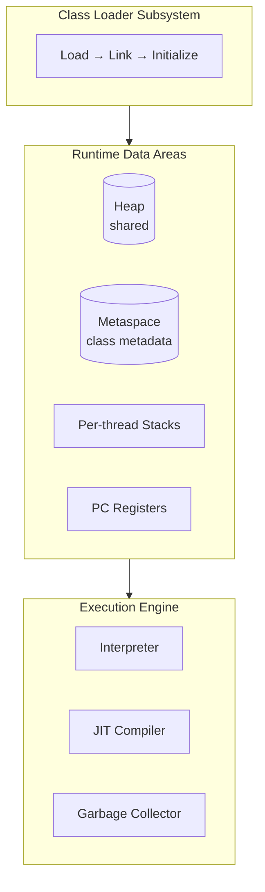
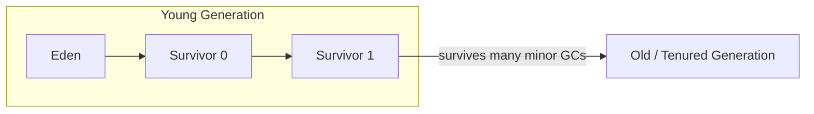
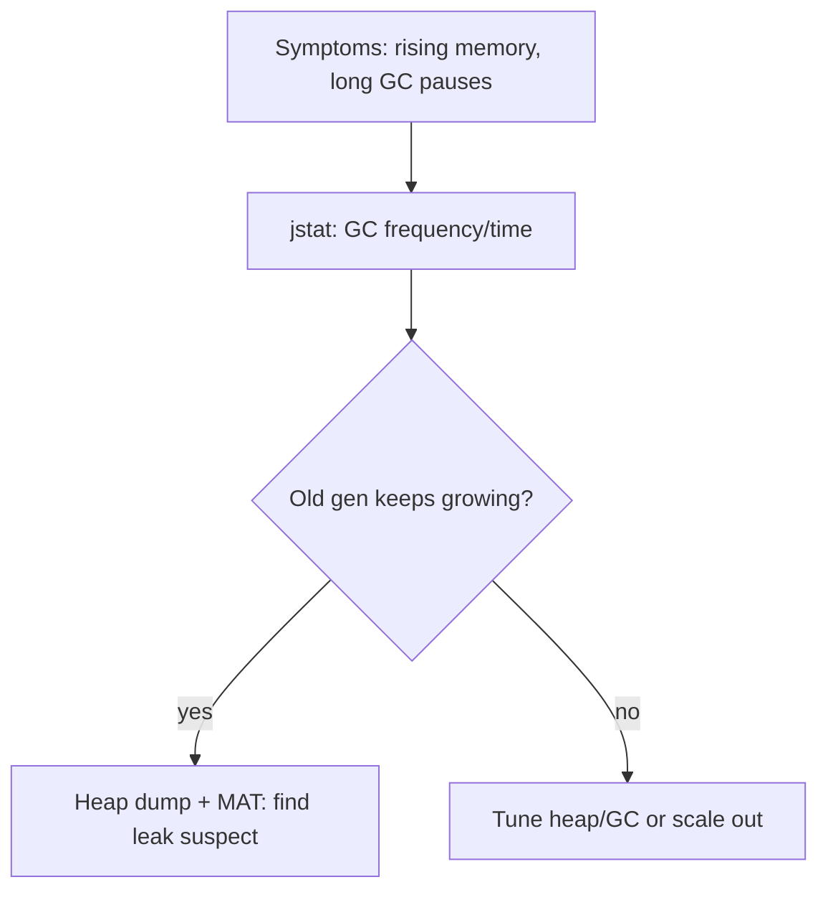

# JVM Internals

You don't need to write a JVM, but you must diagnose one. When a service OOMs at
3am, understanding heap, GC, and generations is the difference between a fix and a
guess.

<ProgressTracker id="jvm-overview" />

## Table of Contents

- [Architecture](#architecture)
- [Memory areas](#memory-areas)
- [Object lifecycle & generations](#object-lifecycle--generations)
- [Garbage collection](#garbage-collection)
- [GC algorithms](#gc-algorithms)
- [Memory leaks & errors](#memory-leaks--errors)
- [Diagnosing production problems](#diagnosing-production-problems)
- [Most Asked Interview Questions](#most-asked-interview-questions)
- [Things You Should Know](#things-you-should-know)

## Architecture



## Memory areas

| Area | Shared? | Holds | Errors |
| --- | --- | --- | --- |
| **Heap** | Yes | All objects, arrays | `OutOfMemoryError: Java heap space` |
| **Stack** | Per-thread | Frames: locals, partial results, references | `StackOverflowError` |
| **Metaspace** | Yes | Class metadata (native memory, replaced PermGen in Java 8) | `OutOfMemoryError: Metaspace` |
| **PC register** | Per-thread | Address of current instruction | — |
| **String pool** | Yes (in heap) | Interned strings | — |

<Interview>
"Stack vs heap?" Stack is per-thread and stores primitives, local variables, and
object *references*; it's reclaimed automatically when a method returns. Heap is
shared and stores the *objects* themselves; it's reclaimed by the garbage collector.
</Interview>

## Object lifecycle & generations

The heap is split into generations based on the **weak generational hypothesis**:
most objects die young.



1. New objects allocate in **Eden**.
2. A **Minor GC** copies survivors between survivor spaces, aging them.
3. Objects that survive enough cycles are **promoted** to the **Old** generation.
4. A **Major/Full GC** collects the Old generation — rarer but more expensive.

## Garbage collection

GC reclaims objects that are no longer **reachable** from GC roots (stack
variables, static fields, active threads). Java uses tracing collectors
(mark-sweep-compact), not reference counting, so it handles cycles.

- **Minor GC** — collects Young gen; frequent, fast, short pauses.
- **Major / Full GC** — collects Old gen (and often the whole heap); infrequent,
  longer "stop-the-world" pauses.

## GC algorithms

| Collector | Best for | Notes |
| --- | --- | --- |
| **Serial** | Small heaps, single core | Simple, stop-the-world |
| **Parallel** | Throughput batch jobs | Multi-threaded young/old collection |
| **G1** (default) | Balanced latency/throughput | Region-based, predictable pause targets |
| **ZGC / Shenandoah** | Very large heaps, low pause | Concurrent, sub-millisecond pauses |

```bash
# Common flags
-Xms2g -Xmx2g                 # fixed heap (avoids resize pauses)
-XX:+UseG1GC                  # select G1
-XX:MaxGCPauseMillis=200      # pause-time goal for G1
-Xss512k                      # per-thread stack size
```

<Tip>
Set `-Xms` equal to `-Xmx` in containers to avoid heap-resize pauses, and set the
heap based on the container memory limit (or use `-XX:MaxRAMPercentage`).
</Tip>

## Memory leaks & errors

Java has GC, but you can still leak by keeping references alive:

<Warning>
Common Java memory leaks:
- **Unbounded caches** (a `HashMap` that only grows). Use an eviction policy or Caffeine.
- **Static collections** holding request-scoped data.
- **Unremoved listeners/callbacks** keeping objects reachable.
- **`ThreadLocal`s not cleared** in thread-pool threads.
</Warning>

- `OutOfMemoryError: Java heap space` — live objects exceed max heap (leak or
  undersized heap).
- `StackOverflowError` — usually unbounded/infinite recursion.
- `OutOfMemoryError: Metaspace` — too many loaded classes (e.g. classloader leaks
  from repeated redeploys).

## Diagnosing production problems

```bash
jps                          # find the Java PID
jstat -gcutil <pid> 1000     # live GC stats every 1s
jmap -histo:live <pid>       # histogram of live objects (what's filling the heap)
jcmd <pid> GC.heap_dump /tmp/heap.hprof   # capture a heap dump
# Analyze the .hprof in Eclipse MAT or VisualVM to find the dominator tree
```



<Backend>
Enable an automatic heap dump on OOM so you can analyze the actual failure:
`-XX:+HeapDumpOnOutOfMemoryError -XX:HeapDumpPath=/dumps`. In Kubernetes, set the
JVM heap relative to the pod memory limit or the pod gets OOM-killed by the kernel
before the JVM can react.
</Backend>

## Most Asked Interview Questions

### Beginner
- Stack vs heap?
- What is garbage collection?

### Intermediate
- What are Young and Old generations?
- Minor GC vs Full GC?
- What causes a memory leak in a GC'd language?

### Advanced
- How does G1 GC work and when would you choose ZGC?
- How do you diagnose an OOM in production?
- What is Metaspace and how does it differ from the old PermGen?

### Coding
- Write code that causes a `StackOverflowError` and one that leaks the heap.

## Things You Should Know

### 🔴 Must Know
- Heap (objects, shared) vs Stack (frames, per-thread).
- Young/Old generations; Minor vs Full GC.
- Common leak sources and the OOM error types.

### 🟡 Good to Know
- G1 as the default collector and key flags.
- Heap dump + `jstat`/`jmap` workflow.

### 🟢 Nice to Know
- ZGC/Shenandoah for low-pause, large heaps.
- Escape analysis and JIT optimizations.
