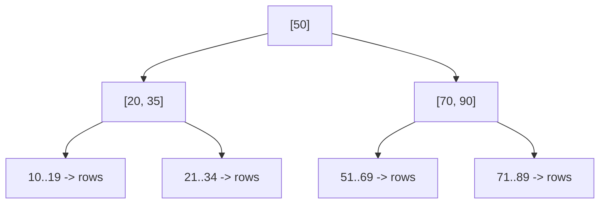

# Indexing Deep Dive

Indexes are the number-one lever for query performance. Most "the app is slow" tickets
are a missing or misused index. This page explains how they work and how to design them.

<ProgressTracker id="db-indexing" />

## Table of Contents

- [Why indexes](#why-indexes)
- [B-tree indexes](#b-tree-indexes)
- [Composite indexes & leftmost prefix](#composite-indexes--leftmost-prefix)
- [Covering indexes](#covering-indexes)
- [Unique & partial indexes](#unique--partial-indexes)
- [Reading EXPLAIN](#reading-explain)
- [When indexes hurt](#when-indexes-hurt)
- [Common mistakes](#common-mistakes)
- [Interview questions](#interview-questions)
- [Things You Should Know](#things-you-should-know)

## Why indexes

Without an index, finding rows means a **full table scan** — read every row, O(n). An
index is a sorted structure that lets the database jump straight to matching rows,
turning O(n) into O(log n).

```sql
CREATE INDEX idx_orders_customer ON orders(customer_id);
-- WHERE customer_id = 42  now uses an index seek instead of scanning the whole table
```

## B-tree indexes

The default index type is a **balanced B-tree**: sorted keys with pointers to rows.
Because it's sorted, it accelerates equality, range, ordering, and prefix queries.



<Important>
A B-tree index helps with `=`, `<`, `>`, `BETWEEN`, `ORDER BY`, and `LIKE 'prefix%'`
(because the tree is sorted). It does **not** help with `LIKE '%suffix'` (leading
wildcard) or a function applied to the column (`WHERE lower(email) = ...`) unless you
create a matching functional index.
</Important>

## Composite indexes & leftmost prefix

A composite index on `(a, b, c)` is sorted by `a`, then `b`, then `c`.

```sql
CREATE INDEX idx_orders_cust_status_date ON orders(customer_id, status, created_at);
```

<Important>
**Leftmost-prefix rule:** the index serves queries that filter on a **left prefix** of
its columns:
- `WHERE customer_id = ?` ✅
- `WHERE customer_id = ? AND status = ?` ✅
- `WHERE customer_id = ? AND status = ? AND created_at > ?` ✅
- `WHERE status = ?` ❌ (skips the leftmost column)
- `WHERE customer_id = ? AND created_at > ?` ⚠️ (uses only the `customer_id` part)

Order columns by: equality filters first, then the range/sort column last.
</Important>

## Covering indexes

If an index contains **all** columns a query needs, the database answers from the index
alone — an **index-only scan**, never touching the table.

```sql
-- Query: SELECT status, created_at FROM orders WHERE customer_id = 42
CREATE INDEX idx_cover ON orders(customer_id, status, created_at);
-- All selected + filtered columns are in the index -> index-only scan (very fast)
```

<Tip>
A covering index eliminates the extra "go fetch the row" step. Great for hot read paths,
but wider indexes cost more storage and slow writes — cover only your most important
queries.
</Tip>

## Unique & partial indexes

```sql
-- Unique index: enforces uniqueness AND speeds lookups
CREATE UNIQUE INDEX uq_users_email ON users(email);

-- Partial index (Postgres): index only the rows you query
CREATE INDEX idx_active_orders ON orders(customer_id) WHERE status = 'ACTIVE';
```

<Backend>
A unique index is both a **constraint** and a **performance** structure — it stops
duplicate emails even under a race between two concurrent signups (see
[SQL & Databases](/docs/database/#constraints)). Partial indexes keep the index small
when most rows are irrelevant to your queries (e.g. only active/undeleted rows).
</Backend>

## Reading EXPLAIN

`EXPLAIN ANALYZE` shows the actual plan and timings. Learn to spot the red flags.

```sql
EXPLAIN ANALYZE
SELECT * FROM orders WHERE customer_id = 42 AND status = 'PAID';
```

| Plan node | Meaning |
| --- | --- |
| **Seq Scan** | Full table scan — usually a missing index on a big table 🚩 |
| **Index Scan** | Used an index to find rows ✅ |
| **Index Only Scan** | Answered from the index alone (covering) ✅✅ |
| **Bitmap Heap Scan** | Combined multiple indexes |
| high **rows** vs actual | Bad statistics — consider `ANALYZE` |

<Warning>
A `Seq Scan` on a large table in a hot query is the classic performance bug. But a
`Seq Scan` on a **small** table is fine — the planner correctly decides scanning is
cheaper than an index lookup. Always judge with real data volumes.
</Warning>

## When indexes hurt

<Warning>
Indexes are not free:
- Every `INSERT`/`UPDATE`/`DELETE` must update every affected index → slower writes.
- Each index consumes storage and memory.
- Too many overlapping indexes confuse the planner and waste space.
- Low-cardinality columns (e.g. a boolean) rarely benefit from a standalone index.

Index for your **actual** query patterns; drop unused indexes (Postgres:
`pg_stat_user_indexes`).
</Warning>

## Common mistakes

<Warning>
- No index on foreign keys / frequent `WHERE`/`JOIN` columns.
- Composite index column order that ignores the leftmost-prefix rule.
- Function/leading-wildcard queries that can't use the index.
- Over-indexing write-heavy tables.
- Trusting `EXPLAIN` on tiny dev data instead of production-scale volumes.
</Warning>

## Interview questions

**Q: What data structure backs a typical index and why?**
A balanced B-tree — sorted keys give O(log n) lookups and support range/ordering/prefix
queries.

**Q: Explain the leftmost-prefix rule.**
A composite index on `(a,b,c)` serves queries filtering on a left prefix (`a`, `a+b`,
`a+b+c`) but not `b` or `c` alone. Put equality columns first, range/sort column last.

**Q: What is a covering index?**
One that contains every column a query needs, enabling an index-only scan without
reading the table.

**Q: What are the downsides of indexes?**
Slower writes, more storage, and planner overhead — index deliberately for real queries.

## Things You Should Know

### 🔴 Must Know
- B-tree indexes; index the `WHERE`/`JOIN`/`ORDER BY` columns.
- Leftmost-prefix rule for composite indexes.
- Reading `EXPLAIN` (Seq Scan vs Index Scan).

### 🟡 Good to Know
- Covering / index-only scans; unique and partial indexes.
- Why indexes slow writes.

### 🟢 Nice to Know
- Functional indexes; GIN/GiST for full-text/JSON; index bloat and `REINDEX`.
