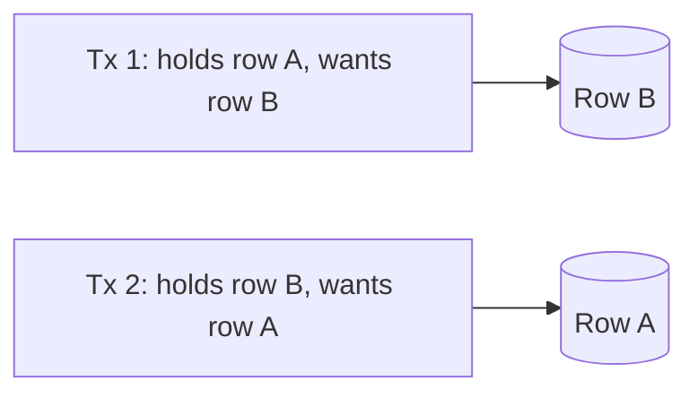

# Transactions & Isolation

A transaction is an all-or-nothing unit of work. **Isolation** decides how much
concurrent transactions can see of each other — the knob that trades correctness against
concurrency, and a favorite interview topic.

<ProgressTracker id="db-transactions" />

## Table of Contents

- [ACID](#acid)
- [The read anomalies](#the-read-anomalies)
- [Isolation levels](#isolation-levels)
- [Choosing a level](#choosing-a-level)
- [Optimistic vs pessimistic locking](#optimistic-vs-pessimistic-locking)
- [Deadlocks](#deadlocks)
- [MVCC in one paragraph](#mvcc-in-one-paragraph)
- [Common mistakes](#common-mistakes)
- [Interview questions](#interview-questions)
- [Things You Should Know](#things-you-should-know)

## ACID

```sql
BEGIN;
UPDATE accounts SET balance = balance - 100 WHERE id = 1;
UPDATE accounts SET balance = balance + 100 WHERE id = 2;
COMMIT;   -- both apply, or ROLLBACK undoes everything
```

- **Atomicity** — all statements commit or none do.
- **Consistency** — constraints hold before and after (no negative balances if a `CHECK` forbids it).
- **Isolation** — concurrent transactions don't corrupt each other's view.
- **Durability** — once committed, data survives a crash (written to durable storage).

## The read anomalies

Isolation levels are defined by which of these they prevent:

| Anomaly | What happens |
| --- | --- |
| **Dirty read** | You read another transaction's **uncommitted** change (which may roll back). |
| **Non-repeatable read** | You read a row twice in one transaction and get **different** values (another tx updated + committed in between). |
| **Phantom read** | You run the same range query twice and **new rows appear** (another tx inserted matching rows). |
| **Lost update** | Two transactions read-modify-write the same row; one overwrite is silently lost. |

## Isolation levels

Higher levels prevent more anomalies but reduce concurrency.

| Level | Dirty read | Non-repeatable | Phantom |
| --- | :---: | :---: | :---: |
| READ UNCOMMITTED | possible | possible | possible |
| READ COMMITTED | ❌ prevented | possible | possible |
| REPEATABLE READ | ❌ | ❌ prevented | possible* |
| SERIALIZABLE | ❌ | ❌ | ❌ prevented |

\*PostgreSQL's REPEATABLE READ (snapshot isolation) actually prevents phantoms too.

```java
// Spring: set the level per transaction when the default isn't enough
@Transactional(isolation = Isolation.REPEATABLE_READ)
public void generateStatement(Long accountId) { ... }
```

<Important>
Know your database's **default**: PostgreSQL and Oracle default to **READ COMMITTED**;
MySQL/InnoDB defaults to **REPEATABLE READ**. Under READ COMMITTED, two reads in the same
transaction can see different committed data — fine for most web requests, a problem for
multi-read reports that need a stable snapshot.
</Important>

## Choosing a level

- **READ COMMITTED** — the pragmatic default for OLTP web apps: no dirty reads, high
  concurrency.
- **REPEATABLE READ / snapshot** — reports and multi-step reads that need a consistent
  view of the data for the whole transaction.
- **SERIALIZABLE** — strongest correctness (transactions behave as if run one at a time),
  but the highest contention and risk of serialization failures you must retry.

## Optimistic vs pessimistic locking

Two strategies to prevent lost updates on concurrently-edited rows.

**Optimistic** — assume conflicts are rare; detect them at write time with a version
column. Best for low-contention web apps.

```java
@Entity
public class Product {
    @Id private Long id;
    @Version private long version;   // JPA bumps this on every update
    private int stock;
}
// If another tx updated the row since you read it, commit throws
// OptimisticLockException -> catch and retry or surface a 409 Conflict.
```

**Pessimistic** — lock the row up front so no one else can change it. Best for genuine
hot rows (inventory decrement, seat booking).

```java
@Lock(LockModeType.PESSIMISTIC_WRITE)   // SELECT ... FOR UPDATE
@Query("SELECT p FROM Product p WHERE p.id = :id")
Product findForUpdate(@Param("id") Long id);
```

<Tip>
Default to **optimistic** locking — it's cheaper and scales because it holds no locks
while the user thinks. Use **pessimistic** only for short, contended critical sections
where retries would be wasteful (decrementing scarce stock). See
[JPA locking](/docs/spring-data-jpa/).
</Tip>

## Deadlocks

Two transactions each hold a lock the other needs — neither can proceed.



<Warning>
The database detects deadlocks and kills one transaction with a deadlock error — your app
must **catch and retry** it. **Prevention:** always acquire locks in a **consistent order**
(e.g. always lock the lower account id first), keep transactions short, and touch as few
rows as possible.
</Warning>

## MVCC in one paragraph

Postgres and InnoDB use **Multi-Version Concurrency Control**: writers create new row
versions instead of overwriting, so **readers never block writers and writers never block
readers**. Each transaction sees a consistent snapshot as of its start (or statement).
This is why READ COMMITTED reads don't wait on in-flight writes — they read the last
committed version.

## Common mistakes

<Warning>
- Assuming SERIALIZABLE everywhere "to be safe" — it kills concurrency and needs retry logic.
- Ignoring the DB's default isolation level.
- Read-modify-write without optimistic/pessimistic locking → lost updates.
- Long transactions (holding locks / snapshots) that block others and bloat MVCC.
- Not retrying on deadlock/serialization failures.
</Warning>

## Interview questions

**Q: What are the ACID properties?**
Atomicity, Consistency, Isolation, Durability — all-or-nothing, valid state, concurrency
safety, and crash-survivability.

**Q: Explain isolation levels and their anomalies.**
READ UNCOMMITTED (allows dirty reads) → READ COMMITTED (no dirty) → REPEATABLE READ (no
non-repeatable) → SERIALIZABLE (no phantoms). Higher = safer but less concurrent.

**Q: Optimistic vs pessimistic locking?**
Optimistic detects conflicts at commit via a `@Version` (best for low contention);
pessimistic locks rows with `SELECT ... FOR UPDATE` (best for hot rows).

**Q: How do you handle deadlocks?**
Consistent lock ordering, short transactions, and catch-and-retry the deadlock error.

## Things You Should Know

### 🔴 Must Know
- ACID; the read anomalies; the four isolation levels.
- Your DB's default level (Postgres = READ COMMITTED, MySQL = REPEATABLE READ).
- Optimistic (`@Version`) vs pessimistic (`FOR UPDATE`) locking.

### 🟡 Good to Know
- Deadlock prevention via consistent lock order + retry.
- When to raise isolation for reports.

### 🟢 Nice to Know
- MVCC (readers don't block writers); serialization-failure retries.
