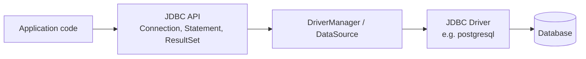
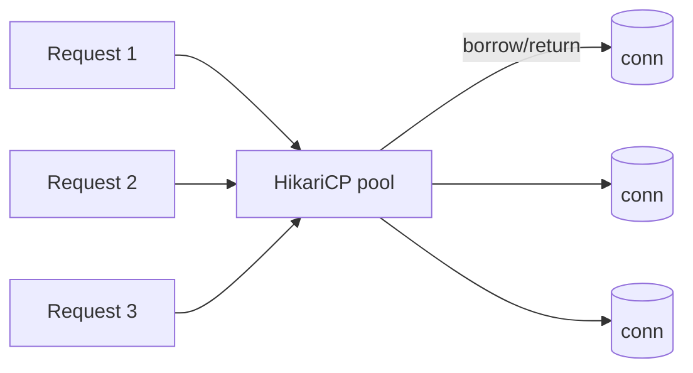

# JDBC

JDBC is the low-level API every Java data layer sits on — JPA, Spring Data, and
`JdbcTemplate` all use it underneath. Understanding it explains connection pools,
prepared statements, and transaction boundaries.

<ProgressTracker id="jdbc-overview" />

## Table of Contents

- [Architecture](#architecture)
- [The core objects](#the-core-objects)
- [JDBC URLs: DriverManager vs DataSource](#jdbc-urls-drivermanager-vs-datasource)
- [Statement types](#statement-types)
- [PreparedStatement & SQL injection](#preparedstatement--sql-injection)
- [ResultSet](#resultset)
- [Batch updates](#batch-updates)
- [Transactions](#transactions)
- [Exception handling](#exception-handling)
- [Connection pooling & HikariCP](#connection-pooling--hikaricp)
- [Common mistakes](#common-mistakes)
- [Most Asked Interview Questions](#most-asked-interview-questions)
- [Things You Should Know](#things-you-should-know)

## Architecture



The JDBC API is a set of interfaces; each database ships a **driver** implementing
them. Your code targets the interfaces, so switching databases is (mostly) a driver
and dialect change. Since JDBC 4.0, drivers are auto-registered via
`META-INF/services/java.sql.Driver` (the Service Provider Interface), so you no
longer need `Class.forName("org.postgresql.Driver")` before connecting.

## The core objects

```java
String sql = "SELECT id, email FROM customers WHERE id = ?";
try (Connection conn = dataSource.getConnection();
     PreparedStatement ps = conn.prepareStatement(sql)) {
    ps.setLong(1, id);
    try (ResultSet rs = ps.executeQuery()) {
        if (rs.next()) {
            return new Customer(rs.getLong("id"), rs.getString("email"));
        }
        return null;
    }
}
```

- **`Connection`** — a session with the database (expensive to create → pooled).
- **`Statement` / `PreparedStatement` / `CallableStatement`** — carries SQL to execute.
- **`ResultSet`** — a cursor over query results.
- **`DataSource`** — the modern factory for connections (backed by a pool).

Resources are closed **innermost-first** automatically by try-with-resources
(`ResultSet` → `PreparedStatement` → `Connection`), which matters because closing
a `Connection` implicitly closes everything opened from it anyway — but explicit
closing surfaces errors earlier and keeps intent clear.

## JDBC URLs: DriverManager vs DataSource

A JDBC URL identifies the driver, host, and database:

```
jdbc:postgresql://localhost:5432/shop?sslmode=require
jdbc:mysql://localhost:3306/shop?useSSL=false&serverTimezone=UTC
jdbc:h2:mem:testdb
```

Two ways to obtain a `Connection`:

| | `DriverManager` | `DataSource` |
|---|---|---|
| Connection creation | New physical connection every call | Pooled, reused connections |
| Use case | Scripts, quick tests | Production apps (via HikariCP, etc.) |
| Config | URL + credentials passed per call | Configured once, injected as a bean |

<Important>
Always use a `DataSource`-backed pool in application code. `DriverManager.getConnection()`
opens a brand-new TCP connection every time — fine for a one-off script, unacceptable
under real request load.
</Important>

## Statement types

| Type | Use case | SQL cached? | Parameters? |
|---|---|---|---|
| `Statement` | Static SQL, DDL (`CREATE TABLE`, admin scripts) | No | No — string concatenation only |
| `PreparedStatement` | Any query with variable input | Yes | `?` placeholders |
| `CallableStatement` | Stored procedure calls | Yes | `?` placeholders + `OUT` params |

```java
// CallableStatement: calling a stored procedure with an OUT parameter
try (CallableStatement cs = conn.prepareCall("{call get_balance(?, ?)}")) {
    cs.setLong(1, accountId);
    cs.registerOutParameter(2, Types.DECIMAL);
    cs.execute();
    BigDecimal balance = cs.getBigDecimal(2);
}
```

`Statement` should be limited to SQL with no user-supplied values — anything else
belongs in a `PreparedStatement`.

## PreparedStatement & SQL injection

<Important>
**Never build SQL by concatenating user input.** Use `PreparedStatement` with `?`
placeholders. The driver sends SQL and parameters separately, so input can never be
parsed as SQL — this is the primary defense against SQL injection.
</Important>

```java
// VULNERABLE: attacker sets email to  ' OR '1'='1
String bad = "SELECT * FROM users WHERE email = '" + email + "'";

// SAFE: parameter is bound, never interpreted as SQL
PreparedStatement ps = conn.prepareStatement(
    "SELECT * FROM users WHERE email = ?");
ps.setString(1, email);
```

`PreparedStatement` also lets the database **cache the query plan** and enables
efficient batch inserts. Note that placeholders can only replace **values**, never
identifiers — table names, column names, and `ORDER BY` directions must be
allow-listed and inserted into the SQL string yourself, not bound as parameters.

```java
// Sorting by a dynamic column: validate against an allow-list first
Set<String> allowedColumns = Set.of("id", "email", "created_at");
if (!allowedColumns.contains(sortColumn)) {
    throw new IllegalArgumentException("Invalid sort column");
}
String sql = "SELECT * FROM customers ORDER BY " + sortColumn; // safe: allow-listed
```

## ResultSet

A `ResultSet` is a forward-only, read-only cursor by default. Fetch columns by
name or index and always iterate with `next()`.

```java
List<Customer> customers = new ArrayList<>();
while (rs.next()) {
    customers.add(new Customer(rs.getLong("id"), rs.getString("email")));
}
```

You can request scrollable or updatable cursors when creating the statement, at
the cost of extra driver/database overhead:

```java
Statement st = conn.createStatement(
    ResultSet.TYPE_SCROLL_INSENSITIVE,
    ResultSet.CONCUR_UPDATABLE);
ResultSet rs = st.executeQuery("SELECT id, email FROM customers");
rs.last();                 // jump to the last row
rs.absolute(3);            // jump to row 3
rs.updateString("email", "new@example.com");
rs.updateRow();             // pushes the change back to the database
```

In practice, scrollable/updatable `ResultSet`s are rare in application code —
most frameworks (JPA, `JdbcTemplate`) never expose them. `TYPE_FORWARD_ONLY` /
`CONCUR_READ_ONLY` (the defaults) is what you want almost always.

`rs.getMetaData()` returns a `ResultSetMetaData` (column count, names, types) when
you need to process results generically, and `conn.getMetaData()` returns
`DatabaseMetaData` for introspecting the database itself (tables, driver version,
supported features).

## Batch updates

Executing statements one at a time means a network round trip per row. Batching
sends many statements together, which is dramatically faster for bulk inserts/updates.

```java
String sql = "INSERT INTO events (user_id, type) VALUES (?, ?)";
try (PreparedStatement ps = conn.prepareStatement(sql)) {
    for (Event e : events) {
        ps.setLong(1, e.userId());
        ps.setString(2, e.type());
        ps.addBatch();
        if (++count % 1000 == 0) {
            ps.executeBatch();  // flush periodically to bound memory use
        }
    }
    ps.executeBatch(); // flush the remainder
}
```

`executeBatch()` returns an `int[]` of update counts (or `Statement.SUCCESS_NO_INFO`
per entry, depending on the driver) so you can check how many rows each statement
in the batch affected.

## Transactions

By default JDBC auto-commits every statement. For multi-statement atomicity, turn
it off and commit/rollback explicitly.

```java
try (Connection conn = dataSource.getConnection()) {
    conn.setAutoCommit(false);
    try (PreparedStatement debit = conn.prepareStatement("UPDATE accounts SET balance = balance - ? WHERE id = ?");
         PreparedStatement credit = conn.prepareStatement("UPDATE accounts SET balance = balance + ? WHERE id = ?")) {
        debit.setBigDecimal(1, amount); debit.setLong(2, from); debit.executeUpdate();
        credit.setBigDecimal(1, amount); credit.setLong(2, to); credit.executeUpdate();
        conn.commit();
    } catch (SQLException e) {
        conn.rollback();
        throw e;
    }
}
```

<Backend>
In Spring you almost never write this — `@Transactional` manages `setAutoCommit`,
`commit`, and `rollback` for you around the connection bound to the current thread.
But this is exactly what happens under the annotation.
</Backend>

### Isolation levels

`conn.setTransactionIsolation(...)` controls what one transaction can see of
another's uncommitted or concurrent changes:

| Level | Dirty read | Non-repeatable read | Phantom read |
|---|---|---|---|
| `READ_UNCOMMITTED` | Possible | Possible | Possible |
| `READ_COMMITTED` (most DB defaults) | Prevented | Possible | Possible |
| `REPEATABLE_READ` | Prevented | Prevented | Possible |
| `SERIALIZABLE` | Prevented | Prevented | Prevented |

Higher isolation costs more locking/contention. `READ_COMMITTED` is the right
default for most applications; reach for stricter levels only for specific
operations that need it (e.g. financial reconciliation).

### Savepoints

Savepoints let you roll back part of a transaction without discarding the whole thing:

```java
conn.setAutoCommit(false);
Savepoint sp = conn.setSavepoint("beforeOptionalStep");
try {
    doOptionalStep(conn);
} catch (SQLException e) {
    conn.rollback(sp); // undo just the optional step, keep everything before it
}
conn.commit();
```

## Exception handling

`SQLException` is a checked exception and can be **chained**: a single failure
(e.g. a batch update) may carry multiple underlying causes accessible via
`getNextException()`, separate from the standard `getCause()` chain.

```java
try {
    ps.executeBatch();
} catch (SQLException e) {
    for (Throwable t : e) {  // SQLException implements Iterable<Throwable>
        log.error("SQL error: {} (SQLState={}, code={})",
            t.getMessage(),
            ((SQLException) t).getSQLState(),
            ((SQLException) t).getErrorCode());
    }
}
```

`getSQLState()` returns a vendor-neutral code (from the X/Open/SQL standard) while
`getErrorCode()` is vendor-specific — useful for distinguishing, say, a unique
constraint violation (`23505` in Postgres) from a generic failure.

## Connection pooling & HikariCP

Opening a database connection involves TCP + authentication + session setup — far
too slow to do per request. A **connection pool** keeps a set of open connections and
lends them out.



HikariCP is the default pool in Spring Boot — fast and reliable.

```yaml
spring:
  datasource:
    url: jdbc:postgresql://localhost:5432/shop
    username: shop
    password: secret
    hikari:
      maximum-pool-size: 10       # cap concurrent DB connections
      minimum-idle: 2
      connection-timeout: 30000   # ms to wait for a connection before failing
      max-lifetime: 1800000       # recycle connections periodically
      leak-detection-threshold: 60000  # ms; logs a warning if a connection isn't returned in time
```

<Warning>
Pool size is not "bigger is better". Too many connections overwhelm the database.
A common starting point is `connections ≈ (core_count * 2) + effective_spindle_count`.
Always **return** connections (try-with-resources) — leaks exhaust the pool and hang
the service. `leak-detection-threshold` is worth turning on in any environment where
leaks are a real risk (e.g. before a load test), since it turns a silent hang into a log line.
</Warning>

## Common mistakes

<Warning>
- String-concatenated SQL (injection).
- Not closing `Connection`/`Statement`/`ResultSet` (use try-with-resources).
- Leaving auto-commit on for multi-statement units of work.
- Oversized connection pools that saturate the database.
- Executing inserts/updates one at a time in a loop instead of batching.
- Swallowing `SQLException` without checking `getNextException()` on batch failures.
- Requesting a scrollable/updatable `ResultSet` when a forward-only read is all that's needed.
</Warning>

## Most Asked Interview Questions

### Beginner
- What is JDBC and what is a driver?
- `Statement` vs `PreparedStatement`?
- What does a JDBC URL look like, and what does `DriverManager` do with it?

### Intermediate
- How does `PreparedStatement` prevent SQL injection?
- Why use a connection pool?
- How do you batch inserts, and why is batching faster?

### Advanced
- How does `@Transactional` relate to JDBC auto-commit?
- How do you size a connection pool?
- What's the difference between `READ_COMMITTED` and `SERIALIZABLE`, and when would you use each?
- How does `SQLException` chaining work, and how is it different from `getCause()`?

### Coding
- Write a safe parameterized query and map the `ResultSet` to objects.
- Write a batch insert that flushes every N rows.
- Write a transfer between two accounts using a savepoint to skip an optional step on failure.

## Things You Should Know

### 🔴 Must Know
- Connection/Statement/ResultSet lifecycle + try-with-resources.
- `PreparedStatement` for injection safety (and why identifiers need allow-listing, not binding).
- Connection pooling (HikariCP) and why it exists.
- Manual transaction control (`setAutoCommit`/`commit`/`rollback`).

### 🟡 Good to Know
- Batch inserts with `addBatch`/`executeBatch`.
- Isolation levels and the read phenomena they prevent.
- `SQLException` chaining via `getNextException()`, `SQLState` vs vendor error codes.
- `DriverManager` vs `DataSource`, and why production code uses the latter.

### 🟢 Nice to Know
- `JdbcTemplate` as a thin, safe wrapper.
- Statement caching and fetch size tuning.
- Scrollable/updatable `ResultSet`s and when (rarely) they're worth it.
- Savepoints for partial rollback within a transaction.
- `ResultSetMetaData` / `DatabaseMetaData` for generic or introspective code.
