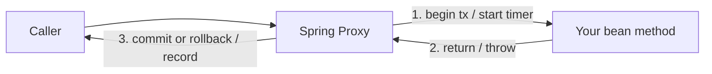

# AOP & Proxies

Aspect-Oriented Programming factors cross-cutting concerns (transactions, caching,
security, logging, retries) out of business logic. Spring implements it with
**proxies** — and understanding proxies explains a whole class of "why isn't my
annotation working?" bugs.

<ProgressTracker id="spring-aop" />

## Table of Contents

- [The problem AOP solves](#the-problem-aop-solves)
- [How proxies work](#how-proxies-work)
- [JDK dynamic proxy vs CGLIB](#jdk-dynamic-proxy-vs-cglib)
- [Aspects, advice & pointcuts](#aspects-advice--pointcuts)
- [The self-invocation gotcha](#the-self-invocation-gotcha)
- [Where Spring uses this](#where-spring-uses-this)
- [Common mistakes](#common-mistakes)
- [Interview questions](#interview-questions)
- [Things You Should Know](#things-you-should-know)

## The problem AOP solves

Without AOP, cross-cutting code is copy-pasted into every method:

```java
public void placeOrder(Order o) {
    long start = System.nanoTime();          // timing (cross-cutting)
    tx.begin();                              // transaction (cross-cutting)
    try {
        // ... actual business logic ...
        tx.commit();
    } catch (Exception e) { tx.rollback(); throw e; }
    finally { metrics.record(System.nanoTime() - start); }
}
```

AOP lets you write only the business logic and **declare** the cross-cutting behavior
with an annotation like `@Transactional`.

## How proxies work

When a bean has AOP behavior, Spring doesn't hand you your object directly — it wraps it
in a **proxy** that runs "advice" before/after delegating to your real method.



The proxy is what's registered in the `ApplicationContext`, so every injection point
gets the proxy, not the raw bean.

## JDK dynamic proxy vs CGLIB

Spring picks a proxy strategy automatically:

| | JDK dynamic proxy | CGLIB |
| --- | --- | --- |
| Requires | Bean implements an interface | Any class (no interface needed) |
| Mechanism | `java.lang.reflect.Proxy` | Subclass generated at runtime |
| Proxies | Interface methods | Overridable methods |
| Limitation | Only interface-declared methods | Can't proxy `final` classes/methods |

<Important>
By default Spring Boot uses **CGLIB** (subclass-based) proxying so it works whether or
not you have an interface. Consequence: a `final` class or `final`/`private`/`static`
method **cannot be advised** — CGLIB can't override it, so `@Transactional` on a `final`
method silently does nothing.
</Important>

## Aspects, advice & pointcuts

Vocabulary you'll be asked about:

- **Aspect** — a module of cross-cutting concern (e.g. a `LoggingAspect`).
- **Join point** — a point where advice can apply (in Spring, a method execution).
- **Pointcut** — an expression selecting which join points to advise.
- **Advice** — the code to run: `@Before`, `@After`, `@AfterReturning`,
  `@AfterThrowing`, `@Around` (the most powerful — wraps the call).

```java
@Aspect
@Component
public class TimingAspect {

    // Pointcut: any method in the service package
    @Around("execution(* com.shop.service..*(..))")
    public Object time(ProceedingJoinPoint pjp) throws Throwable {
        long start = System.nanoTime();
        try {
            return pjp.proceed();                 // invoke the real method
        } finally {
            long ms = (System.nanoTime() - start) / 1_000_000;
            log.info("{} took {}ms", pjp.getSignature(), ms);
        }
    }
}
```

## The self-invocation gotcha

<Warning>
Because the advice lives on the **proxy**, calling an annotated method **from within the
same class** (`this.method()`) bypasses the proxy entirely — so `@Transactional`,
`@Cacheable`, `@Async`, and `@Retryable` do **nothing** on internal calls.
</Warning>

```java
@Service
public class OrderService {

    public void checkout(Order o) {
        save(o);              // ❌ internal call -> proxy bypassed -> NOT transactional
    }

    @Transactional
    public void save(Order o) { repository.save(o); }
}
```

Fixes:

```java
// 1) Call through the injected bean (self-reference)
@Service
public class OrderService {
    private final OrderService self;                 // inject the proxy
    public OrderService(@Lazy OrderService self) { this.self = self; }

    public void checkout(Order o) { self.save(o); }  // ✅ goes through the proxy

    @Transactional public void save(Order o) { repository.save(o); }
}

// 2) Better: move the @Transactional method to a separate bean
//    so the call is a genuine cross-bean call through its proxy.
```

## Where Spring uses this

The whole "declarative magic" of Spring is proxy-based AOP:

| Annotation | What the proxy does |
| --- | --- |
| `@Transactional` | begin/commit/rollback around the method |
| `@Cacheable` / `@CacheEvict` | check/populate/evict a cache |
| `@Async` | run the method on an executor, return a `Future` |
| `@Retryable` | retry on failure with backoff (Spring Retry) |
| `@PreAuthorize` | enforce security before the method runs |

## Common mistakes

<Warning>
- Self-invocation (`this.method()`) expecting the annotation to apply.
- Annotating a `private`/`final`/`static` method (proxies can't advise it).
- Marking a proxied class `final`.
- Expecting `@Async` to return a usable value synchronously.
</Warning>

## Interview questions

**Q: How does Spring implement `@Transactional`?**
It wraps the bean in a proxy; the proxy opens a transaction, invokes your method, and
commits or rolls back — your method contains only business logic.

**Q: JDK dynamic proxy vs CGLIB?**
JDK proxies require an interface and proxy interface methods; CGLIB subclasses the class
and can proxy any non-final method. Spring Boot defaults to CGLIB.

**Q: Why does `@Transactional` sometimes not work?**
Self-invocation (internal `this` call bypasses the proxy) or a non-overridable method
(`private`/`final`/`static`).

**Q: What is `@Around` advice?**
The most powerful advice — it wraps the join point and controls whether/when to call
`proceed()`, seeing both arguments and the result.

## Things You Should Know

### 🔴 Must Know
- AOP = cross-cutting concerns via proxies.
- Self-invocation bypasses the proxy (annotations no-op).
- `@Transactional`/`@Cacheable`/`@Async` are all proxy-based.

### 🟡 Good to Know
- JDK vs CGLIB proxies; `final` methods can't be advised.
- Advice types, especially `@Around` and `proceed()`.

### 🟢 Nice to Know
- Pointcut expression syntax (`execution(...)`).
- AspectJ (compile/load-time weaving) for cases proxies can't handle.
