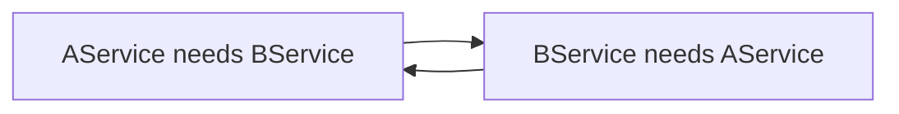

# Dependency Injection Deep Dive

Dependency injection is the mechanism that makes Spring code loosely coupled and
testable. This page goes past "use `@Autowired`" into how the container actually
resolves and wires beans.

<ProgressTracker id="spring-di" />

## Table of Contents

- [The three injection styles](#the-three-injection-styles)
- [Why constructor injection wins](#why-constructor-injection-wins)
- [Resolving ambiguity: @Primary & @Qualifier](#resolving-ambiguity-primary--qualifier)
- [Injecting collections & maps](#injecting-collections--maps)
- [Optional & lazy dependencies](#optional--lazy-dependencies)
- [Circular dependencies](#circular-dependencies)
- [Common mistakes](#common-mistakes)
- [Interview questions](#interview-questions)
- [Things You Should Know](#things-you-should-know)

## The three injection styles

```java
// 1. Constructor injection (PREFERRED)
@Service
public class OrderService {
    private final PaymentGateway gateway;
    private final InventoryClient inventory;
    public OrderService(PaymentGateway gateway, InventoryClient inventory) {
        this.gateway = gateway;
        this.inventory = inventory;
    }
}

// 2. Setter injection (for optional/reconfigurable dependencies)
@Service
public class ReportService {
    private MailClient mail;
    @Autowired(required = false)
    public void setMail(MailClient mail) { this.mail = mail; }
}

// 3. Field injection (AVOID)
@Service
public class BadService {
    @Autowired private PaymentGateway gateway;   // hidden, not final, hard to test
}
```

<Important>
Since Spring 4.3, a class with a **single constructor** needs no `@Autowired` — the
container uses it automatically. This keeps beans plain Java objects with no Spring
annotations on the constructor.
</Important>

## Why constructor injection wins

| | Constructor | Field |
| --- | --- | --- |
| `final` fields (immutable) | ✅ | ❌ |
| Dependencies explicit | ✅ (in the signature) | ❌ (hidden) |
| Test without Spring | ✅ (`new Service(mock)`) | ❌ (needs reflection) |
| Fails fast if missing | ✅ (at construction) | ❌ (NPE later) |
| Encourages small classes | ✅ (big constructor = smell) | ❌ (hides bloat) |

<Warning>
Field injection hides how many collaborators a class has, can't be `final`, and forces
tests to use reflection or a full Spring context. A constructor with too many parameters
is a useful **signal** that the class does too much — field injection just hides that
smell.
</Warning>

## Resolving ambiguity: @Primary & @Qualifier

When multiple beans satisfy a type, Spring needs help choosing.

```java
public interface PaymentGateway { }

@Component @Primary                       // default winner when type is ambiguous
class StripeGateway implements PaymentGateway { }

@Component("paypal")
class PaypalGateway implements PaymentGateway { }

@Service
class Checkout {
    private final PaymentGateway defaultGw;   // gets StripeGateway (@Primary)
    private final PaymentGateway paypal;

    Checkout(PaymentGateway defaultGw,
             @Qualifier("paypal") PaymentGateway paypal) {  // explicit pick
        this.defaultGw = defaultGw;
        this.paypal = paypal;
    }
}
```

<Important>
`@Primary` sets the default bean for a type; `@Qualifier` picks a specific named bean at
the injection point. `@Qualifier` always wins over `@Primary`. Without either, injecting
an ambiguous type throws `NoUniqueBeanDefinitionException` at startup.
</Important>

## Injecting collections & maps

Spring can inject **all** beans of a type — perfect for the Strategy pattern.

```java
public interface Validator { boolean supports(String type); void validate(Order o); }

@Service
class ValidationService {
    private final List<Validator> validators;      // ALL Validator beans, in @Order
    private final Map<String, Validator> byName;   // bean name -> bean

    ValidationService(List<Validator> validators, Map<String, Validator> byName) {
        this.validators = validators;
        this.byName = byName;
    }

    void run(Order o) {
        validators.stream().filter(v -> v.supports(o.type())).forEach(v -> v.validate(o));
    }
}
```

<Tip>
Injecting `List<T>` or `Map<String,T>` of an interface is the idiomatic way to plug in a
family of strategies without a `switch`. Add a new `@Component` implementation and it's
picked up automatically — open/closed principle in action.
</Tip>

## Optional & lazy dependencies

```java
@Service
class NotificationService {
    private final Optional<SmsClient> sms;              // may be absent
    private final ObjectProvider<HeavyBean> heavy;      // lazy / on-demand

    NotificationService(Optional<SmsClient> sms, ObjectProvider<HeavyBean> heavy) {
        this.sms = sms;
        this.heavy = heavy;
    }

    void notifyUser() {
        sms.ifPresent(client -> client.send("hi"));     // only if a bean exists
        heavy.getIfAvailable();                         // created only when needed
    }
}
```

## Circular dependencies

A depends on B and B depends on A. With **constructor injection**, Spring can't
construct either first and fails at startup with `BeanCurrentlyInCreationException`.



<Warning>
A circular dependency is almost always a **design smell** — the two classes are too
tightly coupled. Fixes, best first: (1) extract the shared logic into a third bean; (2)
rethink responsibilities; (3) as a last resort, break the cycle with `@Lazy` on one
dependency or an `ObjectProvider`. Avoid `@Autowired` field injection just to hide the
cycle — it defers the problem to runtime.
</Warning>

## Common mistakes

<Warning>
- Field injection everywhere (untestable, hidden dependencies).
- Ambiguous beans with no `@Primary`/`@Qualifier` → startup failure.
- Putting request-scoped state in a singleton service (thread-safety bug).
- Hiding circular dependencies instead of fixing the design.
</Warning>

## Interview questions

**Q: Why prefer constructor injection?**
Immutable `final` fields, explicit mandatory dependencies, testable without Spring, and
fail-fast at construction.

**Q: `@Primary` vs `@Qualifier`?**
`@Primary` marks the default bean for a type; `@Qualifier` selects a named bean at the
injection point and takes precedence.

**Q: How does Spring resolve which bean to inject?**
By type first; if multiple candidates, by `@Qualifier` name, then `@Primary`, else it
fails with `NoUniqueBeanDefinitionException`.

**Q: How do you handle a circular dependency?**
Refactor to remove it (extract a third bean); if unavoidable, `@Lazy` or `ObjectProvider`
breaks the construction cycle.

## Things You Should Know

### 🔴 Must Know
- Constructor injection + single-constructor auto-wiring.
- `@Primary`/`@Qualifier` resolution.
- Circular dependencies fail with constructor injection and signal bad design.

### 🟡 Good to Know
- Injecting `List`/`Map` of beans for strategies.
- `Optional`/`ObjectProvider` for optional/lazy deps; `@Order` for collection order.

### 🟢 Nice to Know
- `@Lazy` to break cycles; `BeanFactory` vs `ApplicationContext`.
