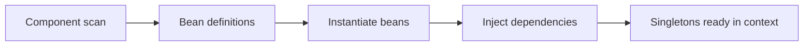
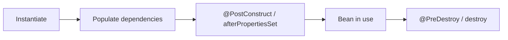
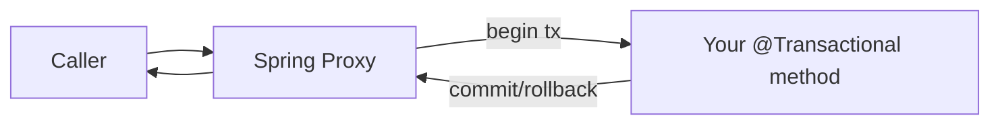

# Spring Core

Spring Boot is Spring Core with sensible defaults. Understand the container — beans,
injection, lifecycle, and proxies — and the "magic" of `@Transactional`, `@Cacheable`,
and auto-configuration stops being magic.

<ProgressTracker id="spring-core-overview" />

## Table of Contents

- [IoC & dependency injection](#ioc--dependency-injection)
- [Beans & the ApplicationContext](#beans--the-applicationcontext)
- [Declaring beans](#declaring-beans)
- [Injection styles](#injection-styles)
- [Bean lifecycle](#bean-lifecycle)
- [Bean scopes](#bean-scopes)
- [Configuration & profiles](#configuration--profiles)
- [AOP & proxies](#aop--proxies)
- [Deep-dive topics](#deep-dive-topics)
- [Most Asked Interview Questions](#most-asked-interview-questions)
- [Things You Should Know](#things-you-should-know)

## IoC & dependency injection

**Inversion of Control (IoC):** instead of your code creating its dependencies, the
framework creates and supplies them. **Dependency Injection (DI)** is how IoC is
delivered — dependencies are handed to an object rather than constructed by it.

```java
// Without DI: tightly coupled, hard to test
class OrderService {
    private final PaymentGateway gateway = new StripeGateway(); // hard-wired
}

// With DI: the collaborator is supplied; swap it freely (tests, config)
@Service
class OrderService {
    private final PaymentGateway gateway;
    OrderService(PaymentGateway gateway) { this.gateway = gateway; }
}
```

<Interview>
"What is DI and why does it matter?" It decouples a class from the construction of
its collaborators, enabling loose coupling, easy testing (inject mocks), and swapping
implementations via configuration. The Spring **container** owns object creation and
wiring.
</Interview>

## Beans & the ApplicationContext

A **bean** is an object the Spring container creates and manages. The
**`ApplicationContext`** is that container: it scans for components, instantiates
them, resolves dependencies, and manages their lifecycle.



## Declaring beans

Two ways: stereotype annotations (scanned) and `@Bean` methods (explicit).

```java
@Service      // business logic
@Repository   // data access (also translates persistence exceptions)
@Controller   // web layer (@RestController for REST)
@Component     // generic bean

// Explicit configuration, ideal for third-party classes
@Configuration
public class AppConfig {
    @Bean
    public RestClient restClient() {
        return RestClient.builder().baseUrl("https://api.example.com").build();
    }
}
```

The stereotypes are all specializations of `@Component`; they add semantic meaning
and, in `@Repository`'s case, exception translation.

## Injection styles

<Important>
**Prefer constructor injection.** It makes dependencies explicit and mandatory,
allows `final` fields (immutability), and enables testing without Spring. Field
injection (`@Autowired` on a field) hides dependencies and can't be `final`.
</Important>

```java
@Service
public class UserService {
    private final UserRepository repo;      // final -> guaranteed set, immutable

    // No @Autowired needed for a single constructor since Spring 4.3
    public UserService(UserRepository repo) {
        this.repo = repo;
    }
}
```

## Bean lifecycle



```java
@Component
public class CacheWarmer {
    @PostConstruct
    void warm() { /* runs after dependencies are injected */ }

    @PreDestroy
    void flush() { /* runs on graceful shutdown */ }
}
```

## Bean scopes

| Scope | Meaning |
| --- | --- |
| `singleton` (default) | One shared instance per container |
| `prototype` | New instance every time it's requested |
| `request` | One per HTTP request (web) |
| `session` | One per HTTP session (web) |

<Warning>
Singletons are shared across all request threads. Keep them **stateless** — don't
store per-request data in singleton fields, or you get race conditions and data
bleeding between users.
</Warning>

## Configuration & profiles

Externalize configuration and vary it per environment with **profiles**.

```java
@ConfigurationProperties(prefix = "app.payment")
public record PaymentProperties(String apiKey, Duration timeout) { }

@Profile("prod")
@Configuration
class ProdConfig { /* beans only active with the 'prod' profile */ }
```

## AOP & proxies

**Aspect-Oriented Programming** factors out cross-cutting concerns (transactions,
logging, security, caching) from business logic. Spring implements it with
**proxies**: it wraps your bean in a proxy that runs "advice" around your method.



<Important>
This proxy model explains a classic gotcha: calling a `@Transactional` (or
`@Cacheable`) method **from within the same class** bypasses the proxy, so the
annotation does nothing. The call must come through the injected bean reference.
</Important>

## Deep-dive topics

<div className="jbm-card-grid">
  <Link className="jbm-card" to="/docs/spring-core/dependency-injection">
    <div className="jbm-card__icon">💉</div>
    <h3>Dependency Injection Deep Dive</h3>
    <p>Injection styles, @Primary/@Qualifier, collection injection, circular deps.</p>
  </Link>
  <Link className="jbm-card" to="/docs/spring-core/aop-and-proxies">
    <div className="jbm-card__icon">🪄</div>
    <h3>AOP & Proxies</h3>
    <p>JDK vs CGLIB proxies, aspects/advice, and the self-invocation gotcha.</p>
  </Link>
</div>

## Most Asked Interview Questions

### Beginner
- What is IoC and DI?
- What is a Spring bean?
- `@Component` vs `@Service` vs `@Repository`?

### Intermediate
- Why prefer constructor injection?
- What are bean scopes and the default?
- What is the bean lifecycle?

### Advanced
- How does Spring AOP use proxies, and what does self-invocation break?
- How does the container resolve a bean when multiple candidates exist (`@Primary`/`@Qualifier`)?

### Coding
- Define a `@Configuration` with a `@Bean` and inject it via constructor.

## Things You Should Know

### 🔴 Must Know
- IoC/DI and constructor injection.
- Beans, stereotypes, and the ApplicationContext.
- Singleton scope + keep singletons stateless.

### 🟡 Good to Know
- Lifecycle callbacks (`@PostConstruct`/`@PreDestroy`).
- `@ConfigurationProperties` and profiles.
- Proxy-based AOP and self-invocation pitfall.

### 🟢 Nice to Know
- CGLIB vs JDK dynamic proxies.
- `@Primary`, `@Qualifier`, and bean resolution rules.
