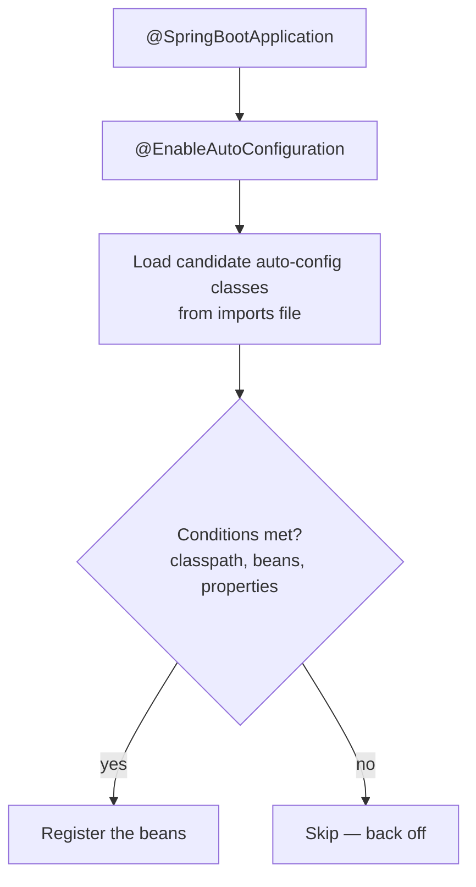

# Auto-Configuration Internals

Auto-configuration is the feature that makes Spring Boot feel magical: add a starter and
a working `DataSource`, `EntityManager`, or web server appears. This page shows exactly
how that happens so you can debug and override it.

<ProgressTracker id="spring-boot-autoconfig" />

## Table of Contents

- [The big picture](#the-big-picture)
- [Conditional beans](#conditional-beans)
- [The imports file](#the-imports-file)
- [Back-off: your beans win](#back-off-your-beans-win)
- [Starters](#starters)
- [Inspecting what happened](#inspecting-what-happened)
- [Writing your own auto-configuration](#writing-your-own-auto-configuration)
- [Common mistakes](#common-mistakes)
- [Interview questions](#interview-questions)
- [Things You Should Know](#things-you-should-know)

## The big picture

`@SpringBootApplication` includes `@EnableAutoConfiguration`, which loads a list of
candidate configuration classes. Each candidate is guarded by `@Conditional...`
annotations that decide, at startup, whether to apply it.



## Conditional beans

Auto-configuration is built on `@Conditional` annotations:

| Annotation | Applies the bean when... |
| --- | --- |
| `@ConditionalOnClass` | a class is on the classpath |
| `@ConditionalOnMissingBean` | you haven't defined that bean yourself |
| `@ConditionalOnProperty` | a property has a given value |
| `@ConditionalOnBean` | another bean exists |
| `@ConditionalOnWebApplication` | it's a web app |

```java
@AutoConfiguration
@ConditionalOnClass(DataSource.class)                 // JDBC is on the classpath
public class DataSourceAutoConfiguration {

    @Bean
    @ConditionalOnMissingBean                          // ...and you didn't define one
    public DataSource dataSource(DataSourceProperties props) {
        return props.initializeDataSourceBuilder().build();
    }
}
```

<Important>
The two conditions that explain 90% of auto-config behavior:
`@ConditionalOnClass` ("the library is present, so configure it") and
`@ConditionalOnMissingBean` ("only if the developer hasn't provided their own"). Together
they give you working defaults that you can always override.
</Important>

## The imports file

Spring Boot finds candidate classes from a resource file inside each auto-configuration
jar (Boot 2.7+):

```text
META-INF/spring/org.springframework.boot.autoconfigure.AutoConfiguration.imports
```

It lists fully-qualified auto-configuration class names, one per line. (Before 2.7 this
was the `spring.factories` file under `EnableAutoConfiguration`.)

## Back-off: your beans win

<Important>
Auto-configuration **backs off** whenever you provide your own bean. Define your own
`DataSource` `@Bean` and Boot's `@ConditionalOnMissingBean` skips its default. This is
why Spring Boot is opinionated but never in your way — your explicit configuration always
takes precedence.
</Important>

```java
@Configuration
public class MyDataConfig {
    @Bean
    public DataSource dataSource() {          // Boot's auto-config now backs off
        return new HikariDataSource(customConfig());
    }
}
```

## Starters

A **starter** is a dependency that pulls in a coherent set of libraries whose presence
triggers the matching auto-configuration.

```xml
<!-- Adds Spring MVC + Jackson + embedded Tomcat; their classes trigger web auto-config -->
<dependency>
  <groupId>org.springframework.boot</groupId>
  <artifactId>spring-boot-starter-web</artifactId>
</dependency>
```

Starter → classes on classpath → `@ConditionalOnClass` matches → beans configured. That's
the whole chain.

## Inspecting what happened

```properties
# Print the auto-configuration report: what matched, what didn't, and why
debug=true
```

Or hit the Actuator endpoint:

```text
GET /actuator/conditions        # positive/negative condition matches per class
GET /actuator/beans             # every bean in the context
```

<Tip>
When a bean you expected isn't there (or one you didn't expect is), turn on `debug=true`
and read the **CONDITIONS EVALUATION REPORT**. It tells you exactly which condition
failed — far faster than guessing.
</Tip>

## Writing your own auto-configuration

Useful for shared internal libraries (a company "starter").

```java
@AutoConfiguration
@ConditionalOnClass(RestClient.class)
@EnableConfigurationProperties(MyClientProperties.class)
public class MyClientAutoConfiguration {

    @Bean
    @ConditionalOnMissingBean
    public MyApiClient myApiClient(MyClientProperties props) {
        return new MyApiClient(props.baseUrl(), props.timeout());
    }
}
```

Register it in your library's `AutoConfiguration.imports` file so consumers get it just
by adding the dependency.

## Common mistakes

<Warning>
- Assuming a bean exists without checking conditions — a missing classpath library
  silently skips its auto-config.
- Defining a conflicting bean and being surprised auto-config backed off (that's correct).
- Component-scanning your auto-configuration class (it should be triggered via the imports
  file, not scanned) — can cause ordering issues.
- Forgetting `@ConditionalOnMissingBean`, so your library forces its bean and can't be overridden.
</Warning>

## Interview questions

**Q: How does Spring Boot auto-configuration work?**
`@EnableAutoConfiguration` loads candidate config classes from the
`AutoConfiguration.imports` file; each is guarded by `@ConditionalOn...` checks
(classpath, missing bean, property) and applies only when its conditions hold.

**Q: How do you override an auto-configured bean?**
Define your own bean of that type — `@ConditionalOnMissingBean` makes Boot back off.

**Q: What's the role of a starter?**
It brings in libraries whose presence (`@ConditionalOnClass`) triggers the relevant
auto-configuration.

**Q: How do you debug why a bean was/wasn't created?**
`debug=true` prints the conditions report, or use `/actuator/conditions`.

## Things You Should Know

### 🔴 Must Know
- `@EnableAutoConfiguration` + conditional beans + the imports file.
- `@ConditionalOnClass` and `@ConditionalOnMissingBean`; back-off behavior.
- Starters trigger auto-config via the classpath.

### 🟡 Good to Know
- `debug=true` / `/actuator/conditions` to inspect matches.
- Writing a custom auto-configuration for shared libraries.

### 🟢 Nice to Know
- `spring.factories` (pre-2.7) vs `AutoConfiguration.imports`.
- `@AutoConfigureBefore`/`@AutoConfigureAfter` ordering.
