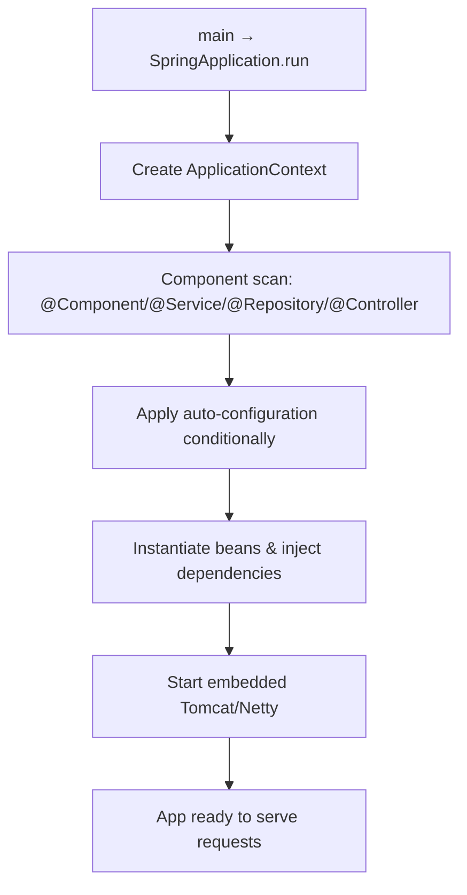

# Spring Boot Essentials

A single, snippet-first tour of the pieces you touch in every Spring Boot service:
how the container wires your beans, how configuration gets in, how data is
persisted with JPA/Hibernate, how input is validated, and how errors become clean
HTTP responses. Each section links to the deep-dive page for more.

<Note>
  Snippets target **Spring Boot 3.x** (Spring Framework 6, Jakarta EE namespaces
  — `jakarta.*`, not `javax.*`) on **Java 25**.
</Note>

<ProgressTracker id="spring-boot-essentials" />

## Table of Contents

- [How Spring Boot works](#how-spring-boot-works)
- [The IoC container & dependency injection](#the-ioc-container--dependency-injection)
- [Stereotypes & component scanning](#stereotypes--component-scanning)
- [Getting properties into your app](#getting-properties-into-your-app)
- [Persistence: JPA & Hibernate](#persistence-jpa--hibernate)
- [Validation](#validation)
- [Global exception handling](#global-exception-handling)
- [Shaping the HTTP response](#shaping-the-http-response)
- [Pagination, filtering, sorting & search](#pagination-filtering-sorting--search)
- [Scheduling & async](#scheduling--async)
- [Annotation cheat sheet](#annotation-cheat-sheet)
- [Most Asked Interview Questions](#most-asked-interview-questions)
- [Things You Should Know](#things-you-should-know)

## How Spring Boot works

At startup `SpringApplication.run(...)` creates an **ApplicationContext** — the IoC
(Inversion of Control) container. The container scans your packages, creates the
objects it finds (**beans**), wires their dependencies, applies auto-configuration,
and starts the embedded web server.

```java
@SpringBootApplication   // @Configuration + @EnableAutoConfiguration + @ComponentScan
public class ShopApplication {
    public static void main(String[] args) {
        SpringApplication.run(ShopApplication.class, args);
    }
}
```



**Inversion of Control** means _you don't `new` your collaborators_ — the container
creates them and hands them to you. That inversion is what makes beans swappable,
configurable, and testable. See [Auto-Configuration Internals](/docs/spring-boot/auto-configuration).

<Interview>
  "What happens when a Spring Boot app starts?" The context is built, components
  are scanned and registered as bean definitions, auto-configuration adds beans
  conditionally (backing off where you defined your own), beans are instantiated
  in dependency order with injection, then the embedded server starts.
</Interview>

## The IoC container & dependency injection

A **bean** is an object the container manages. You declare one with a stereotype
annotation (or `@Bean`), and you ask for collaborators by putting them in the
**constructor** — the container supplies them.

```java
@Service
public class OrderService {
    private final PaymentGateway gateway;      // dependencies are final + explicit
    private final InventoryClient inventory;

    // Single constructor → no @Autowired needed (Spring 4.3+)
    public OrderService(PaymentGateway gateway, InventoryClient inventory) {
        this.gateway = gateway;
        this.inventory = inventory;
    }
}
```

Declare beans the container can't scan (third-party types, conditional wiring) with
`@Bean` methods in a `@Configuration` class:

```java
@Configuration
public class ClientConfig {
    @Bean
    RestClient paymentClient(RestClient.Builder builder,
                             @Value("${payments.base-url}") String baseUrl) {
        return builder.baseUrl(baseUrl).build();
    }
}
```

<Important>
  Prefer **constructor injection** over field injection: it gives you `final`
  fields, makes dependencies explicit, fails fast at startup if something is
  missing, and lets you test with plain `new Service(mock)` — no Spring needed.
  Full comparison and `@Primary`/`@Qualifier` resolution in [Dependency
  Injection Deep Dive](/docs/spring-core/dependency-injection/).
</Important>

## Stereotypes & component scanning

`@ComponentScan` (included in `@SpringBootApplication`) finds classes annotated with
these and registers them as beans. The suffix communicates **intent**; the behavior
is nearly identical except `@Repository` adds persistence exception translation.

| Annotation                        | Layer    | Notes                                                   |
| --------------------------------- | -------- | ------------------------------------------------------- |
| `@Component`                      | any      | Generic managed bean                                    |
| `@Service`                        | business | Orchestration, transactions                             |
| `@Repository`                     | data     | + translates native exceptions to `DataAccessException` |
| `@Controller` / `@RestController` | web      | `@RestController` = `@Controller` + `@ResponseBody`     |
| `@Configuration`                  | config   | Holds `@Bean` factory methods                           |

<Warning>
  Component scanning only covers the package of your `@SpringBootApplication`
  class and its sub-packages. Keep that class at the **root package** so
  everything below is found automatically.
</Warning>

## Getting properties into your app

Externalize settings in `application.yml` (or `.properties`) and read them in four
main ways.

```yaml title="application.yml"
spring:
  application:
    name: shop-service
  datasource:
    url: jdbc:postgresql://localhost:5432/shop
    username: ${DB_USER:shop} # env var, with a default after ':'
    password: ${DB_PASSWORD:secret}
app:
  payments:
    base-url: https://pay.example.com
    timeout: 3s
    retries: 2
```

**1. `@Value` — a single property:**

```java
@Service
class PaymentService {
    PaymentService(@Value("${app.payments.base-url}") String baseUrl,
                   @Value("${app.payments.retries:3}") int retries) { ... }  // default 3
}
```

**2. `@ConfigurationProperties` — bind a whole group to a typed record (preferred):**

```java
@ConfigurationProperties(prefix = "app.payments")
public record PaymentProps(String baseUrl, Duration timeout, int retries) {}
```

```java
@SpringBootApplication
@ConfigurationPropertiesScan          // discover @ConfigurationProperties types
public class ShopApplication { ... }

@Service
class PaymentService {
    private final PaymentProps props;
    PaymentService(PaymentProps props) { this.props = props; }   // type-safe, validated
}
```

**3. Profiles — vary config per environment:**

```java
@Bean
@Profile("dev")
CommandLineRunner seedData(UserRepository repo) { return args -> repo.save(...); }
```

```yaml
# application-prod.yml is loaded when the 'prod' profile is active
spring:
  jpa:
    show-sql: false
```

Activate with `SPRING_PROFILES_ACTIVE=prod` or `--spring.profiles.active=prod`.

<Tip>
  **Precedence (highest wins):** command-line args → OS environment variables →
  `application-{profile}.yml` → `application.yml` → defaults in code. That's why
  `DB_PASSWORD` from the environment overrides the file. Deep dive:
  [Configuration & Profiles](/docs/spring-boot/configuration-and-profiles/).
</Tip>

<Warning>
  Never commit secrets to `application.yml`. Inject them via environment
  variables or a secrets manager, and keep
  `spring.jpa.hibernate.ddl-auto=validate` (or `none`) in production.
</Warning>

## Persistence: JPA & Hibernate

**JPA** is the specification (annotations like `@Entity`, the `EntityManager`);
**Hibernate** is the default implementation Spring Boot ships. **Spring Data JPA**
sits on top and generates repository implementations for you.

**Entity — maps a class to a table:**

```java
@Entity
@Table(name = "users")
public class User {
    @Id
    @GeneratedValue(strategy = GenerationType.IDENTITY)
    private Long id;

    @Column(nullable = false, unique = true)
    private String email;

    private String name;

    @Version                      // optimistic locking
    private long version;

    protected User() {}           // JPA needs a no-arg constructor
    public User(String email, String name) { this.email = email; this.name = name; }
    // getters…
}
```

**Repository — no implementation needed:**

```java
public interface UserRepository extends JpaRepository<User, Long> {
    Optional<User> findByEmail(String email);              // derived query
    List<User> findByNameContainingIgnoreCase(String q);

    @Query("select u from User u where u.active = true")   // JPQL
    List<User> findActive();

    @EntityGraph(attributePaths = "orders")                // fetch orders → avoid N+1
    Optional<User> findWithOrdersById(Long id);
}
```

**Relationships — default to `LAZY` for `@ManyToOne`/`@OneToOne`:**

```java
@Entity
public class Order {
    @Id @GeneratedValue private Long id;

    @ManyToOne(fetch = FetchType.LAZY)        // never EAGER by default
    @JoinColumn(name = "user_id")
    private User user;

    @OneToMany(mappedBy = "order", cascade = CascadeType.ALL, orphanRemoval = true)
    private List<OrderLine> lines = new ArrayList<>();
}
```

**Transactions — put `@Transactional` on the service, not the controller:**

```java
@Service
public class UserService {
    private final UserRepository repo;
    public UserService(UserRepository repo) { this.repo = repo; }

    @Transactional                                   // write: commit or roll back as one unit
    public UserResponse create(CreateUserRequest req) {
        if (repo.findByEmail(req.email()).isPresent())
            throw new EmailTakenException(req.email());
        User saved = repo.save(new User(req.email(), req.name()));
        return UserResponse.from(saved);
    }

    @Transactional(readOnly = true)                  // read: lighter, no dirty-checking flush
    public UserResponse getById(Long id) {
        return repo.findById(id).map(UserResponse::from)
            .orElseThrow(() -> new UserNotFoundException(id));
    }
}
```

<Warning>
  The classic performance trap is the **N+1 query problem** — one query for a
  list, then one per element for a lazy association. Fix it with `@EntityGraph`,
  a `join fetch` query, or batch fetching. See [The N+1
  Problem](/docs/spring-data-jpa/n-plus-one/) and [Entity
  Relationships](/docs/spring-data-jpa/entity-relationships/).
</Warning>

<Backend>
  Never expose entities over HTTP. Map to DTOs/records at the service boundary —
  it prevents accidental lazy-loading outside the transaction, hides internal
  columns, and decouples your API from the schema.
</Backend>

## Validation

Add `spring-boot-starter-validation`, annotate fields with Jakarta Bean Validation
constraints, and trigger validation with `@Valid` on the controller parameter.

```java
public record CreateUserRequest(
    @NotBlank String name,
    @Email @NotBlank String email,
    @Min(18) int age,
    @Size(min = 8, max = 72) String password
) {}
```

```java
@RestController
@RequestMapping("/api/users")
class UserController {
    private final UserService service;
    UserController(UserService service) { this.service = service; }

    @PostMapping
    ResponseEntity<UserResponse> create(@Valid @RequestBody CreateUserRequest req) {
        return ResponseEntity.status(HttpStatus.CREATED).body(service.create(req));
    }
}
```

A `@Valid` failure throws `MethodArgumentNotValidException` **before** your method
runs — handle it globally (next section). Common constraints:

`@NotNull` `@NotBlank` `@NotEmpty` `@Size` `@Min` `@Max` `@Positive` `@Email`
`@Pattern` `@Past` `@Future` `@AssertTrue`.

**Validate method arguments on a service** with `@Validated` on the class:

```java
@Service
@Validated
class CouponService {
    public void apply(@NotBlank String code, @Positive BigDecimal amount) { ... }
}
```

**Custom constraint** when the built-ins aren't enough:

```java
@Target(ElementType.FIELD) @Retention(RetentionPolicy.RUNTIME)
@Constraint(validatedBy = StrongPasswordValidator.class)
public @interface StrongPassword {
    String message() default "password is too weak";
    Class<?>[] groups() default {};
    Class<? extends Payload>[] payload() default {};
}

class StrongPasswordValidator implements ConstraintValidator<StrongPassword, String> {
    public boolean isValid(String value, ConstraintValidatorContext ctx) {
        return value != null && value.length() >= 8
            && value.chars().anyMatch(Character::isDigit);
    }
}
```

<Tip>
  More patterns — cross-field validation, validation groups, and shaping error
  responses — in [Validation & Error
  Handling](/docs/rest-api/validation-and-errors/).
</Tip>

## Global exception handling

Centralize error-to-response mapping in one `@RestControllerAdvice` so controllers
stay clean and every error has a consistent shape. Spring 6 ships `ProblemDetail`
(RFC 7807) as the recommended body.

```java
@RestControllerAdvice
public class GlobalExceptionHandler {

    // Your domain "not found" → 404
    @ExceptionHandler(UserNotFoundException.class)
    ProblemDetail handleNotFound(UserNotFoundException ex) {
        ProblemDetail pd = ProblemDetail.forStatusAndDetail(HttpStatus.NOT_FOUND, ex.getMessage());
        pd.setTitle("Resource not found");
        return pd;
    }

    // Conflict → 409
    @ExceptionHandler(EmailTakenException.class)
    ProblemDetail handleConflict(EmailTakenException ex) {
        return ProblemDetail.forStatusAndDetail(HttpStatus.CONFLICT, ex.getMessage());
    }

    // @Valid body failure → 400 with field-level details
    @ExceptionHandler(MethodArgumentNotValidException.class)
    ProblemDetail handleValidation(MethodArgumentNotValidException ex) {
        Map<String, String> errors = new HashMap<>();
        ex.getBindingResult().getFieldErrors()
          .forEach(fe -> errors.put(fe.getField(), fe.getDefaultMessage()));
        ProblemDetail pd = ProblemDetail.forStatus(HttpStatus.BAD_REQUEST);
        pd.setTitle("Validation failed");
        pd.setProperty("errors", errors);
        return pd;
    }

    // Safety net → 500 (log the real cause, never leak it to the client)
    @ExceptionHandler(Exception.class)
    ProblemDetail handleUnexpected(Exception ex) {
        log.error("Unhandled exception", ex);
        return ProblemDetail.forStatusAndDetail(
            HttpStatus.INTERNAL_SERVER_ERROR, "Something went wrong");
    }

    private static final Logger log = LoggerFactory.getLogger(GlobalExceptionHandler.class);
}
```

A handled validation error then returns:

```json
{
  "type": "about:blank",
  "title": "Validation failed",
  "status": 400,
  "errors": {
    "email": "must be a well-formed email address",
    "age": "must be at least 18"
  }
}
```

<Important>
  Let the advice set the status — don't also hard-code it in the controller. Map
  each **domain exception** to the right HTTP status (404/409/422…), validate at
  the edge, and keep a catch-all `Exception` handler that logs the stack trace
  but returns a generic message so you never leak internals.
</Important>

## Shaping the HTTP response

Return a DTO for a plain `200`. Reach for `ResponseEntity<T>` when you need to control
the status, headers, or a `Location` — and `ProblemDetail` (RFC 7807) for errors.

```java
// 201 Created + Location header
@PostMapping
ResponseEntity<UserResponse> create(@Valid @RequestBody CreateUserRequest req) {
    UserResponse created = service.create(req);
    URI location = ServletUriComponentsBuilder.fromCurrentRequest()
        .path("/{id}").buildAndExpand(created.id()).toUri();
    return ResponseEntity.created(location).body(created);     // 201 + Location
}

@DeleteMapping("/{id}")
ResponseEntity<Void> delete(@PathVariable Long id) {
    service.delete(id);
    return ResponseEntity.noContent().build();                 // 204, no body
}
```

<Tip>
  Full coverage — builders, status codes, ETags, streaming files, client-side
  `toEntity` — in [ResponseEntity: The Complete
  Guide](/docs/rest-api/response-entity/), and the error contract in [Validation
  & Error Handling](/docs/rest-api/validation-and-errors/).
</Tip>

## Pagination, filtering, sorting & search

Never return an unbounded list. Accept a `Pageable`, cap the size, and push
sorting/filtering/search to the database.

```java
@GetMapping("/api/orders")
Page<OrderResponse> list(
        @RequestParam(required = false) String status,       // filter
        @RequestParam(required = false) String q,            // search term
        @PageableDefault(size = 20, sort = "createdAt",
                         direction = Sort.Direction.DESC) Pageable pageable) {
    return orderService.search(status, q, pageable);          // repository returns Page<>
}
```

```java
// Dynamic filter + search with JPA Specifications (apply only what's provided)
Specification<Order> spec = Specification.where(null);
if (status != null) spec = spec.and((r, cq, cb) -> cb.equal(r.get("status"), status));
if (q != null)      spec = spec.and((r, cq, cb) ->
        cb.like(cb.lower(r.get("customerName")), "%" + q.toLowerCase() + "%"));  // search
return orderRepository.findAll(spec, pageable);
```

<Warning>
  **Whitelist** sortable/searchable field names — never pass a raw client string
  into a query. Offset paging (`page`/`size`) is simple; prefer **keyset
  (cursor)** paging for large, live feeds. Details and trade-offs in
  [Pagination, Filtering &
  Versioning](/docs/rest-api/pagination-filtering-versioning/).
</Warning>

## Scheduling & async

Run jobs on a schedule with `@Scheduled`, and offload work from the request thread with
`@Async`.

```java
@EnableScheduling @EnableAsync
@SpringBootApplication
public class ShopApplication { }

@Component
class Jobs {
    @Scheduled(cron = "0 0 2 * * *")             // 02:00 daily
    void nightlyReport() { ... }

    @Async                                       // returns immediately, runs on a pool thread
    public CompletableFuture<Void> sendEmail(String to) {
        mail.send(to); return CompletableFuture.completedFuture(null);
    }
}
```

<Tip>
  Thread-pool sizing, `fixedRate` vs `fixedDelay`, cron syntax, the
  self-invocation trap, run-once-across-the-cluster jobs, and virtual-thread
  executors are all covered in [Scheduling &
  Async](/docs/spring-boot/scheduling-and-async/).
</Tip>

## Annotation cheat sheet

For the full grouped table of annotations with one-line purposes, see the
[Spring Boot Annotations Cheat Sheet](/docs/cheat-sheets/spring/).

## Most Asked Interview Questions

### Beginner

- What is IoC and dependency injection? Why not just `new` your dependencies?
- What does `@SpringBootApplication` do?
- `@Component` vs `@Service` vs `@Repository`?

### Intermediate

- `@Value` vs `@ConfigurationProperties`? When do you pick each?
- What's property precedence between env vars, profiles, and `application.yml`?
- JPA vs Hibernate vs Spring Data JPA?
- How does `@Valid` trigger validation and where is the failure thrown?

### Advanced

- Why is constructor injection preferred over field injection?
- Why default `@ManyToOne` to LAZY, and how do you then avoid N+1?
- How do you design a consistent error contract with `@RestControllerAdvice` and `ProblemDetail`?
- Where should `@Transactional` live and why not on the controller?

### Coding

- Build a Controller → Service → Repository slice with a validated DTO and a global handler.
- Add a custom Bean Validation constraint.

## Things You Should Know

### 🔴 Must Know

- IoC/DI via constructor injection; what a bean is and how scanning finds it.
- `@ConfigurationProperties` for typed config; property precedence.
- Entity + `JpaRepository` + `@Transactional` on the service.
- `@Valid` on request bodies and a `@RestControllerAdvice` global handler.

### 🟡 Good to Know

- `@Profile` and `application-{profile}.yml` for per-environment config.
- Lazy associations and `@EntityGraph`/`join fetch` to avoid N+1.
- `ProblemDetail` (RFC 7807) as a standard error body.
- `@Validated` for method-level validation on services.

### 🟢 Nice to Know

- `@ConfigurationPropertiesScan`, relaxed binding, `Duration`/`DataSize` binding.
- Custom constraints and validation groups.
- `@Qualifier`/`@Primary` resolution and injecting `List<T>`/`Map<String,T>` strategies.
