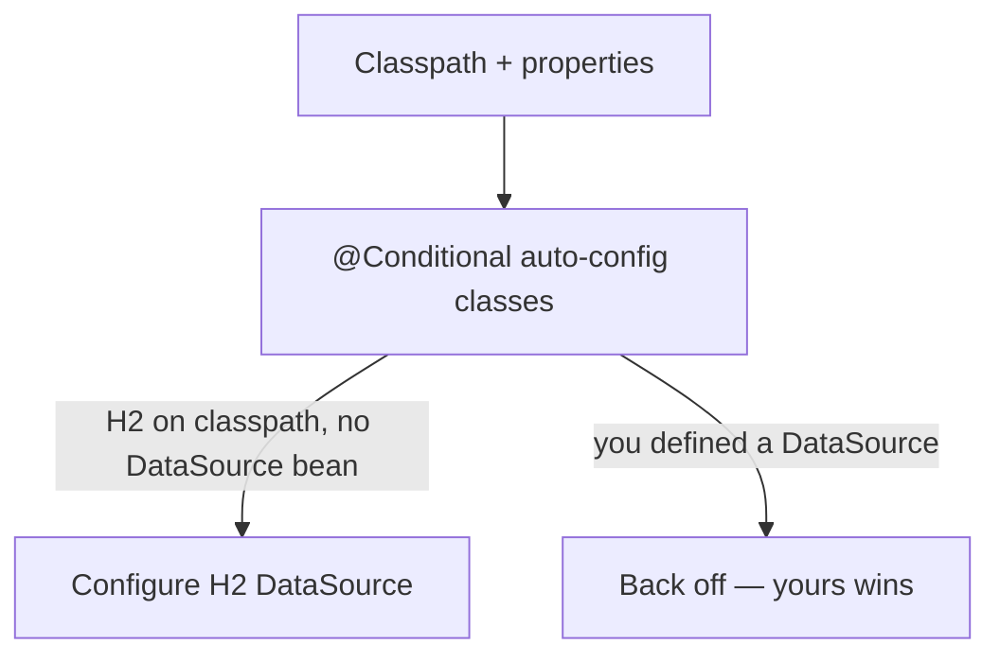
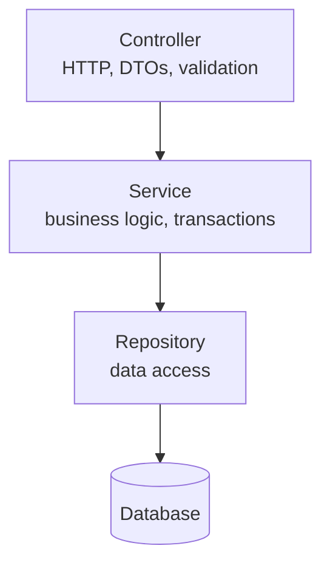

# Spring Boot

Spring Boot removes the boilerplate: opinionated defaults, an embedded server, and
auto-configuration so you write features, not plumbing.

<ProgressTracker id="spring-boot-overview" />

## Table of Contents

- [What Spring Boot gives you](#what-spring-boot-gives-you)
- [@SpringBootApplication](#springbootapplication)
- [Starters](#starters)
- [Auto-configuration](#auto-configuration)
- [Configuration & profiles](#configuration--profiles)
- [Layered architecture](#layered-architecture)
- [A complete slice](#a-complete-slice)
- [Actuator](#actuator)
- [Deep-dive topics](#deep-dive-topics)
- [Most Asked Interview Questions](#most-asked-interview-questions)
- [Things You Should Know](#things-you-should-know)

## What Spring Boot gives you

- **Auto-configuration** — sensible beans configured from what's on the classpath.
- **Starters** — curated dependency bundles.
- **Embedded server** — Tomcat/Netty inside the JAR; run with `java -jar`.
- **Production-ready features** — Actuator health, metrics, and externalized config.

## @SpringBootApplication

```java
@SpringBootApplication   // = @Configuration + @EnableAutoConfiguration + @ComponentScan
public class ShopApplication {
    public static void main(String[] args) {
        SpringApplication.run(ShopApplication.class, args);
    }
}
```

That one annotation bootstraps the context, enables auto-configuration, and scans
the package (and sub-packages) for components.

## Starters

A starter is a dependency that pulls in a coherent set of libraries.

| Starter                          | Brings in                             |
| -------------------------------- | ------------------------------------- |
| `spring-boot-starter-web`        | Spring MVC, Jackson, embedded Tomcat  |
| `spring-boot-starter-data-jpa`   | Hibernate, Spring Data JPA, HikariCP  |
| `spring-boot-starter-security`   | Spring Security                       |
| `spring-boot-starter-validation` | Bean Validation (Hibernate Validator) |
| `spring-boot-starter-actuator`   | Health, metrics, info endpoints       |
| `spring-boot-starter-test`       | JUnit 5, Mockito, AssertJ, MockMvc    |

## Auto-configuration

Auto-configuration classes activate **conditionally** based on the classpath and
your properties. If HikariCP and a JDBC URL are present, Boot configures a
`DataSource` — unless you defined your own.



<Interview>
  "How does auto-configuration work?" `@EnableAutoConfiguration` loads candidate
  config classes listed in `META-INF/spring/...AutoConfiguration.imports`. Each
  uses `@ConditionalOn...` (class present, bean missing, property set) to decide
  whether to apply. Your own beans always take precedence — auto-config "backs
  off".
</Interview>

## Configuration & profiles

`application.yml` externalizes settings; profiles vary them per environment.

```yaml title="application.yml"
spring:
  application:
    name: shop-service
  datasource:
    url: jdbc:postgresql://localhost:5432/shop
    username: ${DB_USER:shop} # env var with default
    password: ${DB_PASSWORD:secret}
  jpa:
    hibernate:
      ddl-auto: validate # never 'update' in production
server:
  port: 8080

---
spring:
  config:
    activate:
      on-profile: prod
  jpa:
    show-sql: false
```

Activate a profile with `SPRING_PROFILES_ACTIVE=prod` or `--spring.profiles.active=prod`.

<Warning>
  Never hard-code secrets in `application.yml`. Inject them via environment
  variables or a secrets manager. Set `spring.jpa.hibernate.ddl-auto=validate`
  (or `none`) in production and manage schema with Flyway/Liquibase.
</Warning>

## Layered architecture



Each layer has one job:

- **Controller** — translate HTTP ↔ DTOs, validate input, return status codes. No business logic.
- **Service** — orchestrate business rules and transactions. Knows nothing about HTTP.
- **Repository** — persist and query. Knows nothing about business rules.

This separation keeps logic testable and each concern independently changeable.

## A complete slice

```java
// DTO (record) — the API boundary, never expose entities directly
public record CreateUserRequest(@NotBlank String name, @Email String email) {}
public record UserResponse(Long id, String name, String email) {}

@RestController
@RequestMapping("/api/users")
class UserController {
    private final UserService service;
    UserController(UserService service) { this.service = service; }

    @PostMapping
    ResponseEntity<UserResponse> create(@Valid @RequestBody CreateUserRequest req) {
        UserResponse created = service.create(req);
        return ResponseEntity.status(HttpStatus.CREATED).body(created);
    }

    @GetMapping("/{id}")
    UserResponse get(@PathVariable Long id) {
        return service.getById(id);
    }
}

@Service
@Transactional
class UserService {
    private final UserRepository repo;
    UserService(UserRepository repo) { this.repo = repo; }

    UserResponse create(CreateUserRequest req) {
        User saved = repo.save(new User(req.name(), req.email()));
        return toResponse(saved);
    }

    @Transactional(readOnly = true)
    UserResponse getById(Long id) {
        return repo.findById(id).map(this::toResponse)
            .orElseThrow(() -> new UserNotFoundException(id));
    }

    private UserResponse toResponse(User u) {
        return new UserResponse(u.getId(), u.getName(), u.getEmail());
    }
}

interface UserRepository extends JpaRepository<User, Long> {
    Optional<User> findByEmail(String email);
}
```

## Actuator

Actuator exposes operational endpoints for health checks, metrics, and info.

```yaml
management:
  endpoints:
    web:
      exposure:
        include: health,info,metrics,prometheus
  endpoint:
    health:
      show-details: when_authorized
```

`/actuator/health` powers Kubernetes liveness/readiness probes;
`/actuator/prometheus` feeds metrics scrapers. See [Production Backend](/docs/production/).

## Deep-dive topics

<div className="jbm-card-grid">
  <Link className="jbm-card" to="/docs/spring-boot/essentials">
    <div className="jbm-card__icon">🧩</div>
    <h3>Spring Boot Essentials</h3>

    IoC, DI, binding properties, JPA/Hibernate, validation, and global error handling — with snippets.

  </Link>
  <Link className="jbm-card" to="/docs/spring-boot/auto-configuration">
    <div className="jbm-card__icon">🔌</div>
    <h3>Auto-Configuration Internals</h3>

    Conditional beans, the imports file, back-off, and debugging with the conditions report.

  </Link>
  <Link className="jbm-card" to="/docs/spring-boot/configuration-and-profiles">
    <div className="jbm-card__icon">⚙️</div>
    <h3>Configuration & Profiles</h3>

    Property precedence, @ConfigurationProperties, profiles, env vars, and secrets.

  </Link>
  <Link className="jbm-card" to="/docs/spring-boot/scheduling-and-async">
    <div className="jbm-card__icon">⏱️</div>
    <h3>Scheduling & Async</h3>

    @Scheduled jobs (fixedRate/fixedDelay/cron), @Async, thread pools, and the pitfalls.

  </Link>
</div>

## Most Asked Interview Questions

### Beginner

- What problem does Spring Boot solve?
- What does `@SpringBootApplication` do?
- What is a starter?

### Intermediate

- How does auto-configuration work and how do you override it?
- How do profiles and externalized configuration work?

### Advanced

- Walk through what happens when a request enters a Spring Boot app.
- How does the embedded server get configured?

### Coding

- Build a Controller → Service → Repository slice with a DTO and validation.

## Things You Should Know

### 🔴 Must Know

- `@SpringBootApplication` composition and component scanning.
- Auto-configuration + conditional back-off.
- Controller/Service/Repository responsibilities and DTOs.

### 🟡 Good to Know

- Profiles, `application.yml`, env-var injection.
- Actuator health/metrics for ops.

### 🟢 Nice to Know

- `spring-boot-devtools`, custom auto-configuration.
- Building layered/OCI images with `bootBuildImage`.
