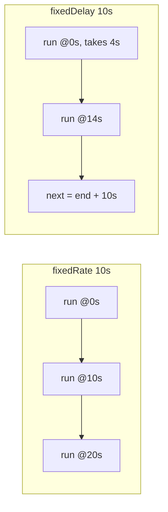

# Scheduling & Async

Two everyday needs in a backend: run code **on a schedule** (cleanups, reports,
polling) and run code **off the request thread** (emails, webhooks, parallel calls).
Spring gives you `@Scheduled` and `@Async` for both — small annotations with a few
sharp edges worth knowing.

<Note>
Snippets target **Spring Boot 3.x** on **Java 25**. For composing async pipelines in
depth, see [CompletableFuture](/docs/concurrency/completable-future/) and
[Executors & Thread Pools](/docs/concurrency/executors-and-thread-pools/).
</Note>

<ProgressTracker id="spring-scheduling-async" />

## Table of Contents

- [Scheduling: @Scheduled](#scheduling-scheduled)
- [fixedRate vs fixedDelay vs cron](#fixedrate-vs-fixeddelay-vs-cron)
- [The scheduler is single-threaded by default](#the-scheduler-is-single-threaded-by-default)
- [Scheduling across multiple instances](#scheduling-across-multiple-instances)
- [Async: @Async](#async-async)
- [Returning results from @Async](#returning-results-from-async)
- [Configuring the async executor](#configuring-the-async-executor)
- [@Async pitfalls](#async-pitfalls)
- [Scheduling vs async — which one?](#scheduling-vs-async--which-one)
- [Most Asked Interview Questions](#most-asked-interview-questions)
- [Things You Should Know](#things-you-should-know)

## Scheduling: @Scheduled

Enable scheduling once, then annotate `void`, no-argument methods on beans.

```java
@SpringBootApplication
@EnableScheduling                         // turn on the scheduler
public class ShopApplication { }

@Component
class ReportJobs {

    @Scheduled(fixedRate = 60_000)                       // every 60s (ms)
    void collectMetrics() { ... }

    @Scheduled(fixedDelay = 5, timeUnit = TimeUnit.MINUTES)   // 5 min AFTER each run ends
    void pollInbox() { ... }

    @Scheduled(cron = "0 0 2 * * *", zone = "Europe/London") // 02:00 every day
    void nightlyReport() { ... }

    @Scheduled(initialDelay = 10, fixedRate = 30, timeUnit = TimeUnit.SECONDS)
    void warmCache() { ... }                             // wait 10s, then every 30s
}
```

The cron expression is 6 fields: `second minute hour day-of-month month day-of-week`.

```text
 ┌───── second (0-59)
 │ ┌───── minute (0-59)
 │ │ ┌───── hour (0-23)
 │ │ │ ┌───── day of month (1-31)
 │ │ │ │ ┌───── month (1-12 or JAN-DEC)
 │ │ │ │ │ ┌───── day of week (0-7 or SUN-SAT)
 0 0 2 * * *      → 02:00:00 every day
 0 */15 * * * *   → every 15 minutes
 0 0 9 * * MON-FRI→ 09:00 on weekdays
```

## fixedRate vs fixedDelay vs cron

| Attribute | Fires | Use for |
| --- | --- | --- |
| `fixedRate` | Every N ms **from each start** (overlaps if the task runs long) | Steady cadence, fast tasks |
| `fixedDelay` | N ms **after the previous run finishes** | Avoid overlap; polling |
| `cron` | At wall-clock times | Daily/weekly jobs, business hours |



<Important>
`fixedRate` measures from the **start** of each run, so a task that takes longer than
the interval can pile up (and, with a bigger pool, run concurrently). `fixedDelay`
measures from the **end**, guaranteeing a gap and no overlap. For polling and
idempotency-sensitive jobs, prefer `fixedDelay`.
</Important>

## The scheduler is single-threaded by default

All `@Scheduled` methods share **one** thread unless you say otherwise. A slow job
therefore delays every other job.

```yaml title="application.yml"
spring:
  task:
    scheduling:
      pool:
        size: 4                      # give the scheduler a real pool
      thread-name-prefix: sched-
```

Or define a `TaskScheduler` bean for full control:

```java
@Bean
ThreadPoolTaskScheduler taskScheduler() {
    var s = new ThreadPoolTaskScheduler();
    s.setPoolSize(4);
    s.setThreadNamePrefix("sched-");
    s.setWaitForTasksToCompleteOnShutdown(true);
    return s;
}
```

<Warning>
With the default single-thread scheduler, one long or stuck job silently starves all
the others. Size the pool for the number of jobs that can run at once, and keep each
scheduled method short — delegate heavy work to an async executor or a queue.
</Warning>

## Scheduling across multiple instances

`@Scheduled` fires on **every** running instance. Deploy three replicas and your
"nightly report" runs three times. For a job that must run **once** cluster-wide, use a
distributed lock.

```java
// ShedLock: only one instance acquires the lock and runs the job
@Scheduled(cron = "0 0 2 * * *")
@SchedulerLock(name = "nightlyReport", lockAtMostFor = "10m", lockAtLeastFor = "1m")
void nightlyReport() { ... }
```

<Tip>
Options for "run once across the cluster": a distributed lock
([ShedLock](https://github.com/lukas-krecan/ShedLock) backed by your DB/Redis), a leader
election, or an external scheduler (Kubernetes `CronJob`, Quartz with a clustered
JobStore). ShedLock is the lightest for a Spring Boot fleet.
</Tip>

## Async: @Async

`@Async` makes a method return immediately and run on a separate thread. Enable it,
then annotate the method.

```java
@SpringBootApplication
@EnableAsync
public class ShopApplication { }

@Service
class NotificationService {

    @Async                                    // returns right away; runs on a pool thread
    public void sendWelcomeEmail(String to) {
        mailClient.send(to, "Welcome!");      // slow I/O off the request thread
    }
}
```

The caller continues without waiting — the request thread isn't blocked on the email.

## Returning results from @Async

Return `CompletableFuture<T>` when you need the result; return `void` for
fire-and-forget. Returning a future lets you run calls in **parallel** and combine them.

```java
@Async
public CompletableFuture<PriceDto> fetchPrice(String sku) {
    return CompletableFuture.completedFuture(pricingClient.get(sku));
}

// Caller: fan out, then join
CompletableFuture<PriceDto> a = pricing.fetchPrice("A");
CompletableFuture<PriceDto> b = pricing.fetchPrice("B");
CompletableFuture.allOf(a, b).join();          // both run concurrently
var result = List.of(a.join(), b.join());
```

## Configuring the async executor

Without configuration, `@Async` uses a `SimpleAsyncTaskExecutor` that creates a new
thread per task — fine for demos, dangerous under load. Define your own pool.

```java
@Configuration
class AsyncConfig implements AsyncConfigurer {

    @Override
    public Executor getAsyncExecutor() {
        var ex = new ThreadPoolTaskExecutor();
        ex.setCorePoolSize(8);
        ex.setMaxPoolSize(16);
        ex.setQueueCapacity(100);
        ex.setThreadNamePrefix("async-");
        ex.initialize();
        return ex;
    }

    @Override
    public AsyncUncaughtExceptionHandler getAsyncUncaughtExceptionHandler() {
        return (ex, method, params) ->           // void @Async swallows exceptions otherwise
            LoggerFactory.getLogger(AsyncConfig.class).error("Async error in {}", method, ex);
    }
}

// Pick a specific executor by bean name
@Async("reportExecutor")
public CompletableFuture<Report> build(Long id) { ... }
```

<Backend>
On Java 21+ you can back `@Async`/scheduling with **virtual threads** for I/O-bound work —
set `spring.threads.virtual.enabled=true`, or supply a
`newVirtualThreadPerTaskExecutor()`. Blocking calls then cost almost nothing, so you
rarely need a large bounded pool. See [Virtual Threads](/docs/concurrency/virtual-threads/).
</Backend>

## @Async pitfalls

<Warning>
- **Self-invocation doesn't work.** Calling an `@Async` method from another method in the
  *same* bean bypasses the Spring proxy and runs synchronously. Call it from a *different*
  bean (or inject self). Same rule as `@Transactional`.
- **Must be `public`** and on a Spring-managed bean (proxy-based).
- **`void` async swallows exceptions** — register an `AsyncUncaughtExceptionHandler`, or
  return `CompletableFuture` and handle failures on it.
- **Don't use the default executor in production** — an unbounded thread-per-task
  executor can exhaust resources. Configure a bounded pool (or virtual threads).
- **Context doesn't propagate automatically** — security/request/MDC context needs
  explicit propagation to the worker thread.
</Warning>

## Scheduling vs async — which one?

| | `@Scheduled` | `@Async` |
| --- | --- | --- |
| Trigger | Time (rate/delay/cron) | A method call |
| Returns | `void` only | `void` or `CompletableFuture<T>` |
| Typical use | Cleanups, reports, polling | Emails, webhooks, parallel I/O |
| Enable with | `@EnableScheduling` | `@EnableAsync` |

## Most Asked Interview Questions

### Beginner
- How do you run a method on a schedule in Spring Boot?
- `fixedRate` vs `fixedDelay`?
- What does `@Async` do and how do you enable it?

### Intermediate
- Why doesn't calling an `@Async` method from the same class work?
- How many threads does the default scheduler use, and why is that a problem?
- How do you get a result back from an async method?

### Advanced
- A `@Scheduled` job runs on 3 replicas but must execute once — how do you fix it?
- How do you configure and size the async/scheduling thread pools?
- How do exceptions behave in a `void` `@Async` method, and how do you catch them?
- How would virtual threads change your executor sizing?

### Coding
- Fan out three downstream calls with `@Async`/`CompletableFuture` and combine results.
- Write a nightly cron job guarded by a distributed lock.

## Things You Should Know

### 🔴 Must Know
- `@EnableScheduling` + `@Scheduled` with `fixedRate`/`fixedDelay`/`cron`.
- `@EnableAsync` + `@Async`; return `CompletableFuture<T>` for results.
- Self-invocation bypasses the proxy (async and transactional alike).

### 🟡 Good to Know
- The scheduler is single-threaded by default — size the pool.
- Configure a bounded `ThreadPoolTaskExecutor`; handle `void` async exceptions.
- `@Scheduled` fires on every instance — use ShedLock for run-once jobs.

### 🟢 Nice to Know
- Virtual-thread executors for I/O-bound async work.
- Context propagation (security/MDC) to worker threads.
- Quartz / Kubernetes CronJob as alternatives for clustered scheduling.
