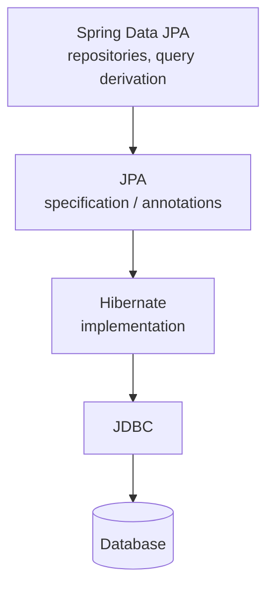
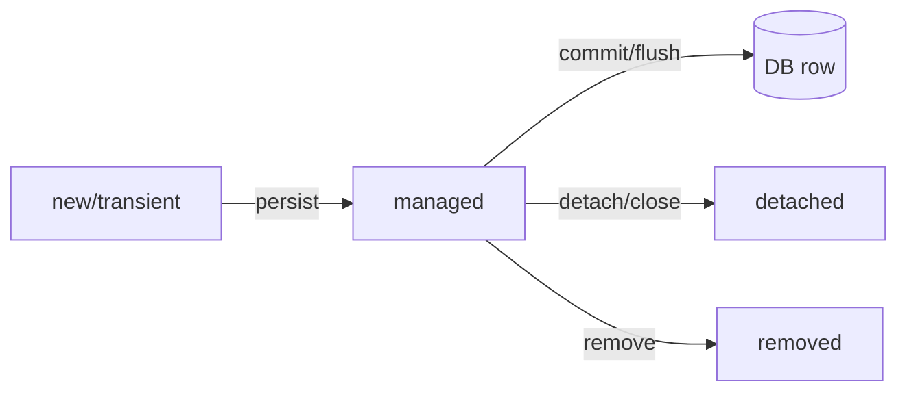

# Spring Data JPA & Hibernate

JPA maps objects to tables; Hibernate implements JPA; Spring Data JPA removes the
boilerplate. Together they're the most common Java persistence stack — and the
source of the most common production performance bugs.

<ProgressTracker id="jpa-overview" />

## Table of Contents

- [ORM, JPA, Hibernate, Spring Data](#orm-jpa-hibernate-spring-data)
- [Entities](#entities)
- [The persistence context & dirty checking](#the-persistence-context--dirty-checking)
- [Repositories](#repositories)
- [JPQL, derived & native queries](#jpql-derived--native-queries)
- [Transactions](#transactions)
- [Locking](#locking)
- [Topics in this section](#topics-in-this-section)
- [Most Asked Interview Questions](#most-asked-interview-questions)
- [Things You Should Know](#things-you-should-know)

## ORM, JPA, Hibernate, Spring Data



- **ORM** — the general idea of mapping objects ↔ relational tables.
- **JPA** — the standard (annotations, `EntityManager`, JPQL).
- **Hibernate** — the default JPA provider.
- **Spring Data JPA** — generates repository implementations from interfaces.

## Entities

```java
@Entity
@Table(name = "orders")
public class Order {

    @Id
    @GeneratedValue(strategy = GenerationType.IDENTITY)
    private Long id;

    @Column(nullable = false)
    private String status;

    @Column(nullable = false)
    private BigDecimal total;

    @Column(name = "created_at", updatable = false)
    private Instant createdAt;

    // JPA requires a no-arg constructor; getters/setters omitted
}
```

<Warning>
Avoid `@GeneratedValue(strategy = AUTO)` blindly. `IDENTITY` uses the DB
auto-increment but disables JDBC batch inserts; `SEQUENCE` (Postgres) allows
batching and is usually preferred for write-heavy systems.
</Warning>

## The persistence context & dirty checking

The **persistence context** (first-level cache) tracks managed entities within a
transaction. If you change a managed entity, Hibernate detects the change (**dirty
checking**) and flushes an `UPDATE` at commit — no explicit `save` needed.

```java
@Transactional
public void rename(Long id, String status) {
    Order order = repo.findById(id).orElseThrow();   // now managed
    order.setStatus(status);                          // dirty
    // no save() call — Hibernate flushes an UPDATE on commit
}
```



## Repositories

Extend `JpaRepository` and get CRUD + pagination for free.

```java
public interface OrderRepository extends JpaRepository<Order, Long> {
    List<Order> findByStatus(String status);              // derived query
    Page<Order> findByCustomerId(Long customerId, Pageable pageable);
    Optional<Order> findByIdAndStatus(Long id, String status);
}
```

## JPQL, derived & native queries

```java
public interface OrderRepository extends JpaRepository<Order, Long> {

    // Derived: method name parsed into a query
    long countByStatus(String status);

    // JPQL: object-oriented query over entities, not tables
    @Query("SELECT o FROM Order o WHERE o.total > :min ORDER BY o.total DESC")
    List<Order> findExpensive(@Param("min") BigDecimal min);

    // Native SQL when you need DB-specific features
    @Query(value = "SELECT * FROM orders WHERE created_at > now() - interval '7 days'",
           nativeQuery = true)
    List<Order> recent();
}
```

## Transactions

`@Transactional` opens a transaction, binds a connection to the thread, and
commits/rolls back around your method (via a proxy — see [Spring Core](/docs/spring-core/)).

```java
@Service
public class TransferService {

    @Transactional                       // commit on success, rollback on RuntimeException
    public void transfer(Long from, Long to, BigDecimal amount) {
        accounts.debit(from, amount);
        accounts.credit(to, amount);     // if this throws, the debit rolls back too
    }

    @Transactional(readOnly = true)      // hints no flush; can optimize
    public List<Account> list() { return accounts.findAll(); }
}
```

**Key behaviors:**
- Rolls back on unchecked (`RuntimeException`) by default, **not** checked exceptions
  (override with `rollbackFor`).
- **Propagation** (`REQUIRED` default, `REQUIRES_NEW`, etc.) controls whether a new
  transaction joins or suspends an existing one.
- **Isolation** maps to the DB isolation levels ([SQL & Databases](/docs/database/)).

<Warning>
Self-invocation (`this.otherTransactionalMethod()`) bypasses the proxy, so the inner
`@Transactional` is ignored. Call through an injected bean instead.
</Warning>

## Locking

- **Optimistic locking** — a `@Version` column; the update fails if the row changed
  since you read it. Best for low-contention web apps.
- **Pessimistic locking** — `SELECT ... FOR UPDATE` locks the row. Use for hot rows
  with real contention (inventory decrement).

```java
@Entity
public class Product {
    @Id private Long id;
    @Version private long version;   // optimistic lock
    private int stock;
}
```

## Topics in this section

<div className="jbm-card-grid">
  <Link className="jbm-card" to="/docs/spring-data-jpa/entity-relationships">
    <div className="jbm-card__icon">🔗</div>
    <h3>Entity Relationships</h3>
    <p>One-to-One, One-to-Many, Many-to-Many, mappedBy, cascade, orphan removal.</p>
  </Link>
  <Link className="jbm-card" to="/docs/spring-data-jpa/n-plus-one">
    <div className="jbm-card__icon">🐘</div>
    <h3>The N+1 Problem</h3>
    <p>Lazy vs eager loading, fetch joins, entity graphs, and how to detect it.</p>
  </Link>
</div>

## Most Asked Interview Questions

### Beginner
- JPA vs Hibernate vs Spring Data JPA?
- What is an entity?

### Intermediate
- What is the persistence context and dirty checking?
- Lazy vs eager loading?
- What does `@Transactional` do?

### Advanced
- What is the N+1 problem and how do you fix it?
- Optimistic vs pessimistic locking?
- Transaction propagation levels?

### Coding
- Write a paginated derived query and a JPQL fetch join.

## Things You Should Know

### 🔴 Must Know
- Entity annotations, persistence context, dirty checking.
- `JpaRepository`, derived queries, JPQL.
- `@Transactional` semantics + self-invocation pitfall.

### 🟡 Good to Know
- Lazy vs eager and the N+1 problem.
- Optimistic locking with `@Version`.
- IDENTITY vs SEQUENCE id generation.

### 🟢 Nice to Know
- Second-level cache, `@BatchSize`.
- Specifications and the Criteria API.
