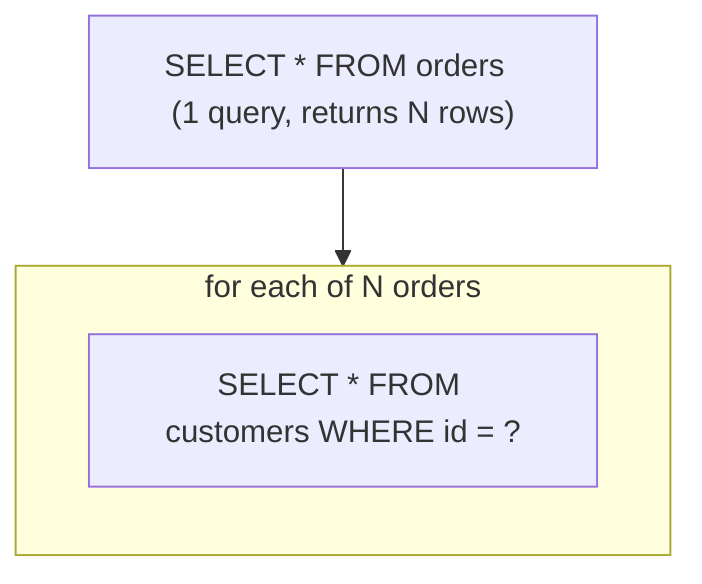

# The N+1 Problem

The single most common JPA performance bug — and a favorite interview question.

<ProgressTracker id="n-plus-one" />

## Table of Contents

- [What is it?](#what-is-it)
- [How it happens](#how-it-happens)
- [How to detect it](#how-to-detect-it)
- [The fixes](#the-fixes)
- [Interview questions](#interview-questions)
- [Things You Should Know](#things-you-should-know)

## What is it?

You load N parent rows in one query, then lazily access an association on each,
triggering **N additional queries** — 1 + N total. With 100 orders each touching
`order.getCustomer()`, that's 101 queries instead of 1.

## How it happens

```java
List<Order> orders = orderRepository.findAll();   // 1 query
for (Order o : orders) {
    System.out.println(o.getCustomer().getName()); // +1 query PER order (lazy)
}
```



## How to detect it

<Tip>
Turn on SQL logging in a test/dev profile and count the queries:

```yaml
spring:
  jpa:
    properties:
      hibernate.format_sql: true
  logging:
    level:
      org.hibernate.SQL: DEBUG
```

Better: add a query-count assertion in integration tests (e.g. datasource-proxy or
Hibernate statistics) so a regression fails the build.
</Tip>

## The fixes

### 1. Fetch join (JPQL)

Load the association in the same query.

```java
@Query("SELECT o FROM Order o JOIN FETCH o.customer")
List<Order> findAllWithCustomer();
```

### 2. Entity graph

Declarative fetch plan without writing JPQL.

```java
@EntityGraph(attributePaths = {"customer", "items"})
List<Order> findByStatus(String status);
```

### 3. Batch fetching

Tell Hibernate to load lazy associations in batches (turns N queries into N/size).

```java
@BatchSize(size = 50)              // on the entity or collection
@OneToMany(mappedBy = "order")
private List<LineItem> items;
```

```properties
# Or globally
spring.jpa.properties.hibernate.default_batch_fetch_size=50
```

<Warning>
Do **not** "fix" N+1 by making everything EAGER — that just moves the problem and
can load enormous graphs on every query. Fetch exactly what a use case needs with a
fetch join or entity graph, and beware the **MultipleBagFetchException** when fetch-
joining two collections (fetch one collection per query, or use `Set`).
</Warning>

## Interview questions

**Q: What is the N+1 problem?**
One query loads N parents; lazily accessing an association fires one query per
parent, totaling 1 + N queries.

**Q: How do you fix it?**
`JOIN FETCH`, `@EntityGraph`, or batch fetching — load associations deliberately per
use case. Don't blanket-EAGER.

**Q: Why not make associations EAGER to avoid it?**
EAGER loads the association on *every* query even when unused, causes cartesian
products with multiple collections, and removes control over fetch strategy.

## Things You Should Know

### 🔴 Must Know
- What N+1 is and how lazy access triggers it.
- Fix with fetch join / entity graph / batch size.
- Never blanket-EAGER as a fix.

### 🟡 Good to Know
- Detecting it via SQL logging and query-count assertions.
- MultipleBagFetchException and its workaround.

### 🟢 Nice to Know
- DTO projections to fetch only needed columns.
- Hibernate statistics for query counting.
