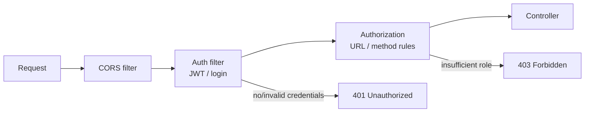
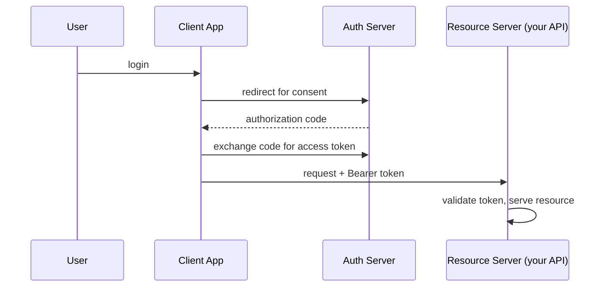

# Spring Security

Security is where a leaked stack trace becomes a breach. Spring Security is a filter
chain that authenticates who you are and authorizes what you can do.

<ProgressTracker id="security-overview" />

## Table of Contents

- [Authentication vs authorization](#authentication-vs-authorization)
- [The security filter chain](#the-security-filter-chain)
- [Password hashing](#password-hashing)
- [UserDetails & roles](#userdetails--roles)
- [A stateless config](#a-stateless-config)
- [CORS & CSRF](#cors--csrf)
- [OAuth2 basics](#oauth2-basics)
- [Topics in this section](#topics-in-this-section)
- [Most Asked Interview Questions](#most-asked-interview-questions)
- [Things You Should Know](#things-you-should-know)

## Authentication vs authorization

- **Authentication (AuthN)** — *who are you?* Verifying identity (credentials, token).
- **Authorization (AuthZ)** — *what may you do?* Checking permissions/roles.

## The security filter chain

Every request passes through an ordered chain of servlet filters before reaching
your controller.



## Password hashing

<Important>
Never store plaintext or reversibly-encrypted passwords. Hash with a slow,
salted, adaptive algorithm. Spring's default `BCryptPasswordEncoder` salts
automatically and is intentionally slow to resist brute force.
</Important>

```java
@Bean
PasswordEncoder passwordEncoder() {
    return new BCryptPasswordEncoder();   // salted, adaptive work factor
}

// Registration
String hash = passwordEncoder.encode(rawPassword);
// Login
boolean ok = passwordEncoder.matches(rawPassword, storedHash);
```

## UserDetails & roles

Spring loads users via `UserDetailsService` and represents authorities as roles.

```java
@Service
public class DbUserDetailsService implements UserDetailsService {
    private final UserRepository users;
    public DbUserDetailsService(UserRepository users) { this.users = users; }

    @Override
    public UserDetails loadUserByUsername(String email) {
        User u = users.findByEmail(email)
            .orElseThrow(() -> new UsernameNotFoundException(email));
        return org.springframework.security.core.userdetails.User
            .withUsername(u.getEmail())
            .password(u.getPasswordHash())
            .roles(u.getRoles().toArray(String[]::new))   // ROLE_ADMIN etc.
            .build();
    }
}
```

Enforce authorization declaratively:

```java
@PreAuthorize("hasRole('ADMIN')")
public void deleteUser(Long id) { ... }
```

## A stateless config

Modern APIs are stateless (no server session) and secured with tokens.

```java
@Configuration
@EnableWebSecurity
@EnableMethodSecurity   // enables @PreAuthorize
public class SecurityConfig {

    @Bean
    SecurityFilterChain filterChain(HttpSecurity http, JwtAuthFilter jwtFilter) throws Exception {
        http
          .csrf(csrf -> csrf.disable())                 // safe: no cookies, token in header
          .sessionManagement(s -> s.sessionCreationPolicy(SessionCreationPolicy.STATELESS))
          .authorizeHttpRequests(auth -> auth
              .requestMatchers("/api/auth/**").permitAll()
              .requestMatchers("/actuator/health").permitAll()
              .anyRequest().authenticated())
          .addFilterBefore(jwtFilter, UsernamePasswordAuthenticationFilter.class);
        return http.build();
    }
}
```

## CORS & CSRF

- **CORS** — browsers block cross-origin requests unless the server opts in.
  Configure allowed origins/methods explicitly (never `*` with credentials).
- **CSRF** — an attack that rides a victim's cookies. It matters for
  **cookie/session** auth. For stateless APIs using a bearer token in the
  `Authorization` header, CSRF protection is typically disabled (there's no ambient
  cookie to exploit).

<Warning>
"Disable CSRF" is correct **only** for token-based stateless APIs. If you use
session cookies, keep CSRF protection on.
</Warning>

## OAuth2 basics

OAuth2 delegates authentication to an authorization server (Google, Okta, Keycloak).
Your API becomes a **resource server** that validates the issued token (often a JWT)
rather than handling passwords itself.



## Topics in this section

<div className="jbm-card-grid">
  <Link className="jbm-card" to="/docs/security/jwt-authentication">
    <div className="jbm-card__icon">🔑</div>
    <h3>JWT Authentication</h3>
    <p>Access & refresh tokens, filter, expiration — a complete stateless flow.</p>
  </Link>
</div>

## Most Asked Interview Questions

### Beginner
- Authentication vs authorization?
- Why hash passwords, and why BCrypt?

### Intermediate
- How does the security filter chain work?
- What is CORS and when do you disable CSRF?

### Advanced
- How does JWT-based stateless auth work end to end?
- Session vs token authentication trade-offs?

### Coding
- Configure a `SecurityFilterChain` that permits `/api/auth/**` and secures the rest.

## Things You Should Know

### 🔴 Must Know
- AuthN vs AuthZ; the filter chain.
- BCrypt password hashing.
- Stateless config with roles and `@PreAuthorize`.

### 🟡 Good to Know
- CORS setup; when to disable CSRF.
- `UserDetailsService` integration.

### 🟢 Nice to Know
- OAuth2 resource server + JWT validation.
- Method vs URL security.
