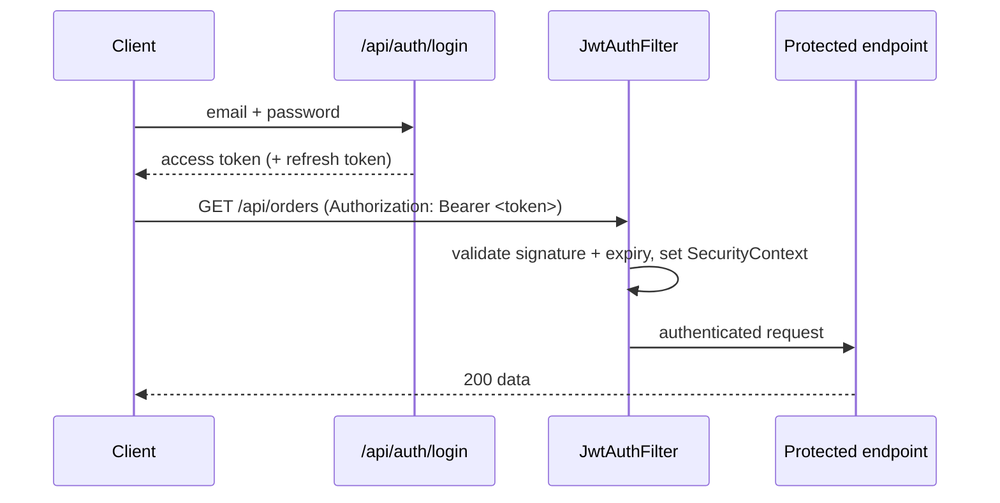

# JWT Authentication

<ProgressTracker id="jwt-authentication" />

## Table of Contents

- [What is a JWT?](#what-is-a-jwt)
- [The flow](#the-flow)
- [Issuing tokens on login](#issuing-tokens-on-login)
- [The authentication filter](#the-authentication-filter)
- [Access vs refresh tokens](#access-vs-refresh-tokens)
- [Common mistakes](#common-mistakes)
- [Interview questions](#interview-questions)
- [Things You Should Know](#things-you-should-know)

## What is a JWT?

A JSON Web Token is a signed, self-contained token with three base64url parts:
`header.payload.signature`.

```text
eyJhbGciOiJIUzI1NiJ9.eyJzdWIiOiJ1c2VyQGV4LmNvbSIsImV4cCI6MTcwMH0.<signature>
   header                    payload (claims)                      signature
```

- **Header** — algorithm (e.g. `HS256`, `RS256`).
- **Payload** — claims: `sub` (subject), `exp` (expiry), roles, etc. **Not encrypted** — readable by anyone.
- **Signature** — verifies the token wasn't tampered with, using a secret (HMAC) or private key (RSA).

<Warning>
JWT payloads are signed, not encrypted. Never put secrets (passwords, card numbers)
in the claims — anyone can decode them. The signature only guarantees integrity.
</Warning>

## The flow



## Issuing tokens on login

```java
@Service
public class JwtService {
    private final SecretKey key = Keys.hmacShaKeyFor(secret.getBytes());
    private final Duration accessTtl = Duration.ofMinutes(15);

    public String generateAccessToken(UserDetails user) {
        Instant now = Instant.now();
        return Jwts.builder()
            .subject(user.getUsername())
            .claim("roles", user.getAuthorities().stream().map(Object::toString).toList())
            .issuedAt(Date.from(now))
            .expiration(Date.from(now.plus(accessTtl)))
            .signWith(key)
            .compact();
    }

    public String extractUsername(String token) {
        return Jwts.parser().verifyWith(key).build()
            .parseSignedClaims(token).getPayload().getSubject();
    }
}

@RestController
@RequestMapping("/api/auth")
class AuthController {
    private final AuthenticationManager authManager;
    private final JwtService jwt;
    private final UserDetailsService users;
    // constructor omitted

    @PostMapping("/login")
    LoginResponse login(@Valid @RequestBody LoginRequest req) {
        authManager.authenticate(
            new UsernamePasswordAuthenticationToken(req.email(), req.password()));
        UserDetails user = users.loadUserByUsername(req.email());
        return new LoginResponse(jwt.generateAccessToken(user));
    }
}
```

## The authentication filter

A `OncePerRequestFilter` reads the token, validates it, and populates the
`SecurityContext` so downstream authorization works.

```java
@Component
public class JwtAuthFilter extends OncePerRequestFilter {
    private final JwtService jwt;
    private final UserDetailsService users;
    // constructor omitted

    @Override
    protected void doFilterInternal(HttpServletRequest req, HttpServletResponse res,
                                    FilterChain chain) throws ServletException, IOException {
        String header = req.getHeader("Authorization");
        if (header != null && header.startsWith("Bearer ")) {
            String token = header.substring(7);
            try {
                String username = jwt.extractUsername(token);      // throws if invalid/expired
                UserDetails user = users.loadUserByUsername(username);
                var auth = new UsernamePasswordAuthenticationToken(
                    user, null, user.getAuthorities());
                SecurityContextHolder.getContext().setAuthentication(auth);
            } catch (JwtException e) {
                // invalid token -> leave context empty -> 401 downstream
            }
        }
        chain.doFilter(req, res);
    }
}
```

## Access vs refresh tokens

| | Access token | Refresh token |
| --- | --- | --- |
| Lifetime | Short (5–15 min) | Long (days/weeks) |
| Sent on | Every API call | Only to refresh endpoint |
| Storage | Memory (client) | Secure, http-only cookie or secure store |
| Revocation | Expires quickly | Stored server-side so it can be revoked |

Short access tokens limit the blast radius of a leak; the refresh token mints new
access tokens without re-login, and can be revoked (logout, compromise).

<Important>
Because JWTs are stateless, you can't "delete" an access token server-side — it's
valid until `exp`. Keep access tokens short-lived, and use a server-side allow/deny
list of refresh tokens (or a token version per user) to support real logout and
revocation.
</Important>

## Common mistakes

<Warning>
- Long-lived access tokens with no revocation strategy.
- Storing secrets/PII in the (readable) payload.
- Weak or hard-coded signing secrets; use a strong secret or RSA keys from config.
- Not validating `exp`/signature on every request.
- Storing tokens in `localStorage` where XSS can steal them — prefer http-only cookies for refresh tokens.
</Warning>

## Interview questions

**Q: How does JWT auth work?**
Server verifies credentials and returns a signed token; the client sends it as a
`Bearer` header; a filter validates the signature/expiry and sets the security
context — no server session needed.

**Q: Session vs JWT?**
Sessions store state server-side (easy revocation, needs sticky sessions/shared
store). JWTs are stateless and scale horizontally but are hard to revoke before
expiry.

**Q: Why access + refresh tokens?**
Short access tokens limit leak damage; refresh tokens allow re-issuing without
re-login and can be revoked server-side.

## Things You Should Know

### 🔴 Must Know
- JWT = header.payload.signature; signed not encrypted.
- The Bearer-token filter flow and stateless context.
- Access vs refresh token strategy.

### 🟡 Good to Know
- Revocation strategies for stateless tokens.
- Safe secret/key management.

### 🟢 Nice to Know
- RS256 (asymmetric) for multi-service token validation.
- Token introspection with OAuth2.
