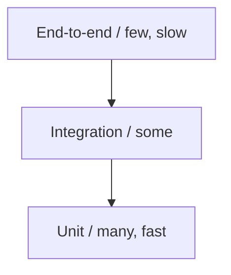

# Testing

Untested backend code is unshippable. This section covers the test pyramid and the
Spring Boot testing toolkit from fast unit tests to realistic integration tests.

<ProgressTracker id="testing-overview" />

## Table of Contents

- [The test pyramid](#the-test-pyramid)
- [JUnit 5](#junit-5)
- [Mockito](#mockito)
- [Service unit test](#service-unit-test)
- [Controller test with MockMvc](#controller-test-with-mockmvc)
- [Repository slice test](#repository-slice-test)
- [Integration test & Testcontainers](#integration-test--testcontainers)
- [Deep-dive topics](#deep-dive-topics)
- [Most Asked Interview Questions](#most-asked-interview-questions)
- [Things You Should Know](#things-you-should-know)

## The test pyramid



Many fast unit tests, fewer integration tests, very few end-to-end tests. Push
detailed logic checks down to unit tests; reserve integration tests for wiring and
real database behavior.

## JUnit 5

```java
class PriceCalculatorTest {

    @Test
    void appliesPercentageDiscount() {
        var calc = new PriceCalculator();
        assertEquals(new BigDecimal("90.00"), calc.apply(new BigDecimal("100.00"), 0.10));
    }

    @ParameterizedTest
    @CsvSource({"100,0.10,90.00", "50,0.20,40.00"})
    void discounts(BigDecimal price, double pct, BigDecimal expected) {
        assertEquals(0, expected.compareTo(new PriceCalculator().apply(price, pct)));
    }

    @Test
    void rejectsNegativePrice() {
        assertThrows(IllegalArgumentException.class,
            () -> new PriceCalculator().apply(new BigDecimal("-1"), 0.1));
    }
}
```

Key annotations: `@Test`, `@BeforeEach`/`@AfterEach`, `@ParameterizedTest`,
`@DisplayName`, `@Nested`.

## Mockito

Mock collaborators so a unit test exercises one class in isolation.

```java
@ExtendWith(MockitoExtension.class)
class UserServiceTest {
    @Mock UserRepository repo;
    @InjectMocks UserService service;   // repo injected into the service

    @Test
    void returnsUserWhenFound() {
        when(repo.findById(1L)).thenReturn(Optional.of(new User(1L, "Ann", "a@x.com")));
        assertEquals("Ann", service.getById(1L).name());
        verify(repo).findById(1L);
    }

    @Test
    void throwsWhenMissing() {
        when(repo.findById(9L)).thenReturn(Optional.empty());
        assertThrows(UserNotFoundException.class, () -> service.getById(9L));
    }
}
```

## Service unit test

Service tests mock the repository and assert business behavior — fast, no Spring
context, no database.

## Controller test with MockMvc

`@WebMvcTest` loads only the web layer; mock the service to test request mapping,
validation, and status codes.

```java
@WebMvcTest(UserController.class)
class UserControllerTest {
    @Autowired MockMvc mvc;
    @MockBean UserService service;   // service mocked, not real

    @Test
    void returns404WhenMissing() throws Exception {
        when(service.getById(9L)).thenThrow(new UserNotFoundException(9L));
        mvc.perform(get("/api/users/9"))
           .andExpect(status().isNotFound())
           .andExpect(jsonPath("$.code").value("USER_NOT_FOUND"));
    }

    @Test
    void rejectsInvalidBody() throws Exception {
        mvc.perform(post("/api/users")
                .contentType(MediaType.APPLICATION_JSON)
                .content("{\"name\":\"\",\"email\":\"bad\"}"))
           .andExpect(status().isBadRequest());
    }
}
```

## Repository slice test

`@DataJpaTest` spins up only JPA + an in-memory (or Testcontainers) database to test
queries.

```java
@DataJpaTest
class UserRepositoryTest {
    @Autowired UserRepository repo;

    @Test
    void findsByEmail() {
        repo.save(new User(null, "Ann", "a@x.com"));
        assertTrue(repo.findByEmail("a@x.com").isPresent());
    }
}
```

## Integration test & Testcontainers

<Backend>
In-memory databases (H2) don't behave exactly like Postgres (types, functions,
locking). **Testcontainers** runs a real Postgres in Docker for the test, giving you
production-accurate behavior.
</Backend>

```java
@SpringBootTest
@Testcontainers
class OrderFlowIntegrationTest {

    @Container
    static PostgreSQLContainer<?> postgres = new PostgreSQLContainer<>("postgres:16");

    @DynamicPropertySource
    static void props(DynamicPropertyRegistry registry) {
        registry.add("spring.datasource.url", postgres::getJdbcUrl);
        registry.add("spring.datasource.username", postgres::getUsername);
        registry.add("spring.datasource.password", postgres::getPassword);
    }

    @Autowired OrderService orderService;

    @Test
    void placesOrderEndToEnd() { /* real DB, real transactions */ }
}
```

## Deep-dive topics

<div className="jbm-card-grid">
  <Link className="jbm-card" to="/docs/testing/unit-testing-mockito">
    <div className="jbm-card__icon">🧪</div>
    <h3>Unit Testing & Mockito</h3>
    <p>JUnit 5, AssertJ, stubbing, verifying, argument captors, parameterized tests.</p>
  </Link>
  <Link className="jbm-card" to="/docs/testing/integration-testcontainers">
    <div className="jbm-card__icon">🐳</div>
    <h3>Integration & Testcontainers</h3>
    <p>Slices (@WebMvcTest/@DataJpaTest), MockMvc, and real databases with Testcontainers.</p>
  </Link>
</div>

## Most Asked Interview Questions

### Beginner
- Unit vs integration test?
- What is the test pyramid?

### Intermediate
- What does Mockito do and when do you mock?
- `@WebMvcTest` vs `@SpringBootTest` vs `@DataJpaTest`?

### Advanced
- Why Testcontainers over H2?
- How do you test transactional rollback behavior?

### Coding
- Write a MockMvc test asserting a 404 error contract.

## Things You Should Know

### 🔴 Must Know
- Test pyramid; JUnit 5 basics; Mockito mocking.
- Slice tests: `@WebMvcTest`, `@DataJpaTest`.
- MockMvc for controllers.

### 🟡 Good to Know
- Testcontainers for real-DB integration tests.
- `@MockBean` vs `@Mock`.

### 🟢 Nice to Know
- Test data builders, AssertJ fluent assertions.
- Contract testing (Spring Cloud Contract).
