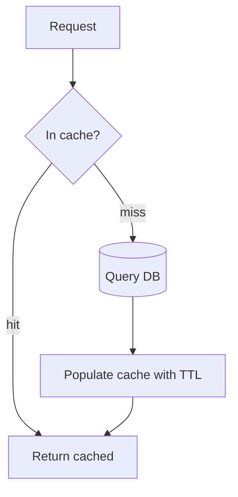

# Redis & Caching

Caching turns a 50ms database query into a 1ms memory lookup. Redis is the default
distributed cache — but caching's hard part isn't reading, it's **invalidation**.

<ProgressTracker id="redis-overview" />

## Table of Contents

- [Why caching?](#why-caching)
- [Caching strategies](#caching-strategies)
- [TTL & invalidation](#ttl--invalidation)
- [Redis data structures](#redis-data-structures)
- [Spring caching](#spring-caching)
- [Cache failure modes](#cache-failure-modes)
- [Distributed locks](#distributed-locks)
- [Rate limiting](#rate-limiting)
- [Most Asked Interview Questions](#most-asked-interview-questions)
- [Things You Should Know](#things-you-should-know)

## Why caching?

Store the result of an expensive operation (a query, an API call, a computation) so
repeated requests are served from fast memory. It reduces latency and offloads the
database — as long as the data can tolerate being slightly stale.

## Caching strategies

| Strategy | How it works | Best for |
| --- | --- | --- |
| **Cache-aside** (lazy) | App checks cache; on miss, loads DB and populates cache | Read-heavy, most common |
| **Read-through** | Cache library loads from DB on miss | Encapsulated cache layer |
| **Write-through** | Write goes to cache and DB synchronously | Consistency-sensitive reads |
| **Write-back** (write-behind) | Write to cache, async flush to DB | Write-heavy, tolerant of loss risk |



Cache-aside pseudocode:

```java
public User getUser(Long id) {
    User cached = redis.get("user:" + id);
    if (cached != null) return cached;             // hit
    User user = repository.findById(id).orElseThrow();
    redis.set("user:" + id, user, Duration.ofMinutes(10));  // populate with TTL
    return user;
}
```

## TTL & invalidation

<Important>
Every cache entry should have a **TTL** (time-to-live) so stale data self-expires.
On writes, either **evict** the key (simplest, correct) or **update** it. Cache
invalidation is famously hard — when in doubt, evict and let the next read repopulate.
</Important>

## Redis data structures

Redis is more than key→string. Choosing the right structure is the skill.

| Type | Use |
| --- | --- |
| String | Simple cached value, counter (`INCR`) |
| Hash | Object fields (`user:1 -> {name, email}`) |
| List | Queues, recent-items feed |
| Set | Unique membership, tags |
| Sorted Set (ZSet) | Leaderboards, rate limiting by time window |
| Streams | Event log / lightweight messaging |

## Spring caching

Declarative caching with annotations backed by Redis.

```java
@Service
public class ProductService {

    @Cacheable(value = "products", key = "#id")
    public Product getById(Long id) {           // result cached; method skipped on hit
        return repository.findById(id).orElseThrow();
    }

    @CacheEvict(value = "products", key = "#product.id")
    public Product update(Product product) {    // evict stale entry on write
        return repository.save(product);
    }

    @CacheEvict(value = "products", allEntries = true)
    public void reloadCatalog() { }             // clear the whole cache region
}
```

```yaml
spring:
  cache:
    type: redis
  data:
    redis:
      host: localhost
      port: 6379
```

## Cache failure modes

<Warning>
- **Cache penetration** — queries for keys that don't exist bypass the cache and hit
  the DB every time. Fix: cache "not found" markers or use a Bloom filter.
- **Cache stampede / thundering herd** — a popular key expires and thousands of
  requests rebuild it at once. Fix: a short lock/single-flight rebuild, or staggered
  TTLs (jitter).
- **Cache avalanche** — many keys expire simultaneously. Fix: randomized TTLs.
</Warning>

## Distributed locks

Coordinate across instances so only one node performs an action (e.g. a scheduled
job). Use `SET key value NX PX ttl` (set-if-absent with expiry).

```java
boolean acquired = redis.opsForValue()
    .setIfAbsent("lock:reindex", nodeId, Duration.ofSeconds(30));
if (acquired) {
    try { reindex(); }
    finally { /* release only if still owner */ }
}
```

<Warning>
A naive Redis lock is not perfectly safe under failover. For strong guarantees use
the Redlock algorithm or a purpose-built library (Redisson), and always set a TTL so
a crashed holder doesn't deadlock everyone.
</Warning>

## Rate limiting

Limit requests per client using a counter with expiry (fixed window) or a sorted set
(sliding window).

```java
// Fixed-window: allow N requests per minute
String key = "rate:" + userId + ":" + currentMinute();
Long count = redis.opsForValue().increment(key);
if (count == 1) redis.expire(key, Duration.ofMinutes(1));
if (count > limit) throw new TooManyRequestsException();
```

## Most Asked Interview Questions

### Beginner
- Why cache? What's a cache hit/miss?
- What is TTL?

### Intermediate
- Cache-aside vs write-through vs write-back?
- How do you invalidate a cache on writes?

### Advanced
- Explain cache penetration, stampede, and avalanche and their fixes.
- How do distributed locks work in Redis and where do they fail?

### Coding
- Implement cache-aside and a fixed-window rate limiter with Redis.

## Things You Should Know

### 🔴 Must Know
- Cache-aside pattern with TTL.
- Evict on write; invalidation is the hard part.
- `@Cacheable`/`@CacheEvict`.

### 🟡 Good to Know
- Redis data structures and their uses.
- Penetration/stampede/avalanche mitigations.

### 🟢 Nice to Know
- Redlock, Redisson, sliding-window rate limiting.
- Redis persistence (RDB/AOF) and eviction policies.
