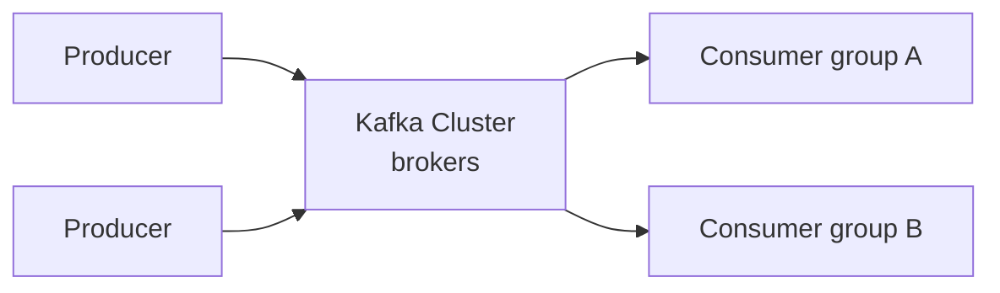
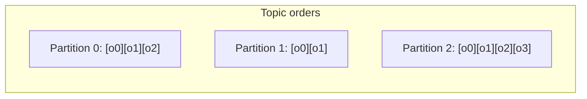
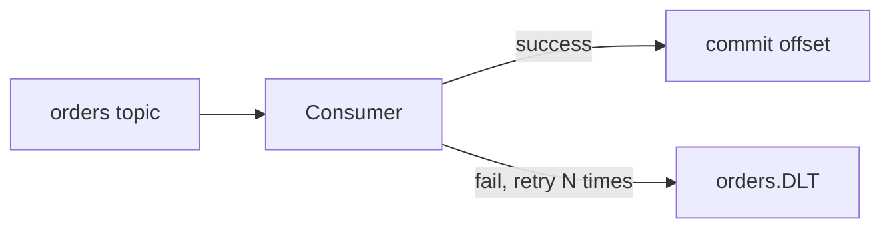

# Kafka & Messaging

Asynchronous messaging decouples services: the producer doesn't wait for the
consumer. Kafka is the de facto backbone for event-driven backends — durable,
ordered-per-partition, and horizontally scalable.

<ProgressTracker id="kafka-overview" />

## Table of Contents

- [Synchronous vs asynchronous](#synchronous-vs-asynchronous)
- [Kafka architecture](#kafka-architecture)
- [Topics, partitions, offsets](#topics-partitions-offsets)
- [Consumer groups](#consumer-groups)
- [Ordering & replication](#ordering--replication)
- [Delivery semantics](#delivery-semantics)
- [Retries & dead-letter topics](#retries--dead-letter-topics)
- [Idempotent consumers](#idempotent-consumers)
- [Spring Kafka](#spring-kafka)
- [Most Asked Interview Questions](#most-asked-interview-questions)
- [Things You Should Know](#things-you-should-know)

## Synchronous vs asynchronous

- **Synchronous (REST):** caller blocks for a response; tight coupling; failure of
  the callee fails the caller.
- **Asynchronous (messaging):** producer emits an event and moves on; consumers
  process independently; a slow/dead consumer doesn't block the producer.

<Backend>
Use messaging for work that can happen out-of-band: sending emails, updating search
indexes, generating invoices, cross-service notifications. Keep the user's request
fast by publishing an event and returning immediately.
</Backend>

## Kafka architecture



- **Broker** — a Kafka server; a cluster has many.
- **Producer** — publishes records to a topic.
- **Consumer** — reads records from a topic.
- **Topic** — a named, append-only log of records.

## Topics, partitions, offsets

A topic is split into **partitions** for parallelism. Each record in a partition has
a monotonically increasing **offset**. Consumers track their offset to know what
they've read.



<Important>
The **partition key** decides which partition a record lands in
(`hash(key) % partitions`). All records with the same key go to the same partition —
which is how Kafka preserves order for that key (e.g. all events for one `orderId`).
</Important>

## Consumer groups

Consumers in the same group **share** the partitions of a topic — each partition is
consumed by exactly one consumer in the group, enabling horizontal scaling.

- More consumers than partitions → some sit idle (partition count caps parallelism).
- Different groups each get the **full** stream (pub/sub fan-out).

## Ordering & replication

- **Ordering** is guaranteed **within a partition**, not across the topic. Need
  global order? Use one partition (no parallelism) or order by key.
- **Replication** copies each partition to multiple brokers. The **leader** handles
  reads/writes; **followers** replicate. `acks=all` waits for the in-sync replicas
  to confirm before acknowledging a write — durability over latency.

## Delivery semantics

| Semantic | Meaning | How |
| --- | --- | --- |
| **At-most-once** | May lose messages, never duplicates | Commit offset before processing |
| **At-least-once** | Never lose, may duplicate | Process then commit offset (default) |
| **Exactly-once** | No loss, no duplicates | Idempotent producer + transactions |

<Interview>
Most systems run **at-least-once** and make consumers **idempotent** — that's simpler
and more robust than chasing true exactly-once. "Exactly-once" in Kafka works within
Kafka (transactions) but the moment you touch an external DB, you still need
idempotency.
</Interview>

## Retries & dead-letter topics

When processing fails, retry with backoff; after N failures, route the record to a
**dead-letter topic (DLT)** for inspection instead of blocking the partition.



## Idempotent consumers

Because at-least-once can redeliver, a consumer must handle duplicates safely — e.g.
track processed message ids, or use an upsert/`INSERT ... ON CONFLICT`.

```java
public void handle(OrderEvent event) {
    if (processed.contains(event.id())) return;   // dedupe
    orderService.apply(event);
    processed.add(event.id());
}
```

## Spring Kafka

```java
@Component
class OrderEventListener {

    @KafkaListener(topics = "orders", groupId = "billing")
    public void onOrder(OrderEvent event) {
        billingService.invoice(event);   // at-least-once; must be idempotent
    }
}

@Service
class OrderProducer {
    private final KafkaTemplate<String, OrderEvent> template;
    OrderProducer(KafkaTemplate<String, OrderEvent> template) { this.template = template; }

    void publish(OrderEvent event) {
        template.send("orders", event.orderId(), event);  // key = orderId -> ordered per order
    }
}
```

```yaml
spring:
  kafka:
    bootstrap-servers: localhost:9092
    producer:
      acks: all               # durability
    consumer:
      group-id: billing
      enable-auto-commit: false   # commit after successful processing
      auto-offset-reset: earliest
```

## Most Asked Interview Questions

### Beginner
- Sync vs async communication?
- What is a topic, partition, and offset?

### Intermediate
- What is a consumer group and how does it scale?
- How does Kafka guarantee ordering?

### Advanced
- Explain delivery semantics; how do you achieve effective exactly-once?
- How do retries and dead-letter topics work?

### Coding
- Write an idempotent `@KafkaListener` with manual offset commit.

## Things You Should Know

### 🔴 Must Know
- Topics/partitions/offsets/consumer groups.
- Ordering is per-partition; key controls partitioning.
- At-least-once + idempotent consumers.

### 🟡 Good to Know
- Replication, `acks=all`, ISR.
- Retries + DLT.

### 🟢 Nice to Know
- Exactly-once via transactions; the outbox pattern.
- Log compaction and retention.
