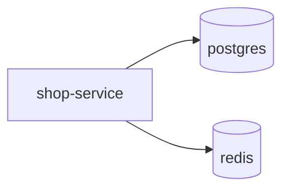

# Docker & Deployment

Containers make "works on my machine" work everywhere. Docker packages your Spring
Boot app with its runtime into a portable image you can run identically in dev,
CI, and production.

<ProgressTracker id="docker-overview" />

## Table of Contents

- [Images vs containers](#images-vs-containers)
- [Core commands](#core-commands)
- [A multi-stage Dockerfile](#a-multi-stage-dockerfile)
- [Environment configuration](#environment-configuration)
- [Volumes & networks](#volumes--networks)
- [Docker Compose: Spring Boot + Postgres + Redis](#docker-compose-spring-boot--postgres--redis)
- [Common mistakes](#common-mistakes)
- [Most Asked Interview Questions](#most-asked-interview-questions)
- [Things You Should Know](#things-you-should-know)

## Images vs containers

- An **image** is an immutable, layered snapshot (your app + JRE + dependencies).
- A **container** is a running instance of an image — an isolated process.

Think class vs object: the image is the class, the container is the instance.

## Core commands

```bash
docker build -t shop-service:1.0 .        # build an image from the Dockerfile
docker run -p 8080:8080 shop-service:1.0  # run a container, map host:container port
docker ps                                 # list running containers
docker logs -f <id>                       # tail container logs
docker exec -it <id> sh                   # shell into a running container
docker image ls                           # list images
```

## A multi-stage Dockerfile

<Important>
Use **multi-stage builds**: compile with a full JDK in a build stage, then copy only
the artifact into a slim JRE runtime image. This keeps the final image small and
removes build tools (smaller attack surface).
</Important>

```dockerfile title="Dockerfile"
# ---- Build stage ----
FROM eclipse-temurin:21-jdk AS build
WORKDIR /app
COPY .mvn/ .mvn/
COPY mvnw pom.xml ./
RUN ./mvnw -q dependency:go-offline      # cache dependencies as a layer
COPY src ./src
RUN ./mvnw -q clean package -DskipTests

# ---- Runtime stage ----
FROM eclipse-temurin:21-jre
WORKDIR /app
# Run as a non-root user for security
RUN useradd -r -u 1001 appuser
COPY --from=build /app/target/*.jar app.jar
USER appuser
EXPOSE 8080
ENTRYPOINT ["java", "-XX:MaxRAMPercentage=75", "-jar", "app.jar"]
```

<Tip>
Copy `pom.xml` and download dependencies *before* copying source. Docker caches
layers, so unchanged dependencies aren't re-downloaded on every code change — much
faster rebuilds.
</Tip>

## Environment configuration

Pass config via environment variables (12-factor). Spring Boot maps
`SPRING_DATASOURCE_URL` → `spring.datasource.url` automatically.

```bash
docker run -p 8080:8080 \
  -e SPRING_PROFILES_ACTIVE=prod \
  -e SPRING_DATASOURCE_URL=jdbc:postgresql://db:5432/shop \
  -e SPRING_DATASOURCE_PASSWORD=$DB_PASSWORD \
  shop-service:1.0
```

<Warning>
Never bake secrets into an image (they persist in layers). Inject them at runtime via
environment variables or a secrets manager, and never commit `.env` files with real
credentials.
</Warning>

## Volumes & networks

- **Volumes** persist data beyond a container's life (databases must use them, or
  data is lost on restart).
- **Networks** let containers reach each other by service name (the app connects to
  `db:5432`, not `localhost`).

## Docker Compose: Spring Boot + Postgres + Redis

Compose defines a multi-container stack in one file.



```yaml title="docker-compose.yml"
services:
  app:
    build: .
    ports: ["8080:8080"]
    environment:
      SPRING_PROFILES_ACTIVE: prod
      SPRING_DATASOURCE_URL: jdbc:postgresql://db:5432/shop
      SPRING_DATASOURCE_USERNAME: shop
      SPRING_DATASOURCE_PASSWORD: secret
      SPRING_DATA_REDIS_HOST: cache
    depends_on:
      db: { condition: service_healthy }
      cache: { condition: service_started }

  db:
    image: postgres:16
    environment:
      POSTGRES_DB: shop
      POSTGRES_USER: shop
      POSTGRES_PASSWORD: secret
    volumes: ["pgdata:/var/lib/postgresql/data"]   # persist data
    healthcheck:
      test: ["CMD-SHELL", "pg_isready -U shop"]
      interval: 5s
      retries: 5

  cache:
    image: redis:7
    ports: ["6379:6379"]

volumes:
  pgdata:
```

```bash
docker compose up -d       # start the whole stack
docker compose logs -f app # follow app logs
docker compose down        # stop (add -v to also remove volumes)
```

## Common mistakes

<Warning>
- Basing the runtime image on a full JDK (bloated, insecure). Use a JRE stage.
- Running as root inside the container.
- Not setting `MaxRAMPercentage` — the JVM may ignore the container memory limit and
  get OOM-killed.
- Storing database data without a volume (lost on restart).
- Using `localhost` between containers instead of the service name.
</Warning>

## Most Asked Interview Questions

### Beginner
- Image vs container?
- What does a Dockerfile do?

### Intermediate
- What is a multi-stage build and why use it?
- How do containers communicate in Compose?

### Advanced
- How do you make the JVM respect container memory limits?
- How do you handle secrets and persistent data?

### Coding
- Write a multi-stage Dockerfile and a Compose file for app + Postgres.

## Things You Should Know

### 🔴 Must Know
- Images vs containers; core commands.
- Multi-stage build with a slim JRE.
- Env-var config; volumes for data; service-name networking.

### 🟡 Good to Know
- `MaxRAMPercentage` / container-aware JVM.
- Layer caching for fast rebuilds; non-root user.

### 🟢 Nice to Know
- `bootBuildImage`/Buildpacks and distroless images.
- Health checks and `depends_on` conditions.
