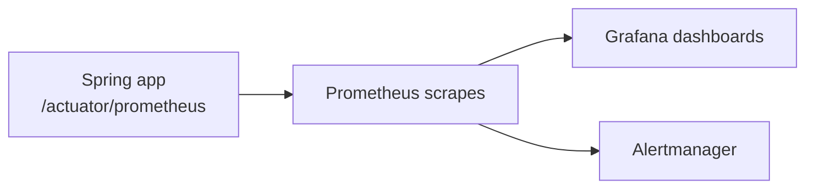
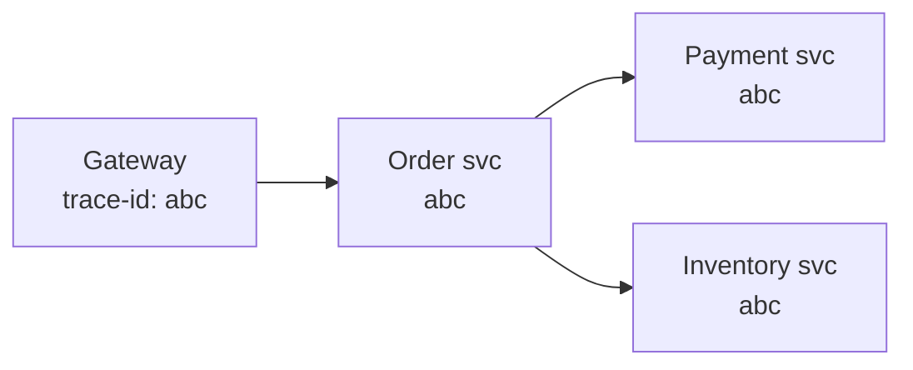
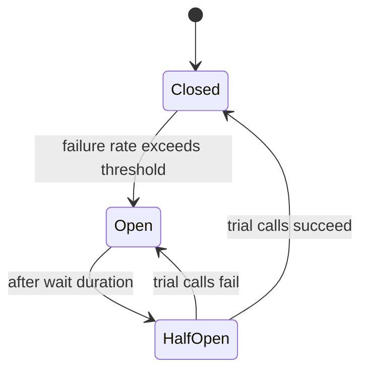

# Production Backend Concepts

Shipping code is the easy part; keeping it healthy under real traffic is the job.
This section covers observability, resilience, and operational concerns that
separate a demo from a production service.

<ProgressTracker id="production-overview" />

## Table of Contents

- [Structured logging](#structured-logging)
- [Metrics](#metrics)
- [Health checks](#health-checks)
- [Distributed tracing & correlation IDs](#distributed-tracing--correlation-ids)
- [Resilience patterns](#resilience-patterns)
- [Rate limiting](#rate-limiting)
- [Graceful shutdown](#graceful-shutdown)
- [Database migrations](#database-migrations)
- [Secrets & configuration](#secrets--configuration)
- [Most Asked Interview Questions](#most-asked-interview-questions)
- [Things You Should Know](#things-you-should-know)

## Structured logging

Use SLF4J with parameterized messages (deferred formatting) and log **JSON** in
production so log aggregators (ELK, Loki, CloudWatch) can index fields.

```java
private static final Logger log = LoggerFactory.getLogger(OrderService.class);

log.info("order placed orderId={} customerId={} total={}", id, customerId, total);
// Never: log.info("order " + id)  — string building even when level is off
```

<Warning>
Never log secrets, passwords, tokens, full card numbers, or PII. Mask sensitive
fields. Logs are widely accessible and long-lived.
</Warning>

## Metrics

Spring Boot Actuator + Micrometer exposes metrics in Prometheus format; Grafana
visualizes them.



The four **golden signals** to watch: **latency, traffic, errors, saturation**.

```java
Counter orders = Counter.builder("orders.placed").register(registry);
orders.increment();

Timer.builder("checkout.duration").register(registry)
     .record(() -> checkoutService.checkout(order));
```

## Health checks

`/actuator/health` reports app + dependency health, powering orchestrator probes.

- **Liveness** — is the process alive? Fail → restart the pod.
- **Readiness** — can it serve traffic (DB reachable, warmed up)? Fail → stop routing
  traffic without killing the pod.

## Distributed tracing & correlation IDs

In a microservice call chain, a **correlation/trace ID** ties all logs and spans for
one request together. Spring Boot 3 uses Micrometer Tracing (OpenTelemetry).



Put the trace id in every log line (MDC) so you can follow one request across
services.

## Resilience patterns

Networks fail. Protect your service and its callers with Resilience4j.

| Pattern | Purpose |
| --- | --- |
| **Timeout** | Never wait forever on a slow dependency |
| **Retry** | Recover from transient failures (with backoff + jitter) |
| **Circuit breaker** | Stop hammering a failing dependency; fail fast |
| **Bulkhead** | Isolate resource pools so one slow call can't exhaust all threads |
| **Rate limiter** | Cap request rate to protect downstream |

```java
@CircuitBreaker(name = "pricing", fallbackMethod = "cachedQuote")
@Retry(name = "pricing")
@TimeLimiter(name = "pricing")
public CompletableFuture<Quote> quote(Order order) { ... }

private CompletableFuture<Quote> cachedQuote(Order order, Throwable t) {
    return CompletableFuture.completedFuture(lastKnownQuote(order));  // graceful degradation
}
```



## Rate limiting

Protect endpoints from abuse and overload (per-user/IP quotas). Implement at the
gateway or with Redis counters — see [Redis & Caching](/docs/redis-caching/). Return
`429 Too Many Requests` with a `Retry-After` header.

## Graceful shutdown

On deploy/scale-down, stop accepting new requests, finish in-flight ones, then close
resources — no dropped requests.

```yaml
server:
  shutdown: graceful
spring:
  lifecycle:
    timeout-per-shutdown-phase: 30s
```

## Database migrations

Never let Hibernate auto-create production schema. Version schema changes with
**Flyway** or **Liquibase** so every environment applies the same, ordered,
repeatable migrations.

```sql title="db/migration/V1__create_orders.sql"
CREATE TABLE orders (
  id BIGSERIAL PRIMARY KEY,
  customer_id BIGINT NOT NULL,
  total NUMERIC(12,2) NOT NULL,
  created_at TIMESTAMPTZ NOT NULL DEFAULT now()
);
```

Flyway runs pending migrations on startup and records them in a `flyway_schema_history`
table.

## Secrets & configuration

<Important>
Configuration follows the 12-factor rule: keep it in the **environment**, not the
code. Secrets belong in a secrets manager (AWS Secrets Manager, Vault, Kubernetes
Secrets), injected at runtime — never committed to git or baked into images.
</Important>

## Most Asked Interview Questions

### Beginner
- Why structured logging? What must you never log?
- Liveness vs readiness probe?

### Intermediate
- What are the golden signals?
- What is a correlation/trace id and why does it matter?

### Advanced
- How does a circuit breaker work and how does it differ from retry?
- How do you do zero-downtime deploys (graceful shutdown + migrations)?

### Coding
- Add a circuit breaker with a fallback to an external call.

## Things You Should Know

### 🔴 Must Know
- Structured logging without secrets/PII.
- Actuator health, metrics, golden signals.
- Retry/timeout/circuit breaker; Flyway migrations.

### 🟡 Good to Know
- Correlation IDs / distributed tracing.
- Graceful shutdown; rate limiting; 429 semantics.

### 🟢 Nice to Know
- Bulkhead isolation; SLOs/SLIs and error budgets.
- Blue-green and canary deployments.
