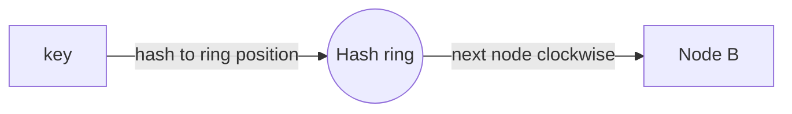
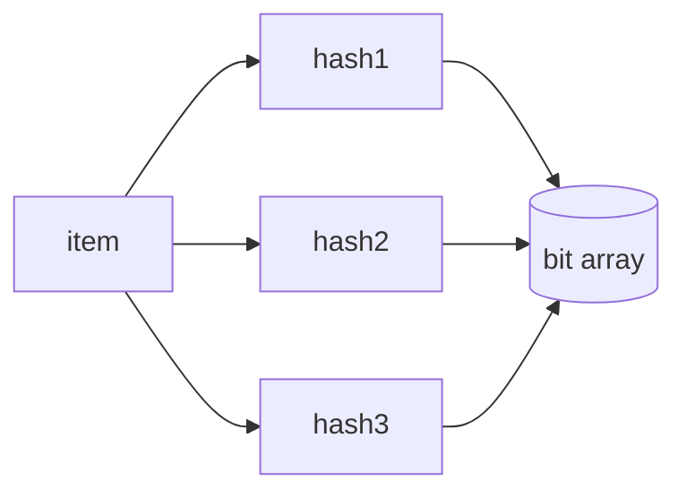

# Algorithms & Data Structures for System Design

System design isn't only boxes and arrows. Specific data structures power real
components — know these cold, because interviewers ask you to implement them.

<ProgressTracker id="sd-algorithms" />

## Table of Contents

- [Where each structure shows up](#where-each-structure-shows-up)
- [Consistent hashing](#consistent-hashing)
- [Bloom filter](#bloom-filter)
- [LRU cache](#lru-cache)
- [Rate-limiter algorithms](#rate-limiter-algorithms)
- [Inverted index](#inverted-index)
- [Deduplication](#deduplication)
- [Interview questions](#interview-questions)
- [Things You Should Know](#things-you-should-know)

## Where each structure shows up

| Structure | Powers |
| --- | --- |
| **HashMap** | Caches, lookups, dedupe |
| **Heap / Priority Queue** | Schedulers, top-K, Dijkstra, rate limiters |
| **Queue / Deque** | Task queues, sliding windows, BFS |
| **Trie** | Autocomplete, prefix search |
| **Graph** | Social networks, routing, dependencies |
| **Consistent hashing ring** | Sharding, distributed caches |
| **Bloom filter** | Membership checks, cache penetration, dedupe |
| **Inverted index** | Full-text search |

## Consistent hashing

Naive `hash(key) % N` remaps almost **every** key when N changes (add/remove a node) —
catastrophic for a distributed cache. **Consistent hashing** places nodes and keys on
a ring; a key belongs to the next node clockwise. Adding/removing a node reshuffles
only the keys between it and its neighbor (≈ 1/N).



<Important>
Use **virtual nodes** (each physical node placed at many ring positions) to spread
load evenly and avoid hotspots. Consistent hashing is why systems like Cassandra and
distributed caches scale smoothly. Contrast with `mod N`, which forces a near-total
remap on every membership change.
</Important>

## Bloom filter

A **bloom filter** is a compact, probabilistic set: it answers "is X definitely NOT
present, or possibly present?" with **no false negatives** but possible false
positives, using several hash functions over a bit array.



<Tip>
Use a bloom filter in front of a store to short-circuit lookups for keys that can't
exist — a classic fix for **cache penetration** and for "have we seen this URL?" in a
web crawler. Tiny memory, no false negatives.
</Tip>

## LRU cache

An **LRU (Least Recently Used) cache** evicts the least-recently-accessed entry when
full. Implemented in O(1) with a **HashMap + doubly-linked list** (map for lookup,
list for recency order). In Java, `LinkedHashMap` with access order does it:

```java
class LruCache<K, V> extends LinkedHashMap<K, V> {
    private final int capacity;
    LruCache(int capacity) {
        super(capacity, 0.75f, true);          // true = access order
        this.capacity = capacity;
    }
    @Override
    protected boolean removeEldestEntry(Map.Entry<K, V> eldest) {
        return size() > capacity;              // evict when over capacity
    }
}
```

## Rate-limiter algorithms

| Algorithm | Idea | Note |
| --- | --- | --- |
| **Fixed window** | Count per clock window | Simple; bursty at edges |
| **Sliding window** | Weighted/log over last window | Accurate |
| **Token bucket** | Tokens refill at rate; spend per request | Allows bursts; industry standard |
| **Leaky bucket** | Requests drain at fixed rate | Smooths output |

Full implementation in the [rate-limiter design](/docs/system-design/rate-limiter/).

## Inverted index

A search engine's core structure: map each **term → list of documents** containing it
(a posting list). Query "java backend" → intersect the posting lists for "java" and
"backend". Powers Elasticsearch/Lucene.

```text
"java"    -> [doc1, doc3, doc7]
"backend" -> [doc3, doc7, doc9]
query     -> intersect -> [doc3, doc7]
```

## Deduplication

Detect and drop duplicates at scale:
- Exact: a `HashSet` / DB unique constraint / idempotency key.
- Approximate at massive scale: a **bloom filter** (probabilistic, tiny memory).

## Interview questions

- Why consistent hashing instead of `hash % N`? What do virtual nodes fix?
- What is a bloom filter, and what guarantee does it make (and not make)?
- Implement an O(1) LRU cache.
- Token bucket vs sliding window rate limiting?
- What data structure backs full-text search?

## Things You Should Know

### 🔴 Must Know
- Consistent hashing (+ virtual nodes) for sharding/caches.
- LRU cache in O(1); rate-limiter algorithms.
- Bloom filter guarantees.

### 🟡 Good to Know
- Inverted index for search; heap for top-K/schedulers.
- Trie for autocomplete.

### 🟢 Nice to Know
- Count-min sketch, HyperLogLog for approximate counting.
