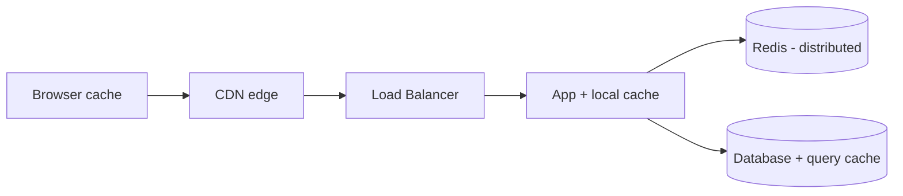
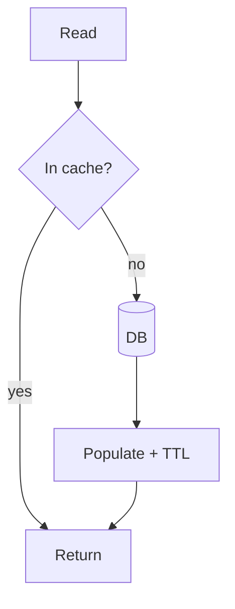

# Caching

Caching is the highest-leverage performance tool in backend design — and its hardest
problem is invalidation. Be ready to answer: *where would you put Redis here, and why?*

<ProgressTracker id="sd-caching" />

## Table of Contents

- [Why caching?](#why-caching)
- [Where caches live](#where-caches-live)
- [Caching patterns](#caching-patterns)
- [TTL & eviction policies](#ttl--eviction-policies)
- [Cache invalidation](#cache-invalidation)
- [Failure modes: stampede & penetration](#failure-modes-stampede--penetration)
- [Distributed cache & Redis locks](#distributed-cache--redis-locks)
- [Interview questions](#interview-questions)
- [Things You Should Know](#things-you-should-know)

## Why caching?

Store the result of an expensive operation in fast memory so repeated reads skip the
database or computation. It cuts latency (ms → μs) and offloads the datastore — as
long as the data tolerates being slightly stale.

## Where caches live



Caches exist at every layer: browser, CDN, application (in-process), a distributed
cache (Redis), and the database. Each trades freshness for speed.

## Caching patterns

| Pattern | How | Best for |
| --- | --- | --- |
| **Cache-aside** (lazy) | App checks cache; on miss loads DB and populates | Read-heavy (most common) |
| **Read-through** | Cache layer loads from DB on miss | Encapsulated caches |
| **Write-through** | Write to cache + DB synchronously | Consistency-sensitive reads |
| **Write-back** (write-behind) | Write to cache, async flush to DB | Write-heavy, tolerant of loss risk |



## TTL & eviction policies

- **TTL** — every entry should expire so stale data self-heals.
- **Eviction** (when memory is full): **LRU** (least recently used, the default
  mental model), **LFU** (least frequently used), **FIFO**, or random. Redis
  supports `allkeys-lru`, `volatile-ttl`, etc.

## Cache invalidation

<Important>
On writes, **evict** the key (simplest, correct) or update it. "There are only two
hard things in CS: cache invalidation and naming things." When unsure, evict and let
the next read repopulate. Always set a TTL as a safety net so nothing is stale forever.
</Important>

## Failure modes: stampede & penetration

<Warning>
- **Cache stampede / thundering herd** — a hot key expires and thousands of requests
  rebuild it at once, hammering the DB. Fix: a single-flight lock so one request
  rebuilds while others wait, plus TTL **jitter**.
- **Cache penetration** — requests for keys that don't exist bypass the cache every
  time. Fix: cache a "not found" marker, or front the cache with a **bloom filter**.
- **Cache avalanche** — many keys expire simultaneously. Fix: randomized TTLs.
</Warning>

## Distributed cache & Redis locks

A **distributed cache** (Redis) is shared across all app instances, so a value cached
by one instance serves all — essential once you scale horizontally.

Redis also provides **distributed locks** via `SET key val NX PX ttl` (set-if-absent
with expiry) to ensure only one node runs a job or rebuilds a hot key.

```java
boolean locked = redis.opsForValue()
    .setIfAbsent("lock:rebuild:catalog", nodeId, Duration.ofSeconds(30));
if (locked) { try { rebuild(); } finally { /* release if still owner */ } }
```

<Warning>
A naive single-instance Redis lock isn't safe under failover — use Redlock/Redisson
for stronger guarantees, and always set a TTL so a crashed holder can't deadlock
everyone. See [Redis & Caching](/docs/redis-caching/).
</Warning>

## Interview questions

- Where would you place Redis in this architecture and why?
- Cache-aside vs write-through vs write-back?
- How do you invalidate caches on writes?
- Explain cache stampede, penetration, and avalanche and their fixes.
- How does a distributed lock in Redis work and where does it fail?

## Things You Should Know

### 🔴 Must Know
- Cache-aside + TTL; evict on write.
- Where caches live in the stack.
- Stampede/penetration/avalanche and mitigations.

### 🟡 Good to Know
- Eviction policies (LRU/LFU); distributed cache vs local.
- Redis distributed locks and their limits.

### 🟢 Nice to Know
- Bloom filters for penetration.
- Single-flight / request coalescing.
