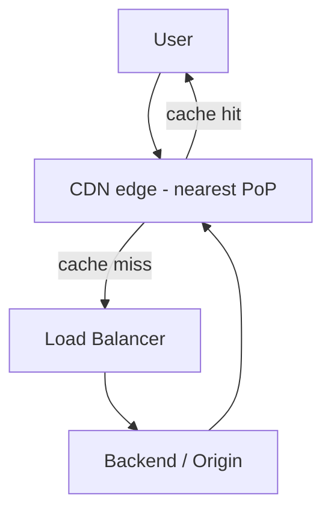
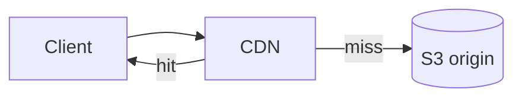

# CDN (Content Delivery Network)

A CDN serves content from servers physically close to users, cutting latency and
offloading your origin. It's the outermost cache in the stack.

<ProgressTracker id="sd-cdn" />

## Table of Contents

- [What a CDN does](#what-a-cdn-does)
- [Where it sits](#where-it-sits)
- [Cache-Control & TTL](#cache-control--ttl)
- [Cache invalidation](#cache-invalidation)
- [Origin & origin shield](#origin--origin-shield)
- [CDN + object storage](#cdn--object-storage)
- [What to cache](#what-to-cache)
- [Interview questions](#interview-questions)
- [Things You Should Know](#things-you-should-know)

## What a CDN does

A CDN (CloudFront, Cloudflare, Fastly, Akamai) caches copies of your content at
**edge locations** worldwide. A user in Tokyo hits a Tokyo edge instead of your
origin in Virginia — lower latency, less origin load, and DDoS absorption.

## Where it sits



On a **cache miss** the edge fetches from the origin, stores it, and serves
subsequent requests locally until it expires.

## Cache-Control & TTL

The origin controls caching via response headers:

```http
Cache-Control: public, max-age=86400        # cache for 24h
Cache-Control: no-store                       # never cache (auth'd content)
Cache-Control: private, max-age=0             # browser only, not shared caches
ETag: "abc123"                                # validation token for conditional GETs
```

<Important>
**TTL** (`max-age`) is the freshness window. Use **long TTLs for immutable assets**
(hash the filename: `app.9f3a.js`) so you can cache "forever" and bust the cache by
changing the URL on deploy. Use short/no caching for personalized or auth'd responses.
</Important>

## Cache invalidation

Two strategies:

- **Versioned URLs (preferred):** put a content hash in the filename. New content =
  new URL = automatic cache bust; no invalidation call needed.
- **Explicit invalidation / purge:** tell the CDN to drop a path. Slower, sometimes
  rate-limited/costly — use sparingly.

## Origin & origin shield

The **origin** is where the CDN pulls from (your load balancer, or an S3 bucket). An
**origin shield** is an extra caching layer in front of the origin that consolidates
edge misses, further protecting the origin during traffic spikes.

## CDN + object storage

The classic pattern for media: store files in **S3**, front them with a **CDN**, and
hand clients **presigned URLs**. The CDN caches the bytes at the edge; the origin
(S3) is hit only on misses.



## What to cache

- **Cache:** static assets (JS/CSS/images), public API responses, media, fonts.
- **Don't cache (or cache carefully):** personalized data, authenticated responses,
  anything with per-user content — unless you vary correctly by key.

## Interview questions

- What problem does a CDN solve and where does it sit?
- How does `Cache-Control`/`max-age` work with a CDN?
- Versioned URLs vs explicit purge for invalidation?
- How do CDN + S3 + presigned URLs fit together?
- What should you *not* put behind a CDN?

## Things You Should Know

### 🔴 Must Know
- CDN caches at edge locations; reduces latency + origin load.
- `Cache-Control`/TTL; versioned URLs for busting.
- CDN + object storage for media.

### 🟡 Good to Know
- ETags/conditional requests; origin shield.
- What not to cache.

### 🟢 Nice to Know
- Edge compute (Workers/Lambda@Edge); anycast routing.
