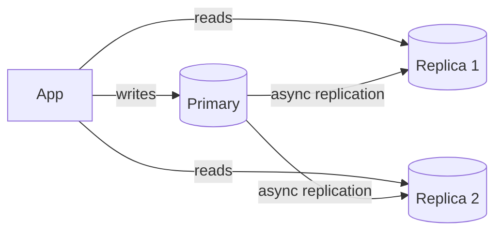
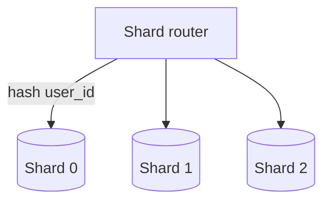
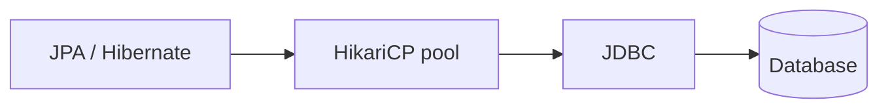

# Databases at Scale

The database is the first thing to fall over under load. Scaling it — without
breaking correctness — is the heart of most system designs.

<ProgressTracker id="sd-database-scaling" />

## Table of Contents

- [Indexes & B-trees](#indexes--b-trees)
- [Query optimization & EXPLAIN](#query-optimization--explain)
- [Transactions, ACID & locking](#transactions-acid--locking)
- [Read replicas](#read-replicas)
- [Partitioning](#partitioning)
- [Sharding](#sharding)
- [Replication & consistency](#replication--consistency)
- [Connection pooling](#connection-pooling)
- [The Java data path](#the-java-data-path)
- [Interview questions](#interview-questions)
- [Things You Should Know](#things-you-should-know)

## Indexes & B-trees

An index is usually a **B-tree** (balanced, sorted) that turns a full-table scan
(`O(n)`) into a lookup (`O(log n)`). **Composite indexes** follow the
**leftmost-prefix** rule: `(a, b)` serves queries on `a` or `a AND b`, not `b` alone.

<Important>
Index the columns in your `WHERE`, `JOIN`, and `ORDER BY`. But every index slows
writes and consumes storage — index deliberately, not everywhere. Full detail in
[SQL & Databases](/docs/database/).
</Important>

## Query optimization & EXPLAIN

`EXPLAIN ANALYZE` reveals the plan. Watch for **sequential scans** on big tables,
bad row estimates, and missing index usage. Fix with the right index, rewritten
query, or denormalization for read-heavy paths.

## Transactions, ACID & locking

- **ACID:** Atomicity, Consistency, Isolation, Durability.
- **Isolation levels** trade concurrency for anomaly prevention (dirty →
  non-repeatable → phantom reads).
- **Optimistic locking** (`@Version`) for low contention; **pessimistic**
  (`SELECT ... FOR UPDATE`) for hot rows like inventory. See
  [JPA transactions](/docs/spring-data-jpa/).
- **Deadlocks:** two transactions each hold a lock the other needs — prevent with a
  consistent lock-acquisition order.

## Read replicas

The primary handles writes; **read replicas** serve reads, scaling read-heavy
workloads (the common case).

<Warning>
Replication is usually **asynchronous**, so replicas lag slightly — a read right
after a write may not see it (**replication lag**). Route read-your-writes traffic to
the primary, or read from the primary within the same request.
</Warning>

## Partitioning

Split one big table into smaller pieces **within one database** to improve
manageability and query performance.

- **Horizontal partitioning** — rows split by a key (e.g. by date range or hash).
- **Vertical partitioning** — columns split (hot columns vs rarely-read blobs).

## Sharding

**Sharding** spreads data across **multiple databases/nodes** to scale writes and
storage beyond one machine. Each shard owns a subset of keys.

- **Shard key** choice is critical — pick one that distributes evenly and matches
  query patterns (e.g. `user_id`).
- Use **consistent hashing** so adding a shard reshuffles minimal keys (see
  [Algorithms](/docs/system-design/concepts/algorithms/)).

<Warning>
Sharding is a big step: cross-shard joins and transactions become hard or impossible,
and rebalancing is operationally heavy. Exhaust replicas, caching, and vertical scaling
first. A bad shard key (low cardinality, skewed) creates **hot shards**.
</Warning>

## Replication & consistency

- **Replication** copies data across nodes for availability and read scaling.
- **Single-leader** (most RDBMS): one primary for writes; simple, consistent.
- **Multi-leader / leaderless** (Cassandra, Dynamo): higher availability, but you
  face write conflicts and **eventual consistency**.
- Ties directly to the **CAP theorem** — see
  [Distributed Systems](/docs/system-design/concepts/distributed-systems/).

## Connection pooling

Opening a DB connection (TCP + auth + session) is far too slow per request. A pool
(HikariCP in Spring Boot) keeps warm connections and lends them out.

<Important>
Pool size is **not** "bigger is better" — too many connections overwhelm the DB.
Total connections across all app instances must stay within the database's limit.
A common formula: `connections ≈ (core_count * 2) + effective_spindles`. See
[JDBC](/docs/jdbc/).
</Important>

## The Java data path

`@Transactional` manages commit/rollback around a pooled connection bound to the
thread; Hibernate translates entity changes to SQL; HikariCP recycles connections.

## Interview questions

- How do you scale a read-heavy database? A write-heavy one?
- What is replication lag and how do you handle read-your-writes?
- How do you pick a shard key? What is a hot shard?
- Partitioning vs sharding?
- Why is connection pooling necessary, and how do you size it?

## Things You Should Know

### 🔴 Must Know
- Indexes/B-trees, EXPLAIN, ACID, isolation levels.
- Read replicas for read scaling; replication lag caveat.
- Sharding for write/storage scale; shard-key choice.
- Connection pooling and sizing.

### 🟡 Good to Know
- Optimistic vs pessimistic locking.
- Consistent hashing for shard rebalancing.
- Single-leader vs leaderless replication.

### 🟢 Nice to Know
- Vertical partitioning; covering indexes.
- MVCC and how Postgres implements isolation.
