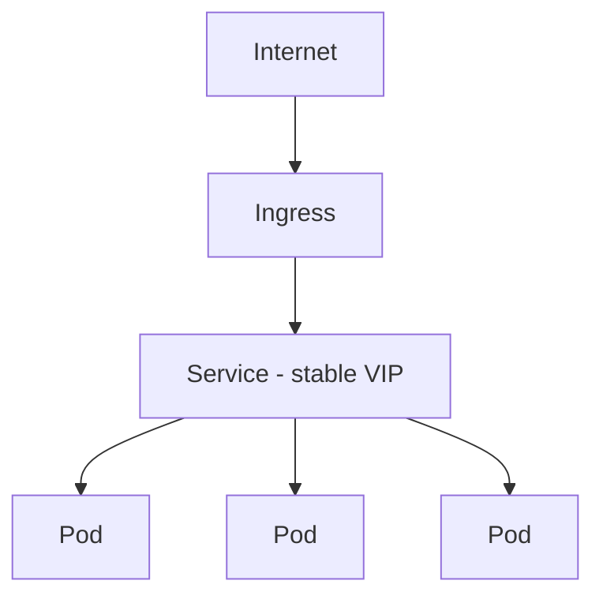
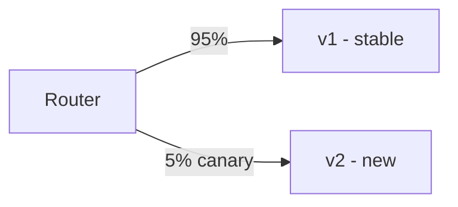
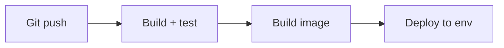

# Deployment & Infrastructure

You don't need to be a DevOps engineer, but you must understand how your service is
packaged, scheduled, scaled, and released without downtime.

<ProgressTracker id="sd-deployment" />

## Table of Contents

- [Containers & Docker](#containers--docker)
- [Kubernetes basics](#kubernetes-basics)
- [Autoscaling](#autoscaling)
- [Deployment strategies](#deployment-strategies)
- [CI/CD](#cicd)
- [Infrastructure as Code](#infrastructure-as-code)
- [Interview questions](#interview-questions)
- [Things You Should Know](#things-you-should-know)

## Containers & Docker

A **container** packages your app + runtime into a portable, isolated unit that runs
identically everywhere. Build a slim image with a multi-stage Dockerfile (JDK to
build, JRE to run) — see [Docker & Deployment](/docs/docker/).

## Kubernetes basics

Kubernetes (K8s) orchestrates containers across a cluster: scheduling, scaling,
self-healing, and networking.

| Object | Role |
| --- | --- |
| **Pod** | Smallest unit — one (or few) containers sharing network/storage |
| **Deployment** | Manages a set of identical pods + rollouts |
| **Service** | Stable virtual IP/DNS load-balancing across pods |
| **Ingress** | L7 HTTP routing into the cluster (host/path rules, TLS) |
| **ConfigMap / Secret** | Externalized config / sensitive values |

<Important>
Kubernetes uses **liveness** and **readiness** probes. Liveness failing → the pod is
restarted; readiness failing → the pod is kept but removed from the Service's load
balancing until healthy. Map these to `/actuator/health` liveness/readiness groups.
</Important>

## Autoscaling

- **Horizontal Pod Autoscaler (HPA)** — add/remove pods based on CPU, memory, or
  custom metrics (e.g. requests/sec, queue depth).
- **Cluster Autoscaler** — add/remove nodes when pods can't be scheduled.

Autoscaling requires **stateless** services so new pods can serve any request.

## Deployment strategies

| Strategy | How | Trade-off |
| --- | --- | --- |
| **Rolling** | Replace pods gradually | Zero downtime; brief mixed versions |
| **Blue-green** | Full new environment, switch traffic at once | Instant rollback; needs 2x capacity |
| **Canary** | Route a small % to the new version first | Safe, gradual; more orchestration |

<Tip>
Combine deployment strategies with **graceful shutdown** (finish in-flight requests)
and backward-compatible **database migrations** (Flyway) so old and new versions can
run simultaneously during the rollout.
</Tip>

## CI/CD

- **CI (Continuous Integration)** — every push builds, runs tests, and produces an
  artifact/image. Catch breakage early.
- **CD (Continuous Delivery/Deployment)** — automatically promote the artifact through
  environments (dev → staging → prod), with gates.

Tools: GitHub Actions, GitLab CI, Jenkins, Azure DevOps, Argo CD.

## Infrastructure as Code

Define infrastructure (networks, clusters, databases) in version-controlled files
instead of clicking consoles — reproducible, reviewable, auditable. Tools: **Terraform**,
CloudFormation, Pulumi, Helm (for K8s manifests).

## Interview questions

- Pod vs Deployment vs Service vs Ingress?
- Liveness vs readiness probes?
- Rolling vs blue-green vs canary — trade-offs?
- What must be true for autoscaling to work?
- What does CI/CD automate? Why Infrastructure as Code?

## Things You Should Know

### 🔴 Must Know
- Containers; K8s Pod/Deployment/Service/Ingress.
- Liveness vs readiness; rolling/blue-green/canary.
- CI/CD basics.

### 🟡 Good to Know
- HPA/cluster autoscaling; graceful shutdown + migrations during rollout.
- IaC (Terraform/Helm).

### 🟢 Nice to Know
- Service mesh (Istio/Linkerd); GitOps (Argo CD).
