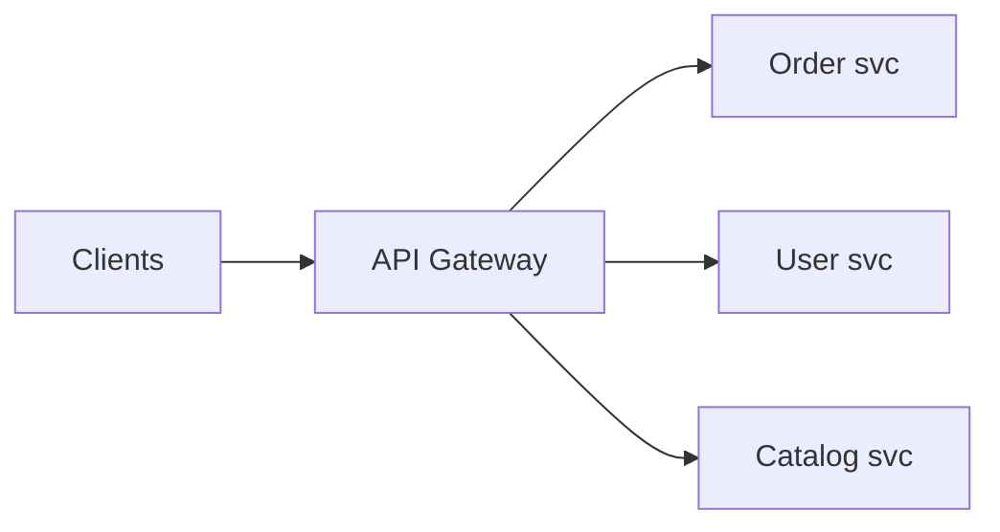
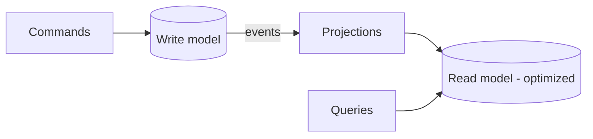
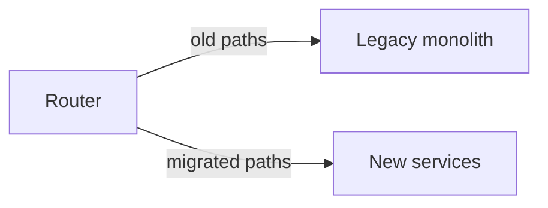

# System Design Patterns

The named, reusable solutions that appear in nearly every architecture diagram. Know
each one's problem, shape, and trade-off.

<ProgressTracker id="sd-design-patterns" />

## Table of Contents

- [Edge patterns: API gateway, reverse proxy, LB](#edge-patterns-api-gateway-reverse-proxy-lb)
- [Resilience patterns](#resilience-patterns)
- [Data & consistency patterns](#data--consistency-patterns)
- [CQRS & event sourcing](#cqrs--event-sourcing)
- [Scaling patterns](#scaling-patterns)
- [Migration & deployment patterns](#migration--deployment-patterns)
- [Pattern selection guide](#pattern-selection-guide)
- [Interview questions](#interview-questions)
- [Things You Should Know](#things-you-should-know)

## Edge patterns: API gateway, reverse proxy, LB

- **Reverse proxy** — a server in front of your backends (TLS, caching, routing).
- **Load balancer** — distributes traffic across instances (see
  [Load Balancing](/docs/system-design/concepts/load-balancing/)).
- **API gateway** — an application-aware entry point that centralizes auth, rate
  limiting, routing, request aggregation, and versioning for many services.

<Important>
An API gateway prevents every client from knowing about every service and from
re-implementing auth/rate-limiting. But it's a single choke point — make it stateless,
horizontally scaled, and highly available, or it becomes a bottleneck and SPOF.
</Important>

## Resilience patterns

- **Cache-aside** — check cache, load DB on miss, populate. ([Caching](/docs/system-design/concepts/caching/))
- **Circuit breaker / retry / bulkhead** — contain failures. ([Reliability](/docs/system-design/concepts/reliability/))

## Data & consistency patterns

- **Saga** — distributed transaction via local steps + compensations.
- **Outbox** — atomically persist data + an event to publish (solves dual-write).
- **Pub/Sub** — decouple producers from consumers via topics.
- **Leader-Follower (primary-replica)** — one writer, many readers.

See [Distributed Transactions](/docs/system-design/concepts/distributed-transactions/).

## CQRS & event sourcing

- **CQRS (Command Query Responsibility Segregation)** — separate the write model
  (commands) from the read model (queries), often with different stores optimized for
  each. Powerful for read/write asymmetry; adds complexity and eventual consistency
  between the models.
- **Event Sourcing** — store state as an append-only log of events; rebuild current
  state by replaying them. Gives a full audit trail and time travel, but querying and
  schema evolution are harder.

<Warning>
CQRS and event sourcing are frequently over-applied. Use them only where read and
write shapes genuinely diverge or you need an audit log. For most CRUD, a single model
is simpler and correct.
</Warning>

## Scaling patterns

- **Sharding** — partition data across nodes by a shard key.
- **Consistent hashing** — map keys to nodes on a ring so adding/removing a node
  reshuffles only a small fraction of keys (see [Algorithms](/docs/system-design/concepts/algorithms/)).

## Migration & deployment patterns

- **Strangler Fig** — incrementally replace a legacy system by routing slices of
  traffic to new services until the old one can be retired. Safer than a big-bang
  rewrite.
- **Sidecar** — deploy a helper container alongside your app (in the same pod) to
  handle cross-cutting concerns (proxying, logging, TLS) — the basis of service meshes.

## Pattern selection guide

| Problem | Pattern |
| --- | --- |
| One entry point for many services | API Gateway |
| Failing dependency cascades | Circuit Breaker + Bulkhead |
| Cross-service consistency | Saga + Outbox + Idempotency |
| Read/write shapes diverge | CQRS |
| Need full audit/history | Event Sourcing |
| Scale storage/writes | Sharding + Consistent Hashing |
| Replace a legacy system safely | Strangler Fig |
| Cross-cutting infra per service | Sidecar |

## Interview questions

- API gateway vs reverse proxy vs load balancer?
- When is CQRS justified, and what does it cost?
- What problem does event sourcing solve, and its downsides?
- Explain the strangler fig and sidecar patterns.
- Why consistent hashing over `hash % N`?

## Things You Should Know

### 🔴 Must Know
- API gateway; cache-aside; circuit breaker; saga; outbox.
- Sharding + consistent hashing.

### 🟡 Good to Know
- CQRS / event sourcing and when to avoid them.
- Strangler fig; leader-follower.

### 🟢 Nice to Know
- Sidecar / service mesh; materialized-view projections.
