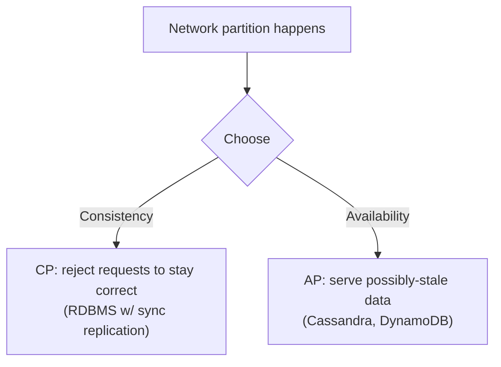
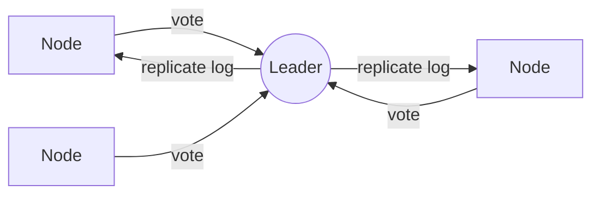

# Distributed Systems

Once state lives on more than one machine, everything gets harder: machines fail,
networks partition, and clocks drift. This is where backend design becomes serious.

<ProgressTracker id="sd-distributed-systems" />

## Table of Contents

- [The core challenges](#the-core-challenges)
- [CAP theorem](#cap-theorem)
- [Consistency models](#consistency-models)
- [Replication & quorum](#replication--quorum)
- [Consensus & leader election](#consensus--leader-election)
- [Split brain & network partitions](#split-brain--network-partitions)
- [Distributed transactions & locks](#distributed-transactions--locks)
- [Interview questions](#interview-questions)
- [Things You Should Know](#things-you-should-know)

## The core challenges

<Important>
The "eight fallacies of distributed computing" boil down to: the network is
unreliable, has latency, and partitions; machines crash; clocks aren't synchronized.
Every distributed design is really about **coping with partial failure** — some parts
work while others don't.
</Important>

## CAP theorem

During a network **partition** (P), you must choose between **Consistency** (C —
every read sees the latest write) and **Availability** (A — every request gets a
response). You cannot have both while partitioned.

<Interview>
CAP is about behavior **during a partition**, not a permanent label. When the network
is healthy you get both C and A. The real skill is deciding *per feature*: payments
and inventory need **CP**; feeds, counts, and caches can be **AP** (eventually
consistent). Also know **PACELC**: else (no partition), trade Latency vs Consistency.
</Interview>

## Consistency models

| Model | Guarantee |
| --- | --- |
| **Strong** | Every read sees the most recent write (as if one copy) |
| **Linearizable** | Strong + real-time ordering of operations |
| **Read-your-writes** | You always see your own latest write |
| **Monotonic reads** | You never see older data than you already saw |
| **Eventual** | Replicas converge given no new writes |

**Eventual consistency** is the price of high availability and horizontal scale —
acceptable when a brief staleness window is harmless.

## Replication & quorum

Data is replicated to N nodes. A **quorum** requires W nodes to acknowledge a write
and R nodes to serve a read.

<Important>
If **W + R > N**, read and write sets overlap, guaranteeing a read sees the latest
write (strong consistency). Tune the knobs: `W=N` favors read speed; `R=1, W=N`
favors read availability; `W=R=(N/2)+1` (majority) balances both. Example: N=3, W=2,
R=2 → 2+2 > 3, strongly consistent, tolerates one node down.
</Important>

## Consensus & leader election

Consensus lets nodes **agree** on a value despite failures — the basis for leader
election, distributed locks, and replicated logs. **Raft** and **Paxos** are the
canonical algorithms.

<Tip>
You don't need to implement Raft, but understand **why** it exists: to elect a single
leader and keep a replicated log consistent across a majority, so the cluster survives
minority failures. Tools like ZooKeeper/etcd/Consul provide this as a service.
</Tip>

## Split brain & network partitions

A **split brain** occurs when a partition leaves two sides that each think they're
the leader — causing divergent, conflicting writes.

<Warning>
Prevent split brain by requiring a **majority quorum** to act. A minority side (no
quorum) must step down and refuse writes. This is why clusters are sized odd (3, 5):
a 3-node cluster tolerates 1 failure and still has a 2-node majority.
</Warning>

## Distributed transactions & locks

- **Two-phase commit (2PC):** a coordinator asks all participants to *prepare*, then
  *commit*. Correct but **blocking** — if the coordinator dies mid-commit, participants
  are stuck. Rarely used across microservices for that reason.
- **Sagas** replace 2PC with local transactions + compensations (see
  [Distributed Transactions](/docs/system-design/concepts/distributed-transactions/)).
- **Distributed locks** (Redis/ZooKeeper) coordinate exclusive access across nodes —
  always with a TTL to survive a crashed holder.

## Interview questions

- Explain CAP and give a CP and an AP example.
- What is eventual consistency and when is it acceptable?
- What does W + R > N guarantee?
- Why do consensus algorithms like Raft exist?
- What is split brain and how do you prevent it?
- Why is 2PC avoided across microservices?

## Things You Should Know

### 🔴 Must Know
- CAP: consistency vs availability under partition; choose per feature.
- Strong vs eventual consistency.
- Quorum W + R > N.

### 🟡 Good to Know
- Consensus/leader election purpose; split-brain prevention via majority.
- Why 2PC blocks.

### 🟢 Nice to Know
- PACELC; Raft internals; vector clocks; CRDTs.
