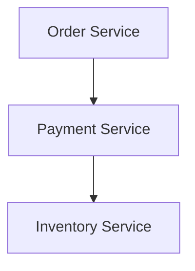
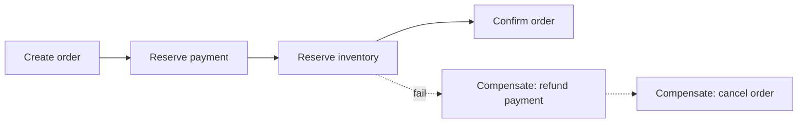
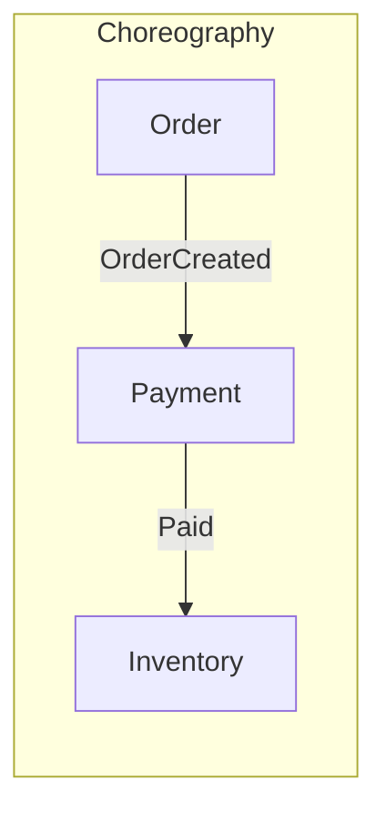
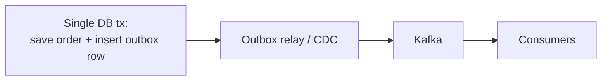

# Distributed Transactions

The defining microservices problem: how do you keep data consistent across services
when there's no shared database transaction?

<ProgressTracker id="sd-distributed-transactions" />

## Table of Contents

- [The problem](#the-problem)
- [Why not two-phase commit?](#why-not-two-phase-commit)
- [The Saga pattern](#the-saga-pattern)
- [Choreography vs orchestration](#choreography-vs-orchestration)
- [Compensating transactions](#compensating-transactions)
- [The transactional outbox](#the-transactional-outbox)
- [Idempotency](#idempotency)
- [Interview questions](#interview-questions)
- [Things You Should Know](#things-you-should-know)

## The problem



<Important>
What happens if **payment succeeds but inventory fails**? There is no cross-service
`ROLLBACK`. You cannot wrap three services in one ACID transaction. You need a
protocol that reaches a consistent outcome despite partial failure.
</Important>

## Why not two-phase commit?

2PC (a coordinator runs *prepare* then *commit* across participants) is technically
consistent but:

<Warning>
2PC **blocks**: if the coordinator crashes after "prepare", participants hold locks
indefinitely, and availability tanks. It also couples services tightly and doesn't
scale. Most microservice architectures avoid it in favor of sagas.
</Warning>

## The Saga pattern

A saga models a distributed transaction as a **sequence of local transactions**. Each
step commits locally and publishes an event; if a later step fails, earlier steps are
undone with **compensating transactions**.



Sagas give you **eventual consistency** without distributed locks.

## Choreography vs orchestration

| | Choreography | Orchestration |
| --- | --- | --- |
| Control | Each service reacts to events | A central orchestrator directs steps |
| Coupling | Loose (no central brain) | Centralized logic |
| Visibility | Harder to trace the flow | Explicit, easy to follow |
| Best for | Few, simple steps | Many steps / complex logic |



<Interview>
**Choreography** = services listen to each other's events (decentralized, loosely
coupled, but the workflow is implicit and hard to debug). **Orchestration** = a
coordinator explicitly invokes each step and handles failures (clear, centralized,
but the orchestrator becomes a critical component). Start with choreography for simple
flows; use orchestration when the saga has many steps and branches.
</Interview>

## Compensating transactions

Since you can't roll back a committed local transaction, you issue a **semantic undo**:
refund the payment, release the inventory reservation, cancel the order. Design each
step with its compensation up front. Compensations must themselves be idempotent.

## The transactional outbox

<Important>
The **dual-write problem**: writing to your DB *and* publishing to Kafka are two
systems — either can fail, leaving them inconsistent. The **outbox pattern** fixes it:
write the business change **and** an "event to publish" row in the **same DB
transaction**; a relay process reads the outbox and publishes to Kafka. The event is
sent if and only if the data committed.
</Important>



## Idempotency

Because sagas and messaging are **at-least-once**, every step and consumer must be
idempotent — processing the same message twice must not double-charge or
double-decrement. Use an **idempotency key** or dedupe by message id / upsert.

```java
public void handle(PaymentEvent e) {
    if (processed.putIfAbsent(e.id(), true) != null) return;  // dedupe
    apply(e);
}
```

## Interview questions

- Payment succeeds, inventory fails — how do you stay consistent?
- Why avoid 2PC across microservices?
- Explain the saga pattern and compensating transactions.
- Choreography vs orchestration — trade-offs?
- What is the dual-write problem and how does the outbox solve it?
- Why must saga steps be idempotent?

## Things You Should Know

### 🔴 Must Know
- No cross-service ACID → use sagas + compensations.
- Choreography vs orchestration.
- Outbox pattern for reliable event publishing.
- Idempotency everywhere.

### 🟡 Good to Know
- Why 2PC blocks and is avoided.
- Eventual consistency implications for the UX.

### 🟢 Nice to Know
- CDC (Debezium) for the outbox relay.
- Saga state persistence and timeouts.
