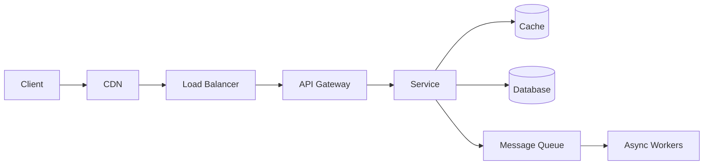
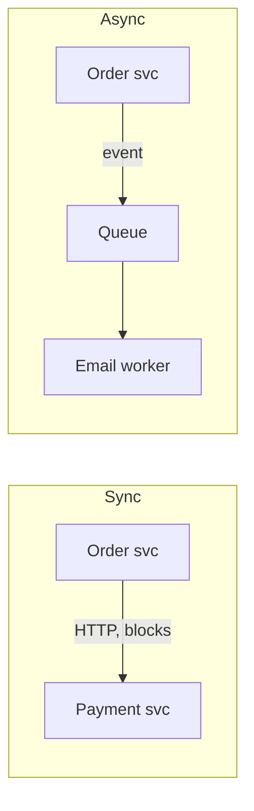

# Fundamentals: Architecture, HTTP & APIs

The vocabulary every system design conversation starts from. If you can't place a
component in the request path and justify it, nothing else lands.

<ProgressTracker id="sd-fundamentals" />

## Table of Contents

- [The request path](#the-request-path)
- [Monolith vs microservices](#monolith-vs-microservices)
- [Horizontal vs vertical scaling](#horizontal-vs-vertical-scaling)
- [Stateless vs stateful services](#stateless-vs-stateful-services)
- [Synchronous vs asynchronous communication](#synchronous-vs-asynchronous-communication)
- [REST vs gRPC](#rest-vs-grpc)
- [Service-to-service communication](#service-to-service-communication)
- [HTTP essentials](#http-essentials)
- [API design essentials](#api-design-essentials)
- [Realtime: polling vs SSE vs WebSockets](#realtime-polling-vs-sse-vs-websockets)
- [Interview questions](#interview-questions)
- [Things You Should Know](#things-you-should-know)

## The request path

Almost every backend design is a variation of this pipeline:

<Important>
Learn to place each box and defend it: **CDN** for static/edge caching, **load
balancer** for distributing traffic across stateless instances, **API gateway** for
auth/routing/rate-limiting, **cache** for hot reads, **queue** for async work. In an
interview, narrate a request through this path.
</Important>

## Monolith vs microservices

| | Monolith | Microservices |
| --- | --- | --- |
| Deployment | One unit | Many independent services |
| Scaling | Scale the whole app | Scale hot services only |
| Data | One shared database | A database per service |
| Complexity | Low (start here) | High (network, ops, consistency) |
| Team fit | Small teams | Many teams owning services |

<Interview>
Don't reflexively say "microservices". The right answer is usually: **start with a
well-structured monolith**, extract services only when you have a scaling or team
bottleneck. Microservices trade code complexity for distributed-systems complexity
(network failures, distributed transactions, eventual consistency).
</Interview>

## Horizontal vs vertical scaling

- **Vertical (scale up):** bigger machine (more CPU/RAM). Simple, but capped and a
  single point of failure.
- **Horizontal (scale out):** more machines behind a load balancer. The path to real
  scale — but requires **stateless** services and distributed data.

## Stateless vs stateful services

<Important>
**Stateless services scale horizontally.** A request carries everything needed (e.g.
a JWT), so any instance can serve it. Push state out to a database, cache, or the
token itself. Stateful services (in-memory sessions, local files) break under load
balancing because request N+1 may hit a different instance.
</Important>

## Synchronous vs asynchronous communication

- **Synchronous (REST/gRPC):** caller blocks for a response; simple; tight coupling;
  the callee's failure/latency propagates to the caller.
- **Asynchronous (queue/event):** producer emits and moves on; decoupled; absorbs
  spikes; adds eventual consistency and requires idempotent consumers.

## REST vs gRPC

| | REST/JSON | gRPC/Protobuf |
| --- | --- | --- |
| Format | Human-readable JSON | Binary protobuf (compact, fast) |
| Transport | HTTP/1.1 or 2 | HTTP/2 (streaming, multiplexing) |
| Contract | OpenAPI (optional) | `.proto` (strict, generated stubs) |
| Best for | Public APIs, browsers | Internal service-to-service, low latency |
| Streaming | Limited (SSE) | First-class bidirectional streaming |

<Tip>
Rule of thumb: **REST for external/public APIs**, **gRPC for internal
service-to-service** calls where latency and payload size matter.
</Tip>

## Service-to-service communication

- **Synchronous:** REST or gRPC, often through service discovery and a client-side
  load balancer or a Feign client (Spring Cloud OpenFeign).
- **Asynchronous:** events over Kafka/RabbitMQ.
- Protect every synchronous call with **timeout + retry + circuit breaker** (see
  [Reliability](/docs/system-design/concepts/reliability/)).

## HTTP essentials

- **Methods:** GET (read, safe), POST (create), PUT (replace, idempotent), PATCH
  (partial), DELETE (idempotent).
- **Status codes:** 2xx success, 3xx redirect, 4xx client error, 5xx server error.
  See the [HTTP cheat sheet](/docs/cheat-sheets/http-rest/).
- **Headers:** `Authorization`, `Content-Type`, `Cache-Control`, `Retry-After`,
  `ETag`, `Idempotency-Key`.
- **Idempotency:** repeating a request has the same effect as doing it once —
  essential for retries on payments and creates.

## API design essentials

- Resources as nouns; plural collections (`/api/orders/42`).
- **Pagination** (prefer keyset over OFFSET at scale), **filtering**, **sorting** via
  query params.
- **API versioning** in the path (`/api/v1`).
- **Rate limiting** with `429` + `Retry-After`.
- **AuthN/AuthZ** on every endpoint; consistent error contract.

Full detail in [REST API Development](/docs/rest-api/).

## Realtime: polling vs SSE vs WebSockets

| Technique | Direction | Use |
| --- | --- | --- |
| **Short polling** | client pulls repeatedly | simple, wasteful |
| **Long polling** | client holds request until data | near-realtime without new protocol |
| **SSE (Server-Sent Events)** | server → client, one-way stream | notifications, live feeds |
| **WebSockets** | full duplex | chat, gaming, collaborative editing, live location |

<Interview>
Pick the lightest tool that fits: SSE for one-way server pushes (dashboards,
notifications); WebSockets when the client also streams to the server (chat, ride
location). Long polling is a fallback when you can't add a new protocol.
</Interview>

## Interview questions

- Walk a request from client to database and name each hop.
- Monolith or microservices for a new product — how do you decide?
- Why must services be stateless to scale horizontally?
- REST vs gRPC — when do you use each?
- SSE vs WebSockets vs long polling?

## Things You Should Know

### 🔴 Must Know
- The full request path and the role of each component.
- Horizontal scaling needs stateless services.
- Sync vs async trade-offs; idempotency for retries.

### 🟡 Good to Know
- Monolith-first, extract services on real pressure.
- REST vs gRPC; realtime options.

### 🟢 Nice to Know
- Service mesh and client-side load balancing.
- HTTP/2 multiplexing and gRPC streaming.
