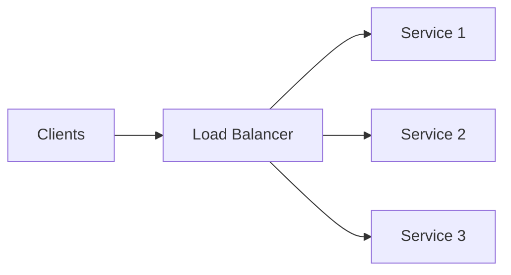

# Load Balancing

A load balancer spreads traffic across many stateless instances so you can scale
horizontally and survive instance failures.

<ProgressTracker id="sd-load-balancing" />

## Table of Contents

- [The role of a load balancer](#the-role-of-a-load-balancer)
- [L4 vs L7](#l4-vs-l7)
- [Balancing algorithms](#balancing-algorithms)
- [Health checks](#health-checks)
- [Sticky sessions](#sticky-sessions)
- [Reverse proxy](#reverse-proxy)
- [Interview questions](#interview-questions)
- [Things You Should Know](#things-you-should-know)

## The role of a load balancer

It distributes requests, removes unhealthy instances from rotation, and provides a
single stable entry point. Cloud options: AWS ALB/NLB, GCP Load Balancing, Azure LB;
software: Nginx, HAProxy, Envoy.

## L4 vs L7

| | L4 (transport) | L7 (application) |
| --- | --- | --- |
| Operates on | TCP/UDP, IP:port | HTTP — URL, headers, cookies |
| Awareness | No request content | Full request content |
| Features | Fast, simple | Path routing, TLS termination, header-based routing |
| Example | AWS NLB | AWS ALB, Nginx |

<Interview>
**L4** balances connections without looking inside them (fast, protocol-agnostic).
**L7** understands HTTP, so it can route `/api` vs `/images` to different pools,
terminate TLS, and do sticky sessions by cookie. Most web APIs use an L7 balancer.
</Interview>

## Balancing algorithms

| Algorithm | Behavior | Use |
| --- | --- | --- |
| **Round robin** | Rotate evenly | Uniform instances |
| **Weighted round robin** | Bigger instances get more | Mixed instance sizes |
| **Least connections** | Send to the least busy | Long-lived/uneven requests |
| **IP hash** | Same client → same server | Basic session affinity |
| **Consistent hashing** | Key → server, minimal reshuffle on change | Sharded caches/backends |

## Health checks

The balancer periodically probes each instance (e.g. `GET /actuator/health`) and
**removes failing ones** from rotation, restoring them when healthy again.

<Important>
Expose a real health endpoint that checks critical dependencies for **readiness**,
but keep **liveness** cheap so a slow DB doesn't cause needless restarts. See
[Deployment](/docs/system-design/concepts/deployment/) and
[Production](/docs/production/).
</Important>

## Sticky sessions

Sticky sessions (session affinity) pin a client to one instance, usually via a
cookie. Needed only for **stateful** servers.

<Warning>
Sticky sessions are a smell in modern design — they undermine even load distribution
and break when an instance dies. Prefer **stateless** services with state in a
shared store (Redis) or the token itself, so any instance can serve any request.
</Warning>

## Reverse proxy

A **reverse proxy** (Nginx) sits in front of your servers and can do load balancing,
TLS termination, caching, compression, and request routing. A load balancer is one
job a reverse proxy can perform. An **API gateway** is an application-aware reverse
proxy adding auth, rate limiting, and routing (see
[Design Patterns](/docs/system-design/concepts/design-patterns/)).

## Interview questions

- L4 vs L7 load balancer — differences and when to use each?
- Which balancing algorithm for long-lived connections? (least connections)
- How do health checks keep traffic off bad instances?
- Why avoid sticky sessions? What's the stateless alternative?
- Reverse proxy vs load balancer vs API gateway?

## Things You Should Know

### 🔴 Must Know
- LB enables horizontal scaling + failover.
- L4 vs L7; round robin / least connections.
- Health checks; prefer stateless over sticky sessions.

### 🟡 Good to Know
- Weighted RR, IP hash, consistent hashing.
- Reverse proxy vs API gateway roles.

### 🟢 Nice to Know
- TLS termination and connection draining.
- Global server load balancing (GeoDNS/anycast).
