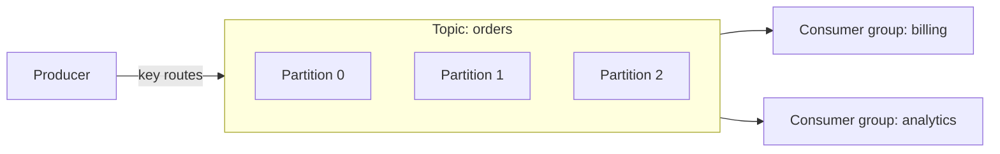
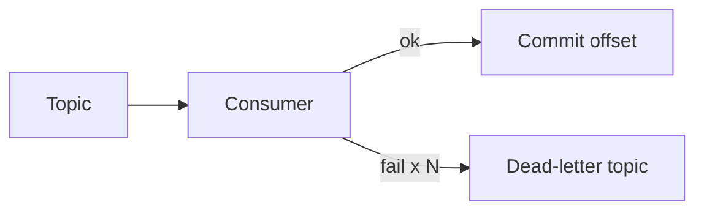

# Messaging & Event-Driven Architecture

Asynchronous messaging decouples services, absorbs load spikes, and enables
event-driven systems. Kafka is the backbone; know it cold.

<ProgressTracker id="sd-messaging" />

## Table of Contents

- [Why messaging?](#why-messaging)
- [Kafka core concepts](#kafka-core-concepts)
- [Ordering, replication, retention](#ordering-replication-retention)
- [Delivery semantics](#delivery-semantics)
- [Consumer lag](#consumer-lag)
- [Retries & dead-letter queues](#retries--dead-letter-queues)
- [Kafka vs RabbitMQ](#kafka-vs-rabbitmq)
- [Event-driven architecture & pub/sub](#event-driven-architecture--pubsub)
- [Interview questions](#interview-questions)
- [Things You Should Know](#things-you-should-know)

## Why messaging?

A producer emits a message and moves on; consumers process independently. This
**decouples** services (the producer doesn't know or wait for consumers), **buffers**
traffic spikes, and lets you add consumers without touching producers.

<Backend>
Use messaging for out-of-band work: emails, search indexing, invoices, cross-service
notifications, analytics. Keep the user's request fast by publishing an event and
returning immediately.
</Backend>

## Kafka core concepts

- **Topic** — a named, append-only log.
- **Partition** — a topic is split into partitions for parallelism; each record has an
  increasing **offset**.
- **Producer / Consumer** — write / read records.
- **Consumer group** — consumers in a group share partitions (each partition to one
  consumer in the group); different groups each get the full stream (fan-out).

<Important>
The **partition key** decides the partition (`hash(key) % partitions`). All records
with the same key (e.g. one `orderId`) land in the same partition — this is how Kafka
preserves **order per key**. Parallelism is capped by partition count.
</Important>

## Ordering, replication, retention

- **Ordering** is guaranteed **within a partition**, not across the topic. Need global
  order → one partition (no parallelism) or order by key.
- **Replication** copies each partition to multiple brokers; a **leader** serves it,
  **followers** replicate. `acks=all` waits for in-sync replicas → durability.
- **Retention** — Kafka keeps messages for a configured time/size even after they're
  consumed, so new consumers can replay history. (Contrast with a queue that deletes
  on consume.)

## Delivery semantics

| Semantic | Meaning | How |
| --- | --- | --- |
| **At-most-once** | May lose, never duplicate | Commit offset **before** processing |
| **At-least-once** | Never lose, may duplicate | Process **then** commit (default) |
| **Exactly-once** | No loss, no duplicate | Idempotent producer + transactions |

<Interview>
The pragmatic default is **at-least-once + idempotent consumers**. True exactly-once
holds within Kafka (transactions) but the moment you write to an external DB you still
need idempotency (dedupe by message id, or upsert). Say this in interviews.
</Interview>

## Consumer lag

**Consumer lag** = latest offset produced − offset the consumer has committed. Growing
lag means consumers can't keep up. Fix by adding consumers (up to partition count),
speeding processing, or increasing partitions. It's a key health metric to alert on.

## Retries & dead-letter queues

On failure, retry with backoff; after N attempts, route the message to a **dead-letter
queue/topic (DLQ)** so one poison message doesn't block the partition.

## Kafka vs RabbitMQ

| | Kafka | RabbitMQ |
| --- | --- | --- |
| Model | Distributed log (pull, replayable) | Message broker/queue (push) |
| Ordering | Per partition | Per queue |
| Retention | Time/size based, replayable | Deleted on ack |
| Throughput | Very high | High |
| Best for | Event streaming, analytics, high volume | Task queues, complex routing, RPC-style |

<Tip>
Rule of thumb: **Kafka** for high-throughput event streams and replay; **RabbitMQ**
for classic task queues with flexible routing and lower operational footprint.
</Tip>

## Event-driven architecture & pub/sub

In **event-driven architecture**, services react to events instead of calling each
other directly. **Pub/Sub** decouples publishers from subscribers via a topic. This
enables loose coupling and independent scaling — but demands idempotency, schema
management, and careful handling of eventual consistency. See
[Kafka & Messaging](/docs/kafka-messaging/) for Spring Kafka code.

## Interview questions

- Topic vs partition vs offset vs consumer group?
- How does Kafka guarantee ordering?
- Explain delivery semantics; how do you get effective exactly-once?
- What is consumer lag and how do you reduce it?
- Kafka vs RabbitMQ — when do you pick each?
- How do retries and DLQs work?

## Things You Should Know

### 🔴 Must Know
- Topics/partitions/offsets/consumer groups; key controls partitioning.
- Ordering per partition; at-least-once + idempotent consumers.
- DLQ for poison messages.

### 🟡 Good to Know
- Replication/`acks=all`/retention/replay.
- Consumer lag; Kafka vs RabbitMQ.

### 🟢 Nice to Know
- Exactly-once via transactions; log compaction; outbox pattern.
